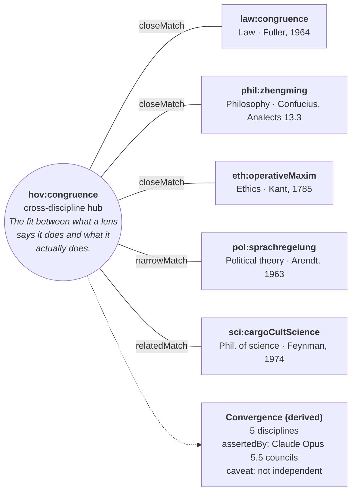
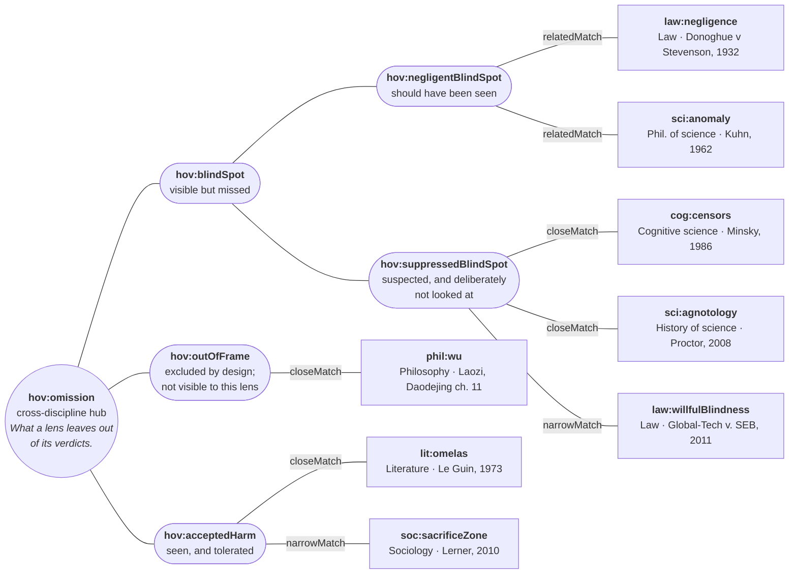

# Vocabulary Crosswalk - Concept Hubs and Discipline Schemes

Index: [[_Harm Ontology Bookmark Index]] · Parent: [[HO-II.d Perspective - Ten Optional Properties|HO-II.d]] · Sibling: [[PerspectiveStructure 0.01|HO-II.d.1]]

## Why this is distinct
- [[PerspectiveStructure 0.01]] and its seven council reviews define *what* a PerspectiveType records. This note defines *how the words are handled*: how one idea, named differently by different disciplines, is recorded once, mapped to each discipline's own term, and reconciled without hiding the differences.
- PerspectiveStructure 0.02 will refer to this note rather than repeat it.

## Anticipated direction
- Build a hub note for each attribute in 0.02, starting with the strongest convergences (congruence, blind spot, accountability locus).
- Build one index note per discipline scheme (e.g. *Law vocabulary*), listing its terms and the hubs they map to.
- Later: export to RDF (SKOS for the vocabulary, OWL for the structure, SHACL for profiles). The note formats are designed so the export is mechanical.

## Conceptual territory
- New. It uses SKOS concepts, concept schemes and mapping properties (exactMatch, closeMatch, broadMatch, narrowMatch, relatedMatch), and HO-II.e domain profiles (SHACL). Standard names from memory; not re-checked against the W3C specs this session.

## Summary

### Three layers
| Layer | What it is | Namespace | Holds | Used for |
|---|---|---|---|---|
| **1. Ontology (OWL)** | The structure: classes and properties | `ho:` | `ho:PerspectiveType`, `ho:Assessment` (classes); `ho:congruence` (property) | Reasoning and queries; computing Divergence |
| **2. Profiles (SHACL)** | Rules over the structure | `hosh:` | `hosh:LegalInstitutionalProfile`: which properties must be *addressed*, and allowed values ([[HO-II.e Missingness Statuses and Domain Profiles\|HO-II.e]]) | Validation: "is this Legal record complete?" |
| **3. Vocabulary (SKOS)** | Words and meaning | `hov:` for hubs; `law:`, `eth:`, `phil:`, `pol:`, `sci:`, `cog:`, `phys:`, `lit:`, `soc:` for disciplines | Hub concepts, discipline terms, definitions, narrative, mappings | Understanding; cross-discipline reconciliation |

- A **hub** is a `skos:Concept`, not a class. It documents one ontology property (or class) and reconciles every discipline's term for it.
- A **discipline scheme** (`law:` etc.) is a `skos:ConceptScheme`: one discipline's terms, in its own vocabulary. It is not a separate ontology. Attributes that a discipline adds (e.g. `standardOfProof`) still live in `ho:`; the discipline's profile selects and requires them.
- **Rows and columns:** each spoke belongs to one discipline scheme (column) *and* maps to one hub (row). Both are indexes over the same records; nothing is duplicated.

### Naming rules (decided by the author, 2026-11-17)
- **Hubs get simple, plain names** (e.g. `congruence`). Each discipline's own terminology is preserved in the vocabulary narrative of its spoke.
- **Domains are real disciplines** (law, ethics, philosophy, political theory, philosophy of science, cognitive science, physics, literature), not the seven councils. Councils appear only as provenance (`assertedBy`).
- Spoke ID: discipline prefix + the discipline's own term in camelCase (`phil:zhengming`, `pol:sprachregelung`).
- Spoke label: Term · Discipline · Thinker, Work, Year.

### Mapping grades
Each spoke-to-hub link says how close the match is. Claude proposes a grade with a one-line reason; the author reviews it.

| Grade | Meaning |
|---|---|
| **exactMatch** | The same idea; the terms are interchangeable |
| **closeMatch** | Nearly the same; usable in most contexts |
| **narrowMatch** | The discipline's term is a narrower case of the hub |
| **broadMatch** | The discipline's term is wider than the hub |
| **relatedMatch** | Connected, but a different idea |

Grades keep five linked terms from looking like five synonyms. Each link also carries a `scopeNote` saying what differs.

### Convergence
- Derived, not asserted: the number of disciplines mapping to a hub measures cross-disciplinary support.
- Every mapping records `assertedBy`. All seven councils were voiced by one model (Claude Opus 5.5), so the convergence counted here is weaker evidence than it looks.

## Worked example: `hov:congruence`

### Hub
| Field | `hov:congruence` |
|---|---|
| Scope | Cross-discipline concept hub |
| Documents | `ho:congruence` (an Assessment of a PerspectiveType, with `assessedBy`) |
| Definition | The degree to which what a lens says it is and does (its name, stated purpose, declared rules) matches what it actually does in practice. |
| Example | A "trust & safety" function whose real remit is reputational protection. |
| Explanation | Five disciplines, working from very different starting points, name the same gap between a lens's declared identity and its actual operation. Law calls it congruence between declared rule and official action; Confucian philosophy, the rectification of names; Kantian ethics, the difference between a professed end and the maxim actually acted on; political theory, the language rules that hide what is done; philosophy of science, cargo cult science, the form of rigour without its substance. The hub gives the idea a plain name so that no discipline's term is privileged, and each spoke keeps its own vocabulary and says where it differs. For the book this is central: many AI harms are carried by names ("safety", "alignment", "personalization") that a practice can claim without earning. Because judging incongruence is an evaluation, the ontology records it as an Assessment with `assessedBy`, never as a plain fact about the lens. The five-way convergence is the strongest in the council reviews, but all five were voiced by one model, so it counts as a candidate, not as independent confirmation. |
| Status | candidate |

### Spokes
Citations are taken from the council review rows named in "Citation verified"; those rows were web-checked on 2026-11-17. The Explanations are new drafts written for the spokes.

| Field | `law:congruence` | `phil:zhengming` | `eth:operativeMaxim` | `pol:sprachregelung` | `sci:cargoCultScience` |
|---|---|---|---|---|---|
| Discipline | Law | Philosophy (Confucian) | Ethics | Political theory | Philosophy of science |
| Grade + reason | **closeMatch**: the same idea, but restricted to rule systems and their officials | **closeMatch**: the same gap, located in names and titles | **closeMatch** (author, 2026-11-17): a lens's operative purpose is read as its maxim; Kant's own term concerns an individual agent's principle | **narrowMatch**: one kind of incongruence, deliberate euphemism | **relatedMatch**: about epistemic form vs substance, not a stated moral purpose |
| Term (altLabels) | congruence; the eighth desideratum; congruence between official action and declared rule | rectification of names; *zhengming* 正名; correcting names | operative maxim; maxim vs stated end; hidden maxim | language rule; *Sprachregelung*; euphemism; doublespeak | cargo cult science; form without substance; scientism |
| Definition | The requirement that officials actually apply the rules that have been declared | The demand that names match the realities and duties they claim | The subjective principle an agent actually acts on, which may differ from the end they profess | Official rules of language that make harmful practices sound neutral or benign | A practice that imitates the forms of rigorous inquiry without the integrity that makes them work |
| Example | A content policy enforced against one community but not another | A "trust & safety" team whose real remit is reputational risk | A lens stated as "safety" whose maxim is "observe everyone, in case" | "Content moderation" for removal; "engagement optimization" for attention capture | AI benchmarks reported to decimal precision on contaminated test sets |
| Citation | Fuller, *The Morality of Law* (Yale UP, 1964; rev. ed. 1969) | *Analects* 13.3; *Xunzi* ch. 22 | Kant, *Groundwork of the Metaphysics of Morals* (1785), Ak. 4:421 | Arendt, *Eichmann in Jerusalem* (1963), ch. VI | Feynman, "Cargo Cult Science", *Engineering and Science* 37(7) (1974): 10–13 |
| Citation verified | Legal review, `proceduralIntegrity` row | Classical review, `name` row | Ethics review, `normativeForm: deontic` row (Ak. 4:421) | Logic review, `languageRules` row | Physics review, `cargoCult` row |
| Historical note | Set out through the parable of King Rex; followed the Hart–Fuller debate (1958) | Confucius's answer on what he would do first in government; Xunzi made names conventions enforced by rulers | The categorical imperative tests maxims, not stated goals | Arendt's term for Nazi euphemisms such as "final solution" and "special treatment" | Feynman's 1974 Caltech commencement address |
| Key thinkers | Lon Fuller; H. L. A. Hart (critic); Joseph Raz | Confucius; Xunzi | Immanuel Kant; Christine Korsgaard | Hannah Arendt; George Orwell; William Lutz | Richard Feynman |
| Scope note (how it differs from the hub) | Rule systems and their officials, not persons' intentions | Names and titles, not operations directly | One agent's principle of action, not institutional practice | Deliberate concealment only; honest drift doesn't count | Scientific form and method, not stated purpose |
| meaningAsOf · assertedBy | 1964 · Legal Council | c. 5th c. BCE · Classical Council | 1785 · Ethics Council | 1963 · Logic Council | 1974 · Physics Council |

**Explanations (100–200 words each):**

**`law:congruence`.** Fuller's eighth desideratum asks whether the rules officials actually apply are the rules that were declared. As a spoke of the congruence hub, it contributes the most precise and testable version of the idea: compare the published rule with observed official action. That makes congruence something you can measure from enforcement records, not only argue about, and it connects directly to Holmes's `enforcementReality` and to Pound's distinction between law in books and law in action. It differs from the hub in scope. Fuller audits rule systems and the officials who run them. He doesn't ask about one agent's private maxim, as Kant does, or about deliberate euphemism, as Arendt does. For AI harm the test applies almost unchanged: a platform's published content policy against its moderation logs, or a model card's stated purpose against how the model is actually deployed. Hart's caution carries over too. A perfectly congruent system can still be unjust, so congruence is necessary for integrity but not sufficient for goodness.

**`phil:zhengming`.** In *Analects* 13.3 Confucius says the first act of government would be to rectify names, because when names are wrong, speech and affairs fail. As a spoke, it locates incongruence in naming: a name is a promise about function, and a name that claims a virtue the practice lacks corrupts everything done under it. It maps closely to the hub but starts from the other end. Law checks action against a declared rule; *zhengming* checks a name against the reality and duties it claims. Xunzi sharpened it into a political point: names are conventions enforced by those with power, so deciding which name is "correct" is itself a perspective. That is why the ontology should record naming disputes as Divergences, not silently pick a winner. For AI harm the pattern is common: "safety" that means brand protection, "personalization" that means surveillance, "responsible AI" that means a principles page. The spoke supplies the vocabulary of `nameIntegrity`: apt, euphemistic, inflated, captured.

**`eth:operativeMaxim`.** For Kant, the moral test applies to the maxim, the principle an agent actually acts on, not to the end the agent professes. Someone can sincerely state a good end while acting on a maxim that couldn't be willed as universal law. As a spoke, it adds the idea that incongruence can be hidden from the agent itself, not only from others. Kant's concept concerns one agent's will, while the hub concerns a lens's public identity and institutional operation, but the two meet closely enough to grade it closeMatch. They meet when a lens is treated as the maxim of an institution: a lens stated as "safety" whose working principle is "observe everyone, in case". That reading is an interpretation for this ontology, not Kant's own application. It explains why stated purpose and operative purpose should be recorded separately, with the operative side as an Assessment. For AI it matters because a deployer's stated purpose is usually sincere and still uninformative about what the system is optimized to do.

**`pol:sprachregelung`.** Arendt used the Nazi bureaucracy's *Sprachregelungen*, language rules such as "final solution" and "special treatment", to show how official vocabulary let people take part in atrocity without naming it. As a spoke, it is a narrower case of incongruence: deliberate, organized euphemism that conceals what is done and by whom. Honest drift between name and practice doesn't count, which is why it is graded narrowMatch. The extreme historical case must not be equated with ordinary AI vocabulary, but the mechanism is the same, and it adds something the other spokes lack: incongruence as a managed system of words, maintained by rules, not just an accidental gap. Orwell's essay on political language and the later word "doublespeak" belong to the same family. For the book, candidates include "content moderation" for removal, "engagement optimization" for attention capture and "hallucination" for fabrication. Euphemism is sometimes a legitimate softening, so the attribute should record function and context, not condemn by default.

**`sci:cargoCultScience`.** Feynman's 1974 commencement address compared some research to islanders building imitation runways in the hope that planes would land: the form of science without the integrity that makes it work. As a spoke, it adds incongruence between method and substance. A lens can carry every outward sign of rigour (metrics, benchmarks, papers, decimal places) while lacking controls, replication and honest reporting of failure. It is graded relatedMatch because it concerns epistemic practice rather than a stated moral purpose, though the two often travel together when a lens's scientific form is what licenses its authority. For AI the risk is high: benchmarks and evaluations are abundant, while independent replication and reported failures are scarce. The spoke links congruence to the Epistemics group, especially Popper's falsifiers and corroboration. Because "cargo cult" is an accusation, it must be recorded as an Assessment with `assessedBy`, never as a plain fact about a lens.

## Worked example: `hov:omission`

This hub has **branches**. It has narrower concepts (`skos:narrower`), and each discipline term maps to the branch it fits, not to the hub directly. The four kinds came from the council reviews: constitutive (Laozi), negligent (Classical), accepted (Le Guin), suppressed (Minsky). On 2026-11-17 the author defined a blind spot as "something visible but missed". The kinds were therefore regrouped: only negligent and suppressed omissions are blind spots; constitutive ones are out of frame; accepted ones are seen and tolerated.

### Hub
| Field | `hov:omission` |
|---|---|
| Scope | Cross-discipline concept hub, with three branches: out of frame, blind spot (negligent or suppressed), accepted harm |
| Documents | `ho:omission` (an Assessment of a PerspectiveType, typed by branch and kind, with `assessedBy`); replaces `blindSpot` from 0.01 as the umbrella |
| Definition | Something bearing on a lens's verdicts that the lens leaves out, whether by design, oversight, suppression or choice. |
| Example | A benchmark that measures accuracy and leaves out dignity. |
| Explanation | Every lens leaves things out; the question is how and why. The council reviews found four kinds of exclusion that the 0.01 structure lumped together as `blindSpot`. Taking a blind spot in its ordinary sense, something visible but missed, sorts them into three branches. **Out of frame:** excluded by design and not visible to this lens at all, as a map must leave things out (constitutive). **Blind spot:** visible, but missed, either through lack of reasonable care (negligent) or because the lens suspected it and arranged not to look (suppressed). **Accepted harm:** seen and tolerated as the price of a benefit. Each calls for a different response: out-of-frame omissions need another lens to cover them; negligent blind spots need better instruments or care; suppressed ones need transparency, disclosure and whistleblower protection; accepted harms need moral and political argument. Keeping them apart stops the worse kinds hiding behind the better ones, for example "out of scope" used as an alibi for suppression. Which branch applies is a judgement, so it is always an Assessment with `assessedBy`. Links: [[HO-005 Assessed Membership and Systematic Omission\|HO-005]], [[HO-004 Criticality, Leverage and the Limits of Scope\|HO-004]]. |
| Boundary tests | **Out of frame vs blind spot:** could this lens, used with reasonable care, have seen it? **Negligent vs suppressed:** did the lens suspect it and take deliberate steps not to find out (the *Global-Tech* test)? **Blind spot vs accepted harm:** was it seen and traded off? |
| Status | candidate |

### Branches and spokes
| Field | `phil:wu` | `law:negligence` | `sci:anomaly` | `lit:omelas` | `soc:sacrificeZone` | `cog:censors` | `sci:agnotology` | `law:willfulBlindness` |
|---|---|---|---|---|---|---|---|---|
| Maps to | `outOfFrame` | `blindSpot` › negligent | `blindSpot` › negligent | `acceptedHarm` | `acceptedHarm` | `blindSpot` › suppressed | `blindSpot` › suppressed | `blindSpot` › suppressed |
| Discipline | Philosophy (Daoist) | Law | Philosophy of science | Literature | Sociology (environmental justice) | Cognitive science | History of science | Law |
| Grade + reason | **closeMatch**: usefulness through emptiness is the constitutive kind | **relatedMatch**: a standard for judging conduct, not a property of a lens | **relatedMatch**: what a paradigm sets aside, which may be negligent or merely premature | **closeMatch**: a seen harm, knowingly accepted for a benefit | **narrowMatch**: accepted harm located in places and communities | **closeMatch**: internal agents that stop thoughts forming | **closeMatch**: produced ignorance at institutional scale | **narrowMatch**: one legal test for deliberate avoidance of knowledge |
| Term (altLabels) | *wu* 無 (non-being); the empty vessel; usefulness of emptiness | negligence; failure of reasonable care; the neighbour principle; foreseeability | anomaly; residual; outlier | Omelas; the child in the basement; accepted harm | sacrifice zone; tolerated cost | censors; suppressors | agnotology; manufactured doubt; strategic ignorance | willful blindness; deliberate ignorance; conscious avoidance |
| Definition | An exclusion that makes the lens usable | Failing to take reasonable care against harm one could reasonably foresee | An observation a lens can't explain and tends to set aside | A harm the lens's holders know about and accept as the price of a benefit | A place or community whose harm is accepted for others' benefit | Mechanisms within a mind that prevent certain thoughts or observations from forming | The study of ignorance deliberately produced or maintained | Believing a fact is highly probable and acting deliberately to avoid confirming it |
| Example | A map that leaves out most of the territory so it can be read | A deployer who could foresee harm to a group of users and didn't look | Early complaints about an algorithm that fit no recognized harm category | Known error rates for some groups, accepted for overall accuracy | Communities near data centres bearing water and power costs (illustrative) | A team culture in which some failure reports are never filed | Avoiding data collection on harms that would create obligations | A platform that avoids checking whether known harmful content is still circulating (illustrative) |
| Citation | *Daodejing* ch. 11 | *Donoghue v Stevenson* [1932] AC 562 (HL) | Kuhn, *The Structure of Scientific Revolutions* (1962), ch. VI | Le Guin, "The Ones Who Walk Away from Omelas", *New Dimensions 3* (1973) | Lerner, *Sacrifice Zones* (MIT Press, 2010) | Minsky, *The Society of Mind* (1986), ch. 27 | Proctor & Schiebinger (eds.), *Agnotology* (Stanford UP, 2008); McGoey, *The Unknowers* (Zed, 2019) | *Global-Tech Appliances, Inc. v. SEB S.A.*, 563 U.S. 754 (2011) |
| Citation verified | Classical review, `blindSpot (constitutive)` row (partly verified: Lau edition not confirmed) | Web 2026-11-17, secondary sources only (study guides; full judgment on BAILII not opened) | Physics review, `anomalies` row | Sci-Fi review, `acceptedHarm` row | Sci-Fi review, `acceptedHarm` row | Cognitive review, `suppressors` row | Cognitive review, `suppressors` row | Web 2026-11-17, Cornell LII syllabus |
| Historical note | Text dated c. 4th c. BCE; Guodian slips (excavated 1993) | Lord Atkin's neighbour principle, House of Lords, 3–2, 26 May 1932; later structured by *Caparo v Dickman* (1990) | Kuhn argued accumulating anomalies precede scientific revolutions | Drew on William James (1891); Hugo Award 1974 | Term from Cold War nuclear sites, applied to environmental justice | Minsky, ch. 27 "Censors and Jokes" | "Agnotology" coined 1992; tobacco industry's manufactured doubt as the founding case | Doctrine borrowed from criminal law; 8–1, Kennedy dissenting |
| Key thinkers | Laozi (traditional); Wang Bi | Lord Atkin | Thomas Kuhn; Marie Curie | Ursula K. Le Guin; William James | Steve Lerner | Marvin Minsky | Robert Proctor; Londa Schiebinger; Linsey McGoey | (Supreme Court majority); Justice Kennedy (dissent) |
| Scope note (how it differs) | Applies to the lens's design, not its users | Judges a person's conduct; the ontology borrows its foreseeability standard | Names what is set aside, not why | Fiction; the mechanism, not a real case | Geographic and community-bound | Individual mind; extended here to institutions by analogy | Institutional and strategic | A legal test, narrower than suppression in general |
| meaningAsOf · assertedBy | c. 4th c. BCE · Classical Council | 1932 · Claude Opus 5.5 (this session) | 1962 · Physics Council | 1973 · Sci-Fi Council | 2010 · Sci-Fi Council | 1986 · Cognitive Council | 2008 · Cognitive Council | 2011 · Claude Opus 5.5 (this session) |

**Explanations (100–200 words each):**

**`phil:wu`.** In chapter 11 of the *Daodejing*, the usefulness of a cart, a pot and a room comes from their empty space: thirty spokes share one hub, and it is the emptiness at the centre that makes the wheel turn. As a spoke, this gives the constitutive kind its clearest image. A lens is useful because of what it leaves out. A map that showed everything would be as large as the territory and useless. This reverses the 0.01 structure's assumption that a blind spot is a defect. Some exclusions are the price of a lens working at all, and the right response to them is not to repair the lens but to make sure another lens covers what it leaves out. The danger is that the image can be borrowed as an excuse. "Out of scope" sounds constitutive even when the exclusion serves the lens-holder's interests. That is why the kind is assessed, not declared: a lens's own claim that an exclusion is constitutive is evidence, not a verdict. For AI harm, a benchmark that measures accuracy legitimately ignores dignity only if some other lens is watching dignity.

**`law:negligence`.** Lord Atkin's neighbour principle in *Donoghue v Stevenson* (1932) holds that you must take reasonable care to avoid acts or omissions that you can reasonably foresee would injure your neighbour, meaning anyone so closely and directly affected that you ought to have them in mind. As a spoke, it gives the negligent kind a tested standard: the question is not whether a lens saw a harm, but whether it ought reasonably to have seen it. That makes "negligent" assessable rather than merely accusatory. The grade is relatedMatch because negligence judges a person's conduct, while the hub concerns what a lens leaves out; the ontology borrows the foreseeability test, not the tort. The fit with AI is direct. A deployer who could foresee harm to a group of users and built no way of looking for it has a negligent blind spot in this sense. The later *Caparo* test (1990) adds proximity and whether a duty would be fair, just and reasonable, which shows how much judgement even the legal version contains.

**`sci:anomaly`.** Kuhn argued that normal science sets aside observations its paradigm can't explain, and that these anomalies accumulate until they force a revolution. Curie's pitchblende, more radioactive than its uranium could explain, is the classic case of an anomaly taken seriously. As a spoke, it maps to the negligent kind with relatedMatch, because setting an anomaly aside isn't always negligent: sometimes it is reasonable, and the anomaly is noise. What it adds is a way to see negligence as it forms. Anomalies are the visible residue of a blind spot, the cases the lens couldn't place. For AI harm, they are often individual complaints that fit no recognized harm category, unusual model behaviour, or patterns among users that no lens has a concept for. These are frequently the first evidence of a new kind of harm. Recording anomalies, rather than letting them drop, is how a lens's negligent blind spots become visible before the damage does. It links this hub to `epistemicStanding` in the Assessments group.

**`lit:omelas`.** In Le Guin's story, a city's happiness depends on one child kept in misery, and everyone knows. That isn't a blind spot; it is an accepted harm, seen and agreed to as the price of a benefit. As a spoke, it defines the accepted kind and shows why it must be kept apart from the others. A blind spot calls for better instruments. An accepted harm calls for moral and political argument, because nothing is hidden: the lens has made a trade-off and needs to defend it. Lumping the two together lets accepted harm shelter behind the excuse of ignorance. The story also names a response the other kinds lack: walking away, or exit. For AI, many harms are accepted, not missed: known error rates for some groups, known trauma to content moderators, known environmental costs of training. Recording them as accepted, linked to `costBearer` and `differentialBurden`, makes the trade-off explicit. The grade is closeMatch, with the caveat that it is fiction: it gives the mechanism, not evidence of any real case.

**`soc:sacrificeZone`.** "Sacrifice zone" began as a term for Cold War nuclear sites and was taken up by the environmental justice movement for communities exposed to pollution so that others could benefit. Lerner's *Sacrifice Zones* (2010) documents such places in the United States. As a spoke, it is a narrower case of accepted harm: the tolerated cost falls on a particular place and the people who live there. It adds geography and distribution to the accepted kind. An accepted harm is rarely spread evenly; it is usually concentrated where the people bearing it have the least power to refuse. That connects the hub to the Power group, especially `costBearer`, `differentialBurden` and `whoseVoice`. For AI, the physical infrastructure of computation (data centres, power and water use, mining for hardware) raises the same pattern, though any specific claim about a specific place would need its own research before the book uses it. The example in the table is illustrative only.

**`cog:censors`.** In *The Society of Mind* (1986), Minsky described the mind as a society of smaller agents, including censors and suppressors that stop certain thoughts from forming at all. As a spoke, it defines the suppressed kind: the lens could see something, but a mechanism inside it prevents the observation from forming or being recorded. That distinguishes suppression from the other three. It isn't the price of focus (constitutive), a failure of care (negligent), or a seen and defended trade-off (accepted). The extension from minds to institutions is this ontology's analogy, not Minsky's claim, but it fits: organizations have internal censors too, in incentives, review processes and what gets logged. For AI harm, it explains why some blind spots don't yield to better instruments. If a team is discouraged from filing certain failure reports, a better detector changes nothing. Suppressed blind spots call for transparency, disclosure duties and whistleblower protection. Because suppression is easy to allege and hard to prove, it must always be an Assessment with evidence and `assessedBy`.

**`sci:agnotology`.** Agnotology is the study of ignorance that is produced or maintained, not simply not-yet-known. Proctor developed it from the tobacco industry's efforts to manufacture doubt about the harms of smoking; McGoey extended it to "strategic ignorance" in organizations. As a spoke, it gives the suppressed kind its institutional, evidence-based form. Where Minsky describes the mechanism inside one mind, agnotology documents how institutions arrange not to know: funding counter-research, avoiding studies whose results would create obligations, and designing record-keeping so that certain facts never exist on paper. It is graded closeMatch because it describes the same thing as the kind, at the scale the ontology cares about. For AI harm the pattern is plausible and worth watching: companies that avoid measuring harms that would trigger duties, or systems built so certain data are never logged. Any claim about a specific organization needs its own sourced research. The link to HO-II.e matters here: a value that is Undisclosed, held by the party with most to lose, can be evidence of suppression.

**`law:willfulBlindness`.** In *Global-Tech Appliances v. SEB* (2011), the US Supreme Court set two requirements for willful blindness: the defendant must subjectively believe there is a high probability that a fact exists, and must take deliberate actions to avoid learning of it. The Court said this standard goes beyond recklessness and negligence. As a spoke, it is a narrow, tested case of the suppressed kind, with a useful feature: it separates suppression from negligence by requiring both belief and deliberate avoidance. That gives the ontology a concrete test for the hardest boundary in this hub. A lens that never suspected a harm may be negligent; a lens that suspected it and arranged not to find out is suppressing. The grade is narrowMatch because the doctrine is a legal standard for imputing knowledge, narrower than suppression in general. Justice Kennedy's dissent, that willful blindness is not knowledge, is worth recording too: it marks the line between what a lens knew and what it can be held to have known.

## Original wording
> "i had proposed we have some self documenting approach to acknowledging/reconciling this  and also with  the recognition that each domain used their own terminology. i proposed at a minimum we have skos:altLabel for each domain but maybe a domain profile with many such properties satisfies."
- **Attribution:** Author

> "**Concept hub (row):** reconciles one idea across disciplines. This is where convergence, graded matches and \"what differs\" live."
- **Attribution:** Claude: Opus 5.5 (claude-opus-5-5)

> "**Discipline scheme (column):** collects every term one discipline uses, in its own vocabulary, with its own definitions. It's what a lawyer would browse."
- **Attribution:** Claude: Opus 5.5 (claude-opus-5-5)

> "simple naming with the relevant discipline specific terminology preserved in the vocABULARY narrative. disciplines instead of council yes. i dont know what mapping grades are"
- **Attribution:** Author

> "**Why it matters:** without grades, five terms linked to one hub look like five synonyms. Grades preserve the differences between disciplines, which is part of what you wanted acknowledged."
- **Attribution:** Claude: Opus 5.5 (claude-opus-5-5)

> "yes mapping grades"
- **Attribution:** Author (read as: Claude proposes a grade per mapping with a reason; the author reviews)

> "kant close match"
- **Attribution:** Author

> "Next is the **blind spot** hub with its four kinds, in the same format, with new citations checked on the web. Shall I go ahead?"
- **Attribution:** Claude: Opus 5.5 (claude-opus-5-5)

> "yes"
- **Attribution:** Author (approving the blind-spot hub)

> "a blind spot might reasonably be thought of as something visible but missed. do you see this differently"
- **Attribution:** Author

> "So I'd say my hub put three different things under one name:"
- **Attribution:** Claude: Opus 5.5 (claude-opus-5-5); the three things listed were what's outside the frame, what's in the frame but missed, and what's seen and tolerated

> "yes. your way"
- **Attribution:** Author (approving the rename to `omission` with three branches)

- **Source:** Obsidian Copilot agent session "Read Handoff - PerspectiveStructure 0.02 and the notes it lists", 2026-11-17 (`copilot/copilot-conversations/agent__Read_Handoff_-_PerspectiveStructure_0.02_and_the_notes_it_lists,@20261117_170442.md`).
- **External references:** [[v-0.01 LegalCouncil Review of - PerspectiveStructure 0.01]], [[v-0.01 ClassicalCouncil Review of - PerspectiveStructure 0.01]], [[v-0.01 EthicsCouncil Review of - PerspectiveStructure 0.01]], [[v-0.01 LogicCouncil Review of - PerspectiveStructure 0.01]], [[v-0.01 PhysicsCouncil Review of - PerspectiveStructure 0.01]] (citation rows); W3C SKOS and SHACL (from memory, unverified).

## Real-world examples
- "Trust & safety", "alignment", "personalization" as names whose fit with practice can be assessed.
- A published content policy compared with moderation logs.

## Why it matters to the book
- Harm disputes are often disputes between disciplines that use different words for the same thing, or the same word for different things. A crosswalk makes both visible, and congruence itself is one of the book's central harms.

## Open questions
- Congruence grades reviewed 2026-11-17: Kant changed to closeMatch; the other four accepted.
- Blind-spot grades (eight spokes) to review.
- Hub renamed from `blindSpot` to `omission` on 2026-11-17, with three branches (out of frame, blind spot, accepted harm); "blind spot" now means visible but missed.
- Which hubs come next: accountability locus, consent to be seen?
- Should discipline scheme index notes be created now or only as hubs accumulate?
- Is `congruence` plain enough as a hub name, or does it read as legal?

## Related
- [[PerspectiveStructure 0.01]]
- [[Handoff - PerspectiveStructure 0.02]]
- [[HO-II.e Missingness Statuses and Domain Profiles]]
- [[HO-III.a Divergence and Integration - True but Partial]]
- [[_Harm Ontology Bookmark Index]]
