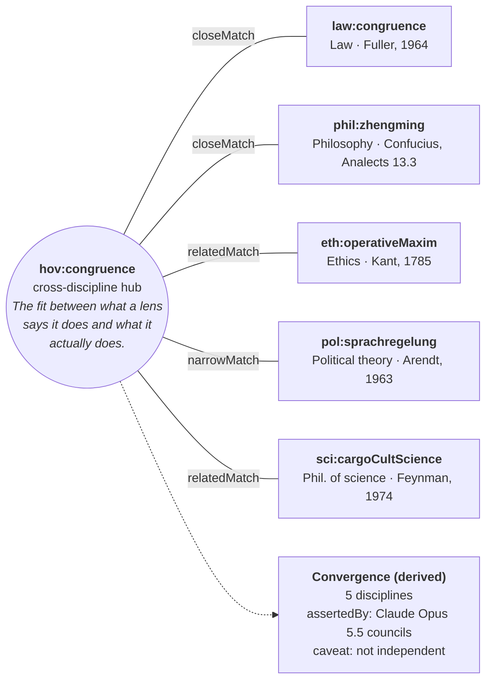

# Vocabulary Crosswalk - Concept Hubs and Discipline Schemes

## Why this is distinct
- [[PerspectiveStructure 0.01]] and its seven council reviews define *what* a PerspectiveType records. This note defines *how the words are handled*: how one idea, named differently by different disciplines, is recorded once, mapped to each discipline's own term, and reconciled without hiding the differences.
- PerspectiveStructure 0.02 will refer to this note rather than repeat it.

## Anticipated direction
- Build a hub note for each attribute in 0.02, starting with the strongest convergences (congruence, blind spot, accountability locus).
- Build one index note per discipline scheme (e.g. *Law vocabulary*), listing its terms and the hubs they map to.
- Later: export to RDF (SKOS for the vocabulary, OWL for the structure, SHACL for profiles). The note formats are designed so the export is mechanical.

## Conceptual territory
- New. It uses SKOS concepts, concept schemes and mapping properties (exactMatch, closeMatch, broadMatch, narrowMatch, relatedMatch), and HO-II.e domain profiles (SHACL). Standard names from memory; not re-checked against the W3C specs this session.

## Summary

### Three layers
| Layer | What it is | Namespace | Holds | Used for |
|---|---|---|---|---|
| **1. Ontology (OWL)** | The structure: classes and properties | `ho:` | `ho:PerspectiveType`, `ho:Assessment` (classes); `ho:congruence` (property) | Reasoning and queries; computing Divergence |
| **2. Profiles (SHACL)** | Rules over the structure | `hosh:` | `hosh:LegalInstitutionalProfile`: which properties must be *addressed*, and allowed values ([[HO-II.e Missingness Statuses and Domain Profiles\|HO-II.e]]) | Validation: "is this Legal record complete?" |
| **3. Vocabulary (SKOS)** | Words and meaning | `hov:` for hubs; `law:`, `eth:`, `phil:`, `pol:`, `sci:`, `cog:`, `phys:`, `lit:` for disciplines | Hub concepts, discipline terms, definitions, narrative, mappings | Understanding; cross-discipline reconciliation |

- A **hub** is a `skos:Concept`, not a class. It documents one ontology property (or class) and reconciles every discipline's term for it.
- A **discipline scheme** (`law:` etc.) is a `skos:ConceptScheme`: one discipline's terms, in its own vocabulary. It is not a separate ontology. Attributes that a discipline adds (e.g. `standardOfProof`) still live in `ho:`; the discipline's profile selects and requires them.
- **Rows and columns:** each spoke belongs to one discipline scheme (column) *and* maps to one hub (row). Both are indexes over the same records; nothing is duplicated.

### Naming rules (decided by the author, 2026-11-17)
- **Hubs get simple, plain names** (e.g. `congruence`). Each discipline's own terminology is preserved in the vocabulary narrative of its spoke.
- **Domains are real disciplines** (law, ethics, philosophy, political theory, philosophy of science, cognitive science, physics, literature), not the seven councils. Councils appear only as provenance (`assertedBy`).
- Spoke ID: discipline prefix + the discipline's own term in camelCase (`phil:zhengming`, `pol:sprachregelung`).
- Spoke label: Term · Discipline · Thinker, Work, Year.

### Mapping grades
Each spoke-to-hub link says how close the match is. Claude proposes a grade with a one-line reason; the author reviews it.

| Grade | Meaning |
|---|---|
| **exactMatch** | The same idea; the terms are interchangeable |
| **closeMatch** | Nearly the same; usable in most contexts |
| **narrowMatch** | The discipline's term is a narrower case of the hub |
| **broadMatch** | The discipline's term is wider than the hub |
| **relatedMatch** | Connected, but a different idea |

Grades keep five linked terms from looking like five synonyms. Each link also carries a `scopeNote` saying what differs.

### Convergence
- Derived, not asserted: the number of disciplines mapping to a hub measures cross-disciplinary support.
- Every mapping records `assertedBy`. All seven councils were voiced by one model (Claude Opus 5.5), so the convergence counted here is weaker evidence than it looks.

## Worked example: `hov:congruence`

### Hub
| Field | `hov:congruence` |
|---|---|
| Scope | Cross-discipline concept hub |
| Documents | `ho:congruence` (an Assessment of a PerspectiveType, with `assessedBy`) |
| Definition | The degree to which what a lens says it is and does (its name, stated purpose, declared rules) matches what it actually does in practice. |
| Example | A "trust & safety" function whose real remit is reputational protection. |
| Explanation | Five disciplines, working from very different starting points, name the same gap between a lens's declared identity and its actual operation. Law calls it congruence between declared rule and official action; Confucian philosophy, the rectification of names; Kantian ethics, the difference between a professed end and the maxim actually acted on; political theory, the language rules that hide what is done; philosophy of science, cargo cult science, the form of rigour without its substance. The hub gives the idea a plain name so that no discipline's term is privileged, and each spoke keeps its own vocabulary and says where it differs. For the book this is central: many AI harms are carried by names ("safety", "alignment", "personalization") that a practice can claim without earning. Because judging incongruence is an evaluation, the ontology records it as an Assessment with `assessedBy`, never as a plain fact about the lens. The five-way convergence is the strongest in the council reviews, but all five were voiced by one model, so it counts as a candidate, not as independent confirmation. |
| Status | candidate |

### Spokes
Citations are taken from the council review rows named in "Citation verified"; those rows were web-checked on 2026-11-17. The Explanations are new drafts written for the spokes.

| Field | `law:congruence` | `phil:zhengming` | `eth:operativeMaxim` | `pol:sprachregelung` | `sci:cargoCultScience` |
|---|---|---|---|---|---|
| Discipline | Law | Philosophy (Confucian) | Ethics | Political theory | Philosophy of science |
| Grade + reason | **closeMatch**: the same idea, but restricted to rule systems and their officials | **closeMatch**: the same gap, located in names and titles | **relatedMatch**: about an individual agent's principle, not a lens's public identity | **narrowMatch**: one kind of incongruence, deliberate euphemism | **relatedMatch**: about epistemic form vs substance, not a stated moral purpose |
| Term (altLabels) | congruence; the eighth desideratum; congruence between official action and declared rule | rectification of names; *zhengming* 正名; correcting names | operative maxim; maxim vs stated end; hidden maxim | language rule; *Sprachregelung*; euphemism; doublespeak | cargo cult science; form without substance; scientism |
| Definition | The requirement that officials actually apply the rules that have been declared | The demand that names match the realities and duties they claim | The subjective principle an agent actually acts on, which may differ from the end they profess | Official rules of language that make harmful practices sound neutral or benign | A practice that imitates the forms of rigorous inquiry without the integrity that makes them work |
| Example | A content policy enforced against one community but not another | A "trust & safety" team whose real remit is reputational risk | A lens stated as "safety" whose maxim is "observe everyone, in case" | "Content moderation" for removal; "engagement optimization" for attention capture | AI benchmarks reported to decimal precision on contaminated test sets |
| Citation | Fuller, *The Morality of Law* (Yale UP, 1964; rev. ed. 1969) | *Analects* 13.3; *Xunzi* ch. 22 | Kant, *Groundwork of the Metaphysics of Morals* (1785), Ak. 4:421 | Arendt, *Eichmann in Jerusalem* (1963), ch. VI | Feynman, "Cargo Cult Science", *Engineering and Science* 37(7) (1974): 10–13 |
| Citation verified | Legal review, `proceduralIntegrity` row | Classical review, `name` row | Ethics review, `normativeForm: deontic` row (Ak. 4:421) | Logic review, `languageRules` row | Physics review, `cargoCult` row |
| Historical note | Set out through the parable of King Rex; followed the Hart–Fuller debate (1958) | Confucius's answer on what he would do first in government; Xunzi made names conventions enforced by rulers | The categorical imperative tests maxims, not stated goals | Arendt's term for Nazi euphemisms such as "final solution" and "special treatment" | Feynman's 1974 Caltech commencement address |
| Key thinkers | Lon Fuller; H. L. A. Hart (critic); Joseph Raz | Confucius; Xunzi | Immanuel Kant; Christine Korsgaard | Hannah Arendt; George Orwell; William Lutz | Richard Feynman |
| Scope note (how it differs from the hub) | Rule systems and their officials, not persons' intentions | Names and titles, not operations directly | One agent's principle of action, not institutional practice | Deliberate concealment only; honest drift doesn't count | Scientific form and method, not stated purpose |
| meaningAsOf · assertedBy | 1964 · Legal Council | c. 5th c. BCE · Classical Council | 1785 · Ethics Council | 1963 · Logic Council | 1974 · Physics Council |

**Explanations (100–200 words each):**

**`law:congruence`.** Fuller's eighth desideratum asks whether the rules officials actually apply are the rules that were declared. As a spoke of the congruence hub, it contributes the most precise and testable version of the idea: compare the published rule with observed official action. That makes congruence something you can measure from enforcement records, not only argue about, and it connects directly to Holmes's `enforcementReality` and to Pound's distinction between law in books and law in action. It differs from the hub in scope. Fuller audits rule systems and the officials who run them. He doesn't ask about one agent's private maxim, as Kant does, or about deliberate euphemism, as Arendt does. For AI harm the test applies almost unchanged: a platform's published content policy against its moderation logs, or a model card's stated purpose against how the model is actually deployed. Hart's caution carries over too. A perfectly congruent system can still be unjust, so congruence is necessary for integrity but not sufficient for goodness.

**`phil:zhengming`.** In *Analects* 13.3 Confucius says the first act of government would be to rectify names, because when names are wrong, speech and affairs fail. As a spoke, it locates incongruence in naming: a name is a promise about function, and a name that claims a virtue the practice lacks corrupts everything done under it. It maps closely to the hub but starts from the other end. Law checks action against a declared rule; *zhengming* checks a name against the reality and duties it claims. Xunzi sharpened it into a political point: names are conventions enforced by those with power, so deciding which name is "correct" is itself a perspective. That is why the ontology should record naming disputes as Divergences, not silently pick a winner. For AI harm the pattern is common: "safety" that means brand protection, "personalization" that means surveillance, "responsible AI" that means a principles page. The spoke supplies the vocabulary of `nameIntegrity`: apt, euphemistic, inflated, captured.

**`eth:operativeMaxim`.** For Kant, the moral test applies to the maxim, the principle an agent actually acts on, not to the end the agent professes. Someone can sincerely state a good end while acting on a maxim that couldn't be willed as universal law. As a spoke, it adds the idea that incongruence can be hidden from the agent itself, not only from others. It is graded relatedMatch because Kant's concept concerns one agent's will, while the hub concerns a lens's public identity and institutional operation. The two meet when a lens is treated as the maxim of an institution: a lens stated as "safety" whose working principle is "observe everyone, in case". That reading is an interpretation for this ontology, not Kant's own application. It explains why stated purpose and operative purpose should be recorded separately, with the operative side as an Assessment. For AI it matters because a deployer's stated purpose is usually sincere and still uninformative about what the system is optimized to do.

**`pol:sprachregelung`.** Arendt used the Nazi bureaucracy's *Sprachregelungen*, language rules such as "final solution" and "special treatment", to show how official vocabulary let people take part in atrocity without naming it. As a spoke, it is a narrower case of incongruence: deliberate, organized euphemism that conceals what is done and by whom. Honest drift between name and practice doesn't count, which is why it is graded narrowMatch. The extreme historical case must not be equated with ordinary AI vocabulary, but the mechanism is the same, and it adds something the other spokes lack: incongruence as a managed system of words, maintained by rules, not just an accidental gap. Orwell's essay on political language and the later word "doublespeak" belong to the same family. For the book, candidates include "content moderation" for removal, "engagement optimization" for attention capture and "hallucination" for fabrication. Euphemism is sometimes a legitimate softening, so the attribute should record function and context, not condemn by default.

**`sci:cargoCultScience`.** Feynman's 1974 commencement address compared some research to islanders building imitation runways in the hope that planes would land: the form of science without the integrity that makes it work. As a spoke, it adds incongruence between method and substance. A lens can carry every outward sign of rigour (metrics, benchmarks, papers, decimal places) while lacking controls, replication and honest reporting of failure. It is graded relatedMatch because it concerns epistemic practice rather than a stated moral purpose, though the two often travel together when a lens's scientific form is what licenses its authority. For AI the risk is high: benchmarks and evaluations are abundant, while independent replication and reported failures are scarce. The spoke links congruence to the Epistemics group, especially Popper's falsifiers and corroboration. Because "cargo cult" is an accusation, it must be recorded as an Assessment with `assessedBy`, never as a plain fact about a lens.

## Original wording
> "i had proposed we have some self documenting approach to acknowledging/reconciling this  and also with  the recognition that each domain used their own terminology. i proposed at a minimum we have skos:altLabel for each domain but maybe a domain profile with many such properties satisfies."
- **Attribution:** Author

> "**Concept hub (row):** reconciles one idea across disciplines. This is where convergence, graded matches and \"what differs\" live."
- **Attribution:** Claude: Opus 5.5 (claude-opus-5-5)

> "**Discipline scheme (column):** collects every term one discipline uses, in its own vocabulary, with its own definitions. It's what a lawyer would browse."
- **Attribution:** Claude: Opus 5.5 (claude-opus-5-5)

> "simple naming with the relevant discipline specific terminology preserved in the vocABULARY narrative. disciplines instead of council yes. i dont know what mapping grades are"
- **Attribution:** Author

> "**Why it matters:** without grades, five terms linked to one hub look like five synonyms. Grades preserve the differences between disciplines, which is part of what you wanted acknowledged."
- **Attribution:** Claude: Opus 5.5 (claude-opus-5-5)

> "yes mapping grades"
- **Attribution:** Author (read as: Claude proposes a grade per mapping with a reason; the author reviews)

- **Source:** Obsidian Copilot agent session "Read Handoff - PerspectiveStructure 0.02 and the notes it lists", 2026-11-17 (`copilot/copilot-conversations/agent__Read_Handoff_-_PerspectiveStructure_0.02_and_the_notes_it_lists,@20261117_170442.md`).
- **External references:** [[v-0.01 LegalCouncil Review of - PerspectiveStructure 0.01]], [[v-0.01 ClassicalCouncil Review of - PerspectiveStructure 0.01]], [[v-0.01 EthicsCouncil Review of - PerspectiveStructure 0.01]], [[v-0.01 LogicCouncil Review of - PerspectiveStructure 0.01]], [[v-0.01 PhysicsCouncil Review of - PerspectiveStructure 0.01]] (citation rows); W3C SKOS and SHACL (from memory, unverified).

## Real-world examples
- "Trust & safety", "alignment", "personalization" as names whose fit with practice can be assessed.
- A published content policy compared with moderation logs.

## Why it matters to the book
- Harm disputes are often disputes between disciplines that use different words for the same thing, or the same word for different things. A crosswalk makes both visible, and congruence itself is one of the book's central harms.

## Open questions
- Do the five proposed grades for congruence hold? (Author to review.)
- Which hubs come next: blind spot (four kinds), accountability locus, consent to be seen?
- Should discipline scheme index notes be created now or only as hubs accumulate?
- Is `congruence` plain enough as a hub name, or does it read as legal?

## Related
- [[PerspectiveStructure 0.01]]
- [[Handoff - PerspectiveStructure 0.02]]
- [[HO-II.e Missingness Statuses and Domain Profiles]]
- [[HO-III.a Divergence and Integration - True but Partial]]
- [[_Harm Ontology Bookmark Index]]
