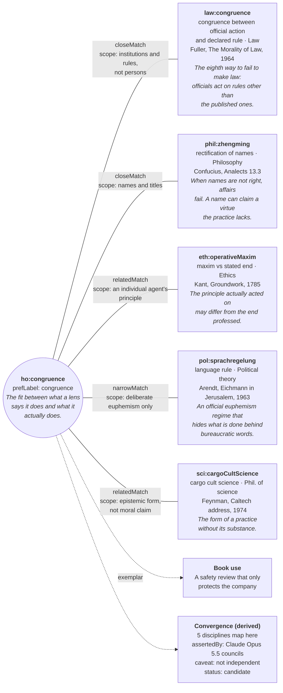

**user**: Read Handoff - PerspectiveStructure 0.02 and the notes it lists, then propose the 0.02 structure.
<!-- copilot-message {"notes":["01_The Writer's Room/Handoff - PerspectiveStructure 0.02.md"]} -->
[Timestamp: 2026/11/17 17:04:42]

**ai**: Reading the Summary, sections 1–3, and Moderator's summary of each review.I've read the handoff, 0.01, and the Summary, sections 1–3 and Moderator's summary of all seven reviews. I didn't open the vocabulary tables, and I only skimmed HO-II.d and HO-II.e for the keep-test and the missingness statuses. Nothing has been written yet. This is the proposal for your approval.

# Proposed PerspectiveStructure 0.02

## How I pruned
I tested each of the 120+ proposals in four ways:
1. **Core:** is it required to identify the lens at all? (Descartes)
2. **Pragmatic test:** would any query, decision or Divergence change if its value changed? (Peirce, the same as the HO-II.d keep-test)
3. **Merge:** is it the same idea as another proposal, under a different name?
4. **Description or evaluation:** is it a fact about the lens, or an Assessment that needs `assessedBy`? (Hart)

Two mechanisms do most of the shrinking:
- **Domain profiles** (from HO-II.e). Most of the Legal and AI-model attributes become optional profiles, not core groups.
- **An Assessments layer.** Every contested judgement about a lens goes into one place.

The groups are display facets, not OWL classes, as Laozi argued. ★ marks the leading tier: the attributes that most change outcomes (Fermi).

```text
PerspectiveType  ◄─ instantiates ─  Perspective (shot, HO-II.d; overrides frame defaults — Minsky)

0 CORE (required; others may take a missingness status, HO-II.e)
  ├── name ★
  ├── canonicalSource ★ ........ absorbs foundationalWork, canonicalText (Scalia)
  ├── objectOfAttention ★ ...... material cause
  └── foundationalCommitments ★  absorbs assumption, principles (Dworkin), priors/baseRates (Bayes)

1 RELATIONS (moved up: relations before attributes — Laozi, Gilligan, Edelman)
  ├── divergesFrom / convergesWith ★ (reified; new subtypes → HO-III.a, see decisions)
  ├── specializes / generalizes .. absorbs formalCause
  ├── partOf / hasSublens ........ Minsky, Hawkins
  ├── complements | complementaryWith (Bohr) | definedAgainst (Laozi)
  ├── coupledWith ................ resonance and feedback between lenses (Tesla)
  └── correctedBy → Community .... communityOfInquiry (Peirce)

2 IDENTITY & LINEAGE
  ├── nameByDomain · definitionByDomain (+ meaningAsOf, Scalia)
  ├── conceptStructure {definitional · family resemblance · prototype · interpretive} + exemplars
  │                               absorbs interpretiveConcept flag, openTexture
  ├── lensKind {designed · tacit · learned · cultural technology}  absorbs tacitPractice,
  │                               learnedRepresentation, culturalTechnology
  ├── lineage → Person · originatingCircumstance → Event
  ├── transmissionMode {text · apprenticeship · ritual · institution · narrative · trained model}
  └── historicalNote

3 AIM & NORMATIVE CORE
  ├── statedPurpose ★ ........... the stated end. The operative side is in the Congruence assessment, group 10
  ├── normativeForm ★ {deontic · consequentialist · aretaic · relational · contractualist} (plural)
  ├── valueTheory · embedsStandard → EvaluativeStandard (HO-II.a; fairnessMetric lives here)
  ├── unitOfMeasure ★ + commensurability
  ├── intentWeighting ★ {intent · outcome · mixed}  (fails on AI-caused harm — Saxe)
  ├── distributiveConcern · conflictResolution {lexical · weighing · deadlock}
  └── domainOfApplicability (jurisdiction lives in the Legal profile)

4 POSITION & SCOPE (three axes, plus extents)
  ├── socialScope (size) · moralCircle ★ (which beings count, AI systems included) · quadrant
  ├── assumedPositionality {impartial · situated · interested}  absorbs impartiality
  ├── spatialScope · systemicScope · temporalScope (+ discountRate)
  └── scaleValidity (Dyson; emergentBlindness = a blind spot outside this range)

5 EPISTEMICS
  ├── method/instrument + instrumentResponse ★ (threshold, false alarm, miss)
  │                               absorbs observabilityLimit, noiseFloor, instrumentDependence, activeSampling
  ├── criterionOfTruth + inferenceModes  (standardOfProof and causationTest in the Legal profile)
  ├── causalModel → CausalGraph (HO-I.a)
  ├── errorHandling {update · act on world · suppress · immunize}
  │                               merges predictionErrorHandling, updateRule, immunizingMoves
  ├── explorationMode {explore · exploit}
  ├── factHandling {preserves · blurs · dissolves}
  └── manipulability (includes authenticityAssumption)

6 STANCE (the holder's side)
  ├── bearerRole · controlLocus · stanceTowardObject {physical · design · intentional}
  ├── governingAnalogies
  └── effectOnHolder ★ {affective · dispositional · cognitive · physical/observer cost}
                                  merges characterFormation, cognitiveAlteration, observerCost

7 SUBJECT'S SIDE (Le Guin)
  ├── standingOfSubjects ★ {agent · patient · datum}
  ├── modelOfSubject · legibility (includes interfaceAbstraction)
  ├── consentToBeSeen ★ (qualified by powerAsymmetry)
  ├── adaptiveResponse
  └── livedExperience [A]

8 POWER (Butler's facet)
  ├── authority → bound parties + authorityBasis {coercive · legal · expert · moral · customary}
  ├── whoseInterests ★ · costBearer ★ (+ differentialBurden) · whoseVoice ★ (+ precisionWeighting)
  ├── powerAsymmetry {low · high · total}
  ├── accountabilityLocus ★ {named agent · role · institution · Nobody} (+ laundering pattern)
  └── remedy

9 DYNAMICS & MATERIALITY
  ├── performativity ★ {none · self-confirming · self-defeating}  absorbs feedback, active inference
  ├── infrastructureDependence → Infrastructure
  ├── validFrom / validTo · changeMode
  └── prevalence {dominant · contested · marginal · emerging}  (descriptive half of the old status)

10 ASSESSMENTS (each is an Assessment with assessedBy → PerspectiveType — Hart)
  ├── congruence ★★ stated vs operative ............ FIRST-CLASS (Confucius · Kant · Fuller ·
  │     ├── operativeMaxim / enforcementReality       Arendt · Feynman); absorbs misnaming,
  │     └── nameIntegrity {apt · euphemistic · inflated · captured}   languageRules, specificationGaming
  ├── blindSpot ★ typed {constitutive · negligent · accepted · suppressed}
  │                               absorbs acceptedHarm, suppressors, emergentBlindness
  ├── failureMode {excess · deficiency}
  ├── developmentalAltitude (only as an assessment, never a bare fact; see decisions)
  ├── epistemicStanding: corroboration (tests survived, HO-002) · calibration + uncertainty
  │                      · anomalies · orderOfMagnitude
  ├── proceduralIntegrity (Fuller's 8) · publicJustifiability (Mill's harm limit lives here)
  └── knownCritique → critiquedBy

11 PROVENANCE & TRUST (about the record, not the lens)
  ├── 11a Sources (keyReference, citation, Source class) — unchanged
  ├── 11b PROV (wasAttributedTo · wasGeneratedBy · wasDerivedFrom · dates · originalWording)
  └── 11c verificationStatus (citations only — Popper) · evidenceLabel · confidence · canonStatus

PROFILES (optional add-ons, HO-II.e)
  ├── LegalInstitutional: validity · efficacy · recognitionStatus · internalAcceptance · standing ·
  │     precedentialWeight · standardOfProof · causationTest · jurisdiction · limitationPeriod ·
  │     discoveryRule · legalPersonhood (twin of moralCircle)
  └── LearnedModel (Hinton): trainingProvenance · objectiveFunction · comprehensionClaim
        (+ lensKind = learned; blind spots default to suppressed or unknown)
```

## Dropped or demoted
Each item below fails the pragmatic test on its own, or is covered by a merge:
- `formalCause` is covered by `specializes` + definition.
- `reflexiveApplication` becomes the `selfInstance` design rule (see open decisions).
- `dominantFactors` is too context-dependent and belongs on the instance (shot).
- `translationLoss` and `compressionLoss` become annotations on a transformation mapping, and only if the embedding model is adopted.
- `limitBehavior` and `futureRobustness` become notes under `epistemicStanding`.
- `emergentEcosystems` is deferred and could later become a relation to Community.
- `narrativeForm` becomes a value of `transmissionMode`.
- `importance` is absorbed by the Power and Dynamics groups.
- `harmPrincipleRespected` folds into `publicJustifiability`.
- `degeneracy` and `reentrantIntegration` move to HO-III.a, because they describe Divergence and Integration, not a lens.

That leaves about 75 named attributes. Only the 4 in Core are required, and about 20 are ★. That's still large. If you want it leaner, I'd cut Dynamics into Power and Epistemics next.

## My pushback
- **Eleven groups is too many for a reader.** I kept them because each new group came from a distinct structural argument (normative core, Stance, Subject's side, Power). If you'd rather have fewer, Stance and Subject's side could merge into one "Holder and subject" group, reflecting Gilligan's point that a lens exists between people.
- **Congruence as first-class rests on five agreeing councils, but all seven councils were voiced by the same model.** I still recommend it. The case for it is that it captures the "safety" problem central to the book, not that the councils agreed.
- **`developmentalAltitude`:** I recommend keeping it, but only inside Assessments. That keeps the ranking visible as somebody's ranking.

## Decisions I need before writing the note
1. Adopt the PerspectiveType/Perspective split? I recommend yes; every review assumes it.
2. Use domain profiles for the Legal and LearnedModel attributes? I recommend yes.
3. Move evaluations into an Assessments layer? I recommend yes.
4. Should provenance be recorded per statement (RDF-star or named graphs), use an OWL + SKOS hybrid, use an embedding model, or record the ontology as an instance of its own type (`selfInstance`)? I recommend recording all four as open questions in 0.02, not deciding them now. The exception is the OWL + SKOS hybrid, which I'd adopt, because `conceptStructure` above already assumes it.
5. Add the two new Divergence subtypes to HO-III.a? I'd do that as a separate edit after 0.02.

Once you approve or adjust this, I'll write PerspectiveStructure 0.02 with the Idea template and file it. I'll then offer to log the type/instance split, the size-vs-altitude split and the table format in [[Decisions_Log]].
<!-- copilot-message {"tools":["Read (read): 01_The Writer's Room/Handoff - PerspectiveStructure 0.02.md","Glob (read)","Read (read): 02_Ideas Topics Concepts/Harm Ontology/PerspectiveStructure 0.01.md","Grep (read): 02_Ideas Topics Concepts/Harm Ontology","Read (read): 02_Ideas Topics Concepts/Harm Ontology/v-0.01 ClassicalCouncil Review of - PerspectiveStructure 0.01.md","Read (read): 02_Ideas Topics Concepts/Harm Ontology/v-0.01 EthicsCouncil Review of - PerspectiveStructure 0.01.md","Read (read): 02_Ideas Topics Concepts/Harm Ontology/v-0.01 LegalCouncil Review of - PerspectiveStructure 0.01.md","Read (read): 02_Ideas Topics Concepts/Harm Ontology/v-0.01 LogicCouncil Review of - PerspectiveStructure 0.01.md","Read (read): 02_Ideas Topics Concepts/Harm Ontology/v-0.01 PhysicsCouncil Review of - PerspectiveStructure 0.01.md","Read (read): 02_Ideas Topics Concepts/Harm Ontology/v-0.01 SciFiCouncil Review of - PerspectiveStructure 0.01.md","Read (read): 02_Ideas Topics Concepts/Harm Ontology/v-0.01 CognitiveCouncil Review of - PerspectiveStructure 0.01.md"]} -->
[Timestamp: 2026/11/17 17:04:42]

**user**: i dont yet want to go.  as you point out, some od these have alignment across several disciplines/domains. i had proposed we have some self documenting approach to acknowledging/reconciling this  and also with  the recognition that each domain used their own terminology. i proposed at a minimum we have skos:altLabel for each domain but maybe a domain profile with many such properties satisfies. how would you handle this and what does domain profiles entail and offer
[Timestamp: 2026/11/17 17:20:14]

**ai**: You're right to stop me. In my proposal, "profile" and "terminology" got blurred together. They solve two different problems, and your altLabel idea addresses one that domain profiles don't.

## Two separate problems

| Problem | Example | What solves it |
|---|---|---|
| **A. The same idea under different names** | Confucius's *misnaming*, Kant's *maxim*, Fuller's *congruence*, Arendt's *Sprachregelung* and Feynman's *cargo cult* | A **vocabulary layer**: each domain's labels, with mappings |
| **B. Each domain needs different attributes** | Law needs `standardOfProof`; an AI model needs `trainingProvenance` | **Domain profiles**: rules about which attributes are required or added |

## What a domain profile entails (from HO-II.e)
A profile is a SHACL shape, a validation rule set for one kind of record, such as `LegalInstitutional` or `LearnedModel`. It does four things:
- **Adds** attributes that only that domain needs.
- **Requires** certain attributes to be *addressed*, meaning given a value or a missingness status (Unknown, Undisclosed, Disputed, and so on). In HO-II.e's words, "must be addressed, not must be known."
- **Constrains** values, for example `standardOfProof` must be one of {preponderance · clear and convincing · beyond reasonable doubt}.
- **Stacks:** COMPAS could be validated against both the Legal and the LearnedModel profiles.

**What it offers:**
- a small core;
- domain completeness checks;
- missing information that becomes visible evidence, not silent blanks.

**What it doesn't do:** say what anything *means* or how one domain's term relates to another's. A shape only checks properties.

So profiles alone don't satisfy your terminology goal. They can help, because a profile could choose which label to *display* to its domain. But the mappings need to live elsewhere. One attribute appears in many profiles, and many domains have a term for an attribute even where no profile exists.

## How I'd handle the terminology: hub and spoke
1. **Hub:** each attribute in the structure is a `skos:Concept` with one neutral `prefLabel`, for example `congruence`. This is the ontology's own name.
2. **Spokes:** each domain's term is recorded as its own object, not as a bare altLabel. Plain `skos:altLabel` can't say *which* domain a label belongs to, or when or where it comes from. Two standard ways to fix that (both from memory, not checked against the specs this session):
   - **SKOS-XL labels:** a label becomes a resource that can carry domain, citation, `meaningAsOf` and key thinkers.
   - **Domain concepts with mapping links:** for example `law:congruence skos:closeMatch hub:congruence`.
3. **Graded matches** make the reconciliation self-documenting: `exactMatch`, `closeMatch`, `broadMatch`/`narrowMatch`, `relatedMatch`. This matters because the five witnesses aren't synonyms. Cargo cult is about *form without substance*, and *Sprachregelung* is *deliberate euphemism*. Graded matches respect Dworkin's warning that disagreement shouldn't be disguised as translation. A `scopeNote` on each mapping can state what differs.
4. **Convergence is derived, not asserted.** How many independent domains map to a hub concept measures its cross-disciplinary support. Each mapping also records `assertedBy`, so the caveat that "all seven councils were voiced by one model" stays attached to the evidence.

Sketch of one spoke:
```text
hub:congruence  (prefLabel "congruence")
  ← closeMatch   law:congruence        domain Law       Fuller 1964   meaningAsOf 1964
  ← closeMatch   conf:zhengming        domain Classical Analects 13.3
  ← relatedMatch eth:operativeMaxim    domain Ethics    Kant 1785     note: about the agent's principle, not institutional practice
  ← relatedMatch pol:Sprachregelung    domain Political Arendt 1963   note: deliberate euphemism regime
  ← relatedMatch sci:cargoCult         domain Science   Feynman 1974  note: form without substance
  convergence: 5 domains · assertedBy Claude Opus 5.5 (councils not independent) · status: candidate
```

You already have most of this. Each row of the councils' vocabulary tables, with its Term (altLabels), Citation, Historical note and Key thinkers, is essentially a spoke record. Consolidating 0.02 then means **mapping the existing rows to hub concepts**, not rewriting them.

## Recommendation
Use both, each for its own job:
- a **vocabulary layer** (hub concepts, per-domain labels with provenance, graded mappings, derived convergence);
- **profiles** for requiredness, with an optional "display labels from domain X" setting.

The 0.02 tree I proposed would stay as it is, but each node becomes a hub concept with its spokes listed.

## Questions for you
1. **Hub names:** should they be neutral coinages like `congruence`, or should each one borrow the strongest domain's term? Neutral names are fairer to all domains, but harder to recognize.
2. **Mapping grade:** should I assign `exact`/`close`/`related` when consolidating, or should every mapping start as `related` until you review it?
3. **Domains:** should a domain be one of the seven councils, or a real discipline (law, ethics, cognitive science…)? Councils are convenient but artificial. I'd use real disciplines and record the council only as provenance.

If this direction fits, it's probably worth its own bookmark (a Vocabulary/Crosswalk note under HO-II.d.1) before 0.02, so the structure can refer to it. I can draft it after you answer these.
<!-- copilot-message {"tools":["Read (read): 02_Ideas Topics Concepts/Harm Ontology/HO-II.e Missingness Statuses and Domain Profiles.md"]} -->
[Timestamp: 2026/11/17 17:20:14]

**user**: the bookmark is a good  idea  yes. but  first can you show a small example as a visual graph of a rich sample section showing hub and spoke with narrative content and the common naming convention
[Timestamp: 2026/11/17 17:27:44]

**ai**: Credit balance is too low
[Timestamp: 2026/11/17 17:27:44]

**user**: repeat previous
[Timestamp: 2026/11/17 17:28:52]

**ai**: Here is the example. It uses the congruence hub, the strongest convergence across the councils, and should render in Obsidian's reading view. The narrative text is illustrative draft wording. The citations are the ones already web-checked in the review tables, but I haven't re-checked them here.

## Naming convention (proposed)

| Element | Pattern | Example |
|---|---|---|
| Hub concept ID | `ho:` + neutral camelCase | `ho:congruence` |
| Hub prefLabel | plain English, lower case | "congruence" |
| Spoke concept ID | `<discipline>:` + the domain's own term in camelCase | `law:congruence`, `phil:zhengming` |
| Spoke label | Term · Discipline · Thinker, Year | "rectification of names · Philosophy · Confucius, Analects 13.3" |
| Mapping edge | SKOS match type, plus a one-line `scopeNote` saying what differs | `closeMatch` — "about institutions, not persons" |
| Discipline prefixes | `law` · `eth` (ethics) · `phil` (classical philosophy) · `pol` (political theory) · `sci` (philosophy of science) · `cog` · `phys` · `lit` (literature) | |

Councils appear only as provenance (`assertedBy`), not as domains.

## Graph: `ho:congruence`



## Spoke record (one of the five, in full)
In the vocabulary note, each spoke would carry the same eight columns as your review tables:

| Field | `law:congruence` |
|---|---|
| Hub | `ho:congruence` (closeMatch) |
| Term (altLabels) | congruence; the eighth desideratum; "congruence between official action and declared rule" |
| Definition | The requirement that officials actually apply the rules that have been published. |
| Example | A content policy enforced against one community but not another: "one name, two lenses". |
| Citation | Lon L. Fuller, *The Morality of Law* (Yale UP, 1964), ch. 2 |
| Citation verified | (copied from the Legal review row) |
| Historical note | Fuller's response to the Hart–Fuller debate (1958) |
| Key thinkers | Lon Fuller; H.L.A. Hart (critic) |
| Scope note (how it differs from the hub) | Applies to rule systems and their officials, not to individual intentions. |
| Explanation | 100–200 words, carried over from the review table |
| meaningAsOf · assertedBy | 1964 · Claude Opus 5.5 (Legal Council), 2026-11-17 |

## Questions from before (still open)
1. **Hub names:** should they be neutral coinages like `congruence`, or should each one borrow the strongest domain's term?
2. **Mapping grade:** should I assign `exact`/`close`/`narrow`/`related` when consolidating, or should every mapping start as `related` until you review it?
3. **Domains:** should they be real disciplines, as shown above, or the seven councils? I recommend disciplines, with councils kept as provenance.

Once you've answered these and approved the format, I'll create the Vocabulary/Crosswalk bookmark note under HO-II.d.1 using the Idea template.
[Timestamp: 2026/11/17 17:28:52]

**user**: is the explanation actually 100-200words... or is that a placeholder? can you show the actual proposed explanation
[Timestamp: 2026/11/17 17:33:01]

**ai**: It was a placeholder. Let me pull the actual row from the Legal review.It was a placeholder. "Carried over from the review table" was also inaccurate: the Legal review has no row for congruence on its own. Its closest row is `proceduralIntegrity`, which covers all eight of Fuller's desiderata and mentions congruence in only one sentence.

## The existing Explanation (`proceduralIntegrity` row, Legal review, verbatim, about 120 words)
> "Fuller's desiderata are a ready-made audit for algorithmic rules, which often fail several at once: unpublished (secret models), unclear (opaque features), constantly changing (retraining), impossible to comply with (unknown criteria), and incongruent (stated purpose vs actual effect). Scoring each desideratum as an object gives the ontology a structured way to say *how* a lens fails procedurally, not just that it does. The eighth desideratum, congruence, is the formal version of Confucius's misnaming and Kant's operative maxim, so three councils converge on it. Hart's objection is worth recording: the desiderata are conditions of efficacy, compatible with great iniquity, so procedural integrity is not moral goodness. The ontology should keep them as separate attributes."

## Proposed new Explanation for the `law:congruence` spoke (about 165 words)
This is a new draft by Claude Opus 5.5, written for this example:

> Fuller's eighth desideratum asks whether the rules officials actually apply are the rules that were declared. As a spoke of `ho:congruence`, it contributes the most precise and testable version of the idea: compare the published rule with observed official action. That makes congruence something you can measure from enforcement records, not only argue about. It connects directly to Holmes's `enforcementReality` and to Pound's distinction between law in books and law in action. It differs from the hub in scope. Fuller audits rule systems and the officials who run them. He doesn't ask about one agent's private maxim, as Kant does, or about deliberate euphemism, as Arendt does. Incongruence in his sense can come from indifference, misreading or inaccessibility, not just bad faith (unverified paraphrase). For AI harm the test applies almost unchanged: a platform's published content policy against its moderation logs, or a model card's stated purpose against how the model is actually deployed. Hart's caution carries over too. A perfectly congruent system can still be unjust, so congruence is necessary for integrity but not sufficient for goodness.

## What this means for the crosswalk
- **Most spokes need a new Explanation.** The existing ones explain the review's *attribute* (here `proceduralIntegrity`). A spoke Explanation has to explain how the *term* relates to the hub and where it differs. I'd write these fresh and cite the review row each one draws on.
- **The hub needs its own Explanation** too: what the concept is in neutral terms, and why five disciplines converge on it.
- **Claims I added need verifying** before saving. Here that means the paraphrase of Fuller's causes of incongruence, which I've marked unverified. All web searches are pre-approved, so I'd check each one during drafting.

Do you want me to draft the hub Explanation and the other four spoke Explanations for congruence as the worked example? Answers to the three earlier questions (hub naming, mapping grades, disciplines vs councils) would still help before I set up the bookmark note.
<!-- copilot-message {"tools":["Grep (read): 02_Ideas Topics Concepts/Harm Ontology/v-0.01 LegalCouncil Review of - PerspectiveStructure 0.01.md","Read (read): 02_Ideas Topics Concepts/Harm Ontology/v-0.01 LegalCouncil Review of - PerspectiveStructure 0.01.md"]} -->
[Timestamp: 2026/11/17 17:33:01]

**user**: is this hub strictly for law where is that made obvious. thinking one hub per domain
[Timestamp: 2026/11/17 17:35:31]

**ai**: No. The hub `ho:congruence` is deliberately **cross-domain**. Only the spoke `law:congruence` is legal. My example made that hard to see in three ways:
- the spoke card I showed in full was the legal one;
- the `ho:` and `law:` prefixes carry the distinction, but nothing says so in plain words;
- the hub and the legal spoke share the word "congruence".

## The model as a matrix
The hub is a **row** (one concept). Your "one hub per domain" is a **column** (one discipline). SKOS has a name for a column too: a **concept scheme**.

| Concept hub (`ho:`) ↓ / Discipline scheme → | Law | Ethics | Philosophy | Political theory | Phil. of science |
|---|---|---|---|---|---|
| **congruence** | `law:congruence` | `eth:operativeMaxim` | `phil:zhengming` | `pol:sprachregelung` | `sci:cargoCultScience` |
| **accountabilityLocus** | `law:standing`? | — | — | `pol:ruleOfNobody` | — |
| **blindSpot** | — | — | `phil:constitutiveEmptiness` | — | `sci:anomaly`? |

(The second and third rows are illustrative only, and the "?" mappings aren't settled.)

- **Concept hub (row):** reconciles one idea across disciplines. This is where convergence, graded matches and "what differs" live.
- **Discipline scheme (column):** collects every term one discipline uses, in its own vocabulary, with its own definitions. It's what a lawyer would browse.

## Should there be one hub per domain?
I'd use both, but not as alternatives:
- **Domain-only hubs (columns only)** lose the thing you asked for: acknowledging and reconciling alignment *across* disciplines. Each domain would be a separate island. Connecting them would need domain-to-domain links, which for 8 disciplines is up to 28 pairings per concept, against 8 links to one shared hub.
- **Concept hubs only** make it hard for a domain reader to see their own vocabulary as a whole.
- **Both from the same data:** each spoke belongs to one discipline scheme (`skos:inScheme law:`) *and* maps to one concept hub. The column view and the row view are two indexes over the same records, with nothing duplicated.

## Making it obvious in the notes
- Label the hub explicitly: "**ho:congruence: cross-domain concept hub**", with a `scope: cross-domain` field.
- Give every spoke a visible `domain: Law` field next to its ID, and list its scheme ("in scheme: Law vocabulary").
- Give each discipline scheme its own index note (for example *Law vocabulary*) listing its terms and the hubs they map to.
- Hub prefLabels should avoid copying one discipline's word where possible. If "congruence" reads as legal, a neutral name like `statedOperativeFit` might be better. That's question 1 again.

So, to settle the design: do you want **concept hubs plus discipline schemes (rows and columns)**, as I recommend? Or did you mean something else by "one hub per domain", for example a separate ontology per domain?
[Timestamp: 2026/11/17 17:35:31]

**user**: would the ontology approach be a new namespace and a hub become like a class that collects properties and narrative for that domain? im adkin for clarification of your proposal not making a different recommendation where/how is an ontology used
[Timestamp: 2026/11/17 17:40:53]

**ai**: I was using "hub" loosely, so here is what each layer would be. There are three, each with a different job.

## The three layers

| Layer | What it is | Namespace | Holds | Used for |
|---|---|---|---|---|
| **1. Ontology (OWL)** | The *structure*: classes and properties | `ho:` | `ho:PerspectiveType` (class), `ho:Assessment` (class), `ho:congruence` (property), with domain and range | Reasoning and querying: "which lenses are incongruent?", computing Divergence |
| **2. Profiles (SHACL)** | *Rules* over the structure | `hosh:` (shapes) | `hosh:LegalInstitutionalProfile`: which properties must be addressed, and allowed values | Validation: "is this Legal record complete?" |
| **3. Vocabulary (SKOS)** | *Words and meaning* | `hov:` for the hubs; `law:`, `eth:`, `phil:` … for disciplines | Hub concepts, discipline terms, labels, definitions, narrative, mappings | Human understanding, cross-domain reconciliation, the explanations |

## Answers to your questions
- **Is a hub a new namespace?** Yes. The hubs would get their own vocabulary namespace (`hov:`), separate from the ontology's `ho:`. Using `ho:congruence` for the hub was my mistake, because it blurred two things:
  - `ho:congruence`: the **property** a record actually uses (an Assessment of a PerspectiveType).
  - `hov:congruence`: the **hub concept** that explains and reconciles that property across disciplines. It links to the property with something like `rdfs:isDefinedBy` or a `documents` link.
- **Is a hub a class?** No. A hub is a `skos:Concept`: a documented idea, not a container with properties. Classes such as `PerspectiveType` and `Assessment` live only in the ontology layer. The narrative (definition, Explanation, history note, examples) is attached to the hub as annotations.
- **Is a discipline namespace (`law:`) an ontology for that domain?** No. It's a **concept scheme**, the list of a discipline's terms with their own definitions. It doesn't define new classes or properties. The legal *attributes* that law adds, such as `standardOfProof`, still belong to the ontology (`ho:`). The Legal profile then selects and requires them. So law contributes **words** (scheme) and **requirements** (profile), but no separate ontology.

## How the layers connect for one item
```text
ONTOLOGY     ho:PerspectiveType ──ho:congruence──► ho:Assessment     (structure; queried)
                                       ▲
VOCABULARY   hov:congruence ───documents┘                             (hub: neutral definition,
              ▲  ▲  ▲  ▲  ▲                                           Explanation, convergence)
              │  │  │  │  └ sci:cargoCultScience  (in scheme: Phil. of science)
              │  │  │  └── pol:sprachregelung    (in scheme: Political theory)
              │  │  └───── phil:zhengming        (in scheme: Philosophy)
              │  └──────── eth:operativeMaxim    (in scheme: Ethics)
              └─────────── law:congruence        (in scheme: Law)   ← match type + scopeNote on each link

PROFILE      hosh:LegalInstitutionalProfile: requires ho:congruence to be addressed;
             displays labels from scheme law:
```

## Where this lives in the vault
None of this has to be RDF yet. For now:
- each hub is one note;
- each discipline scheme is an index note;
- the ontology structure is the PerspectiveStructure note;
- the frontmatter and tables follow the conventions above, so an export to RDF later is mechanical.

If this is clear, I'll write the layer model into the Vocabulary/Crosswalk bookmark note, so 0.02 can refer to it. Before I do: is the three-layer split (ontology, profiles, vocabulary) what you want recorded? And do you still want to answer the three earlier questions first (hub naming, mapping grades, disciplines vs councils)?
[Timestamp: 2026/11/17 17:40:53]

**user**: simple naming with the relevant discipline specific terminology preserved in the vocABULARY narrative. disciplines instead of council yes. i dont know what mapping grades are
[Timestamp: 2026/11/17 17:44:46]

**ai**: Both are settled: hubs get simple names, and each discipline's own terms live in the vocabulary narrative. Domains are real disciplines, and councils appear only as provenance.

## What mapping grades are
When a discipline's term is linked to a hub, the grade says **how closely the two match**. SKOS has five standard grades. Here they are applied to the congruence hub:

| Grade | Meaning | Example |
|---|---|---|
| **exactMatch** | The same idea; the terms are interchangeable | (none in this set) |
| **closeMatch** | Nearly the same; usable in most contexts | Fuller's *congruence*: the same idea, applied to rule systems |
| **narrowMatch** | The discipline's term is a **narrower case** of the hub | Arendt's *Sprachregelung*: a deliberate-euphemism case of incongruence |
| **broadMatch** | The discipline's term is **wider** than the hub | (none here) |
| **relatedMatch** | Connected, but a different idea | Feynman's *cargo cult science*: form without substance, which overlaps with but isn't the same as incongruence |

**Why it matters:** without grades, five terms linked to one hub look like five synonyms. Grades preserve the differences between disciplines, which is part of what you wanted acknowledged.

## Your choice
- **A. I propose grades as I draft, each with a one-line reason, and you review them.** This is my recommendation.
- **B. Everything starts as relatedMatch** (the safest claim), and we upgrade mappings only when you've looked at them.
- **C. Skip grades for now.** Every spoke simply links to its hub, and a scope note says how it differs.

Once you pick, the next step is the Vocabulary/Crosswalk bookmark note, filed under HO-II.d.1. It would record:
- the three-layer model (ontology, profiles, vocabulary);
- the naming rules (simple hub names, discipline terms in the narrative);
- disciplines as domains, with councils as provenance;
- your choice on grades;
- congruence as the worked example, with the hub and five spokes and their Explanations, verified before saving.

Shall I go ahead with that once you've chosen?
[Timestamp: 2026/11/17 17:44:46]

**user**: yes mapping grades
[Timestamp: 2026/11/17 17:45:05]

**ai**: I'll read it as option A: I propose a grade for each mapping with a reason, and you review them. First, the template and the allowed frontmatter values.Next, the citation rows the five spokes depend on. The councils verified these on 2026-11-17.Now filing it into the Harm Ontology index.The index resolved by exact `canonical_id` match, and no note already covers this (the only `ho-vocabulary-crosswalk` match is the new note itself). One placement question before I touch the index.

## Filing plan (needs your OK)

**Placement: I recommend HO-II.d.2, not HO-II.d.1.h.**
The letters a–g under HO-II.d.1 are peer reviews *of 0.01*. The crosswalk isn't a review. It's a method that 0.02 and every later version will depend on. Filing it under 0.01 would tie it to a frozen version. As HO-II.d.2 it sits beside PerspectiveStructure 0.01, and 0.02 can point to it.

| Item | Change |
|---|---|
| Note frontmatter | `bookmark: draft` → `HO-II.d.2`; status stays `seed`; add alias `HO-II.d.2` |
| File name | Unchanged: *Vocabulary Crosswalk - Concept Hubs and Discipline Schemes.md*. This follows the council reviews, which keep descriptive names without an ID prefix. |
| Folder | `_Unfiled Ideas/` → `02_Ideas Topics Concepts/Harm Ontology/` |
| Index entry (after the HO-II.d.1 block) | `[[Vocabulary Crosswalk - Concept Hubs and Discipline Schemes\|HO-II.d.2 — Vocabulary crosswalk]]`: hub-and-spoke vocabulary (SKOS concept hubs, discipline schemes, graded mappings), separating the ontology, profiles and vocabulary layers. Worked example: congruence across five disciplines. |
| Cross-reference added to the index | HO-II.d.2 and HO-II.e: profiles set requiredness, the crosswalk sets meaning, and a profile may display one discipline's labels. |
| Master index | No change (same index) |
| Links to rewrite | None. The note is new and nothing links to it yet. |

Approve this as HO-II.d.2? Or would you rather have HO-II.d.1.h as you first suggested?
<!-- copilot-message {"tools":["Read (read): 00_Claude_Admin/Templates/Idea.md","Read (read): 00_Claude_Admin/FileClasses/Idea.md","Grep (read): 02_Ideas Topics Concepts/Harm Ontology","Read (read): 02_Ideas Topics Concepts/Harm Ontology/v-0.01 ClassicalCouncil Review of - PerspectiveStructure 0.01.md","Read (read): 02_Ideas Topics Concepts/Harm Ontology/v-0.01 LogicCouncil Review of - PerspectiveStructure 0.01.md","Read (read): 02_Ideas Topics Concepts/Harm Ontology/v-0.01 PhysicsCouncil Review of - PerspectiveStructure 0.01.md","Grep (read): 02_Ideas Topics Concepts/Harm Ontology/v-0.01 EthicsCouncil Review of - PerspectiveStructure 0.01.md","Read (read): 02_Ideas Topics Concepts/Harm Ontology/v-0.01 EthicsCouncil Review of - PerspectiveStructure 0.01.md","Write (edit): 02_Ideas Topics Concepts/_Unfiled Ideas/Vocabulary Crosswalk - Concept Hubs and Discipline Schemes.md","Skill (other)","Grep (read)","Grep (read): 02_Ideas Topics Concepts/Harm Ontology/_Harm Ontology Bookmark Index.md"]} -->
[Timestamp: 2026/11/17 17:45:05]

**user**: your recommend
[Timestamp: 2026/11/17 17:50:08]

**ai**: The crosswalk is filed as **HO-II.d.2**, a sibling of PerspectiveStructure 0.01. I checked afterwards that its ID resolves to exactly one note.

**Files changed:**
- **[[Vocabulary Crosswalk - Concept Hubs and Discipline Schemes]]:** new note, moved into `02_Ideas Topics Concepts/Harm Ontology/`. It's set to `bookmark: HO-II.d.2` and `status: seed`, with an index/parent line at the top.
- **[[_Harm Ontology Bookmark Index]]:** a new HO-II.d.2 entry, plus a cross-reference saying that profiles set what's required and the crosswalk sets what things mean.

**What's in the note:**
- the three layers: ontology (`ho:`), profiles (`hosh:`) and vocabulary (`hov:` plus a prefix per discipline);
- your decisions: simple hub names, discipline terms kept in the narrative, real disciplines as domains with councils only as provenance;
- the five mapping grades;
- the congruence worked example: a diagram, the hub with its Explanation, and five spokes, each with a full row and a 100–200-word Explanation.

**Things to check:**
- **Spoke citations** are copied from the council rows already verified on 2026-11-17, and each spoke names the row it comes from. I didn't run new web searches.
- **Dropped claim:** I removed my unverified paraphrase of Fuller's causes of incongruence rather than checking it.
- **One reading of Kant is mine.** Treating a lens as an institution's maxim is labelled in the note as this ontology's interpretation, not Kant's.
- **The five grades are proposals for you to review.** They're listed under Open questions.
- **I read "yes mapping grades" as option A:** I propose a grade for each mapping with a reason, and you review it.

**Decisions to offer for [[Decisions_Log]].** Shall I add these?
- the three-layer model;
- simple hub names, with discipline terms in the narrative;
- disciplines, not councils, as domains;
- graded mappings that I propose and you review.

**Next options:**
1. Review the five congruence grades.
2. Build the next hub (blind spot, with its four kinds).
3. Go back to the 0.02 proposal, where each node now becomes a hub.
<!-- copilot-message {"tools":["PowerShell (other)","Read (read): 02_Ideas Topics Concepts/Harm Ontology/_Harm Ontology Bookmark Index.md","Edit (edit): 02_Ideas Topics Concepts/Harm Ontology/_Harm Ontology Bookmark Index.md","Edit (edit): 02_Ideas Topics Concepts/Harm Ontology/Vocabulary Crosswalk - Concept Hubs and Discipline Schemes.md","Grep (read)"]} -->
[Timestamp: 2026/11/17 17:50:08]

**user**: yes to all
[Timestamp: 2026/11/17 17:53:57]

**ai**: I've added four entries to the top of [[Decisions_Log]], all dated 2026-11-17 and linked to HO-II.d.2:
- the three-layer model;
- simple hub names, with discipline terms in the narrative;
- disciplines, not councils, as domains;
- graded mappings that I propose and you review.

For the next steps, the grade review needs your answers, so here it is first:

## Congruence grades to review

| Spoke | Proposed grade | Reason |
|---|---|---|
| `law:congruence` (Fuller) | **closeMatch** | The same idea, but restricted to rule systems and their officials |
| `phil:zhengming` (Confucius) | **closeMatch** | The same gap, located in names and titles |
| `eth:operativeMaxim` (Kant) | **relatedMatch** | About one agent's principle of action, not a lens's public identity |
| `pol:sprachregelung` (Arendt) | **narrowMatch** | One kind of incongruence: deliberate euphemism |
| `sci:cargoCultScience` (Feynman) | **relatedMatch** | Epistemic form vs substance, not stated purpose |

**Accept all five, or change any?** The one I'm least sure of is Kant. It could be **closeMatch** if you see a lens's operative purpose as the same thing as a maxim.

After that, I'll build the **blind spot** hub with its four kinds: constitutive (Laozi), negligent, accepted (Le Guin) and suppressed (Minsky). It'll use the same format, and I'll check any new citations on the web. Then we'll go back to the 0.02 proposal, where each node becomes a hub.
<!-- copilot-message {"tools":["Grep (read): 00_Claude_Admin/Decisions_Log.md","PowerShell (other)","Read (read): 00_Claude_Admin/Decisions_Log.md","Edit (edit): 00_Claude_Admin/Decisions_Log.md"]} -->
[Timestamp: 2026/11/17 17:53:57]

**user**: kant close match
[Timestamp: 2026/11/17 17:56:08]

**ai**: Updating the Kant spoke to closeMatch in the note.I've changed Kant to **closeMatch** in [[Vocabulary Crosswalk - Concept Hubs and Discipline Schemes]]. That covers the diagram, the grade cell (marked as your decision), the sentence in the Explanation that gave the old grade, and the Open questions line, which now says the review is done.

The other four grades were left as I proposed them. I've taken that as acceptance; tell me if you meant to keep reviewing them.

Final congruence grades:
- **closeMatch:** Fuller, Confucius, Kant
- **narrowMatch:** Arendt
- **relatedMatch:** Feynman

Next is the **blind spot** hub with its four kinds, in the same format, with new citations checked on the web. Shall I go ahead?
<!-- copilot-message {"tools":["Edit (edit): 02_Ideas Topics Concepts/Harm Ontology/Vocabulary Crosswalk - Concept Hubs and Discipline Schemes.md"]} -->
[Timestamp: 2026/11/17 17:56:08]

**user**: yes
[Timestamp: 2026/11/17 17:56:35]

**ai**: Both new legal citations are confirmed: *Global-Tech* through the Cornell LII syllabus, and *Donoghue* through several secondary sources. I'm writing the blind-spot hub into the crosswalk note now.I paraphrased one of my own quotes in Original wording. Replacing it with the exact text.The blind-spot hub is now in [[Vocabulary Crosswalk - Concept Hubs and Discipline Schemes]], below the congruence example.

**How it differs from congruence: the hub has kinds.** `hov:blindSpot` has four narrower concepts: constitutive, negligent, accepted and suppressed. Each discipline term maps to the kind it fits, not to the hub directly. The hub's Explanation sets out the main reason for typing them: each kind needs a different response.
- **Constitutive:** another lens has to cover what this one leaves out.
- **Negligent:** better instruments or more care.
- **Accepted:** moral and political argument.
- **Suppressed:** transparency and whistleblower protection.

## Eight spokes to review

| Kind | Spoke | Proposed grade | Reason |
|---|---|---|---|
| constitutive | `phil:wu` (Laozi, *Daodejing* ch. 11) | closeMatch | Usefulness through emptiness *is* the constitutive kind |
| negligent | `law:negligence` (*Donoghue v Stevenson*, 1932) | relatedMatch | Judges a person's conduct; the ontology borrows only the foreseeability test |
| negligent | `sci:anomaly` (Kuhn, 1962) | relatedMatch | Setting an anomaly aside isn't always negligent |
| accepted | `lit:omelas` (Le Guin, 1973) | closeMatch | A harm that is seen and knowingly accepted |
| accepted | `soc:sacrificeZone` (Lerner, 2010) | narrowMatch | Accepted harm tied to a particular place and community |
| suppressed | `cog:censors` (Minsky, 1986) | closeMatch | Internal agents that stop thoughts forming |
| suppressed | `sci:agnotology` (Proctor & Schiebinger, 2008) | closeMatch | Ignorance produced at institutional scale |
| suppressed | `law:willfulBlindness` (*Global-Tech v. SEB*, 2011) | narrowMatch | A legal test for deliberately avoiding knowledge |

## Citations
Six spokes reuse rows the councils already verified, and each row is named in the note. I checked two new ones on the web today:
- ***Global-Tech*:** confirmed from the Cornell LII syllabus. The two requirements are a subjective belief in a high probability that the fact exists, and deliberate action to avoid learning it. The Court said this goes beyond recklessness and negligence ([Cornell LII](https://www.law.cornell.edu/supct/html/10-6.ZS.html), [Patently-O](https://patentlyo.com/patent/2011/05/)).
- ***Donoghue v Stevenson*:** confirmed only through secondary study sources, for example [Brodies](https://brodies.com/insights/litigation/happy-90th-birthday-donoghue-v-stevenson/) and [Open University](https://www.open.edu/openlearn/mod/oucontent/view.php?id=68381&section=1). I didn't open the judgment itself, and the note says so.

Two examples are marked illustrative (data centres and a platform) because I haven't researched any real case for them.

## Something I'd question
An accepted harm is *seen*, so calling it a "blind spot" is strictly wrong. I kept the plain name, but the note offers `exclusion` or `omission` as alternatives. `omission` would line up with [[HO-005 Assessed Membership and Systematic Omission|HO-005]].

**Your calls:**
1. Accept the eight grades, or change any?
2. Keep `blindSpot` as the hub name, or rename it?

After that, we either build another hub (accountability locus or consent to be seen) or go back to the 0.02 proposal.
<!-- copilot-message {"tools":["Grep (read): 02_Ideas Topics Concepts/Harm Ontology","Bash (execute)","ToolSearch (other)","WebSearch (fetch)","Edit (edit): 02_Ideas Topics Concepts/Harm Ontology/Vocabulary Crosswalk - Concept Hubs and Discipline Schemes.md"]} -->
[Timestamp: 2026/11/17 17:56:35]

**user**: a blind spot might reasonably be thought of as something visible but missed. do you see this differently
[Timestamp: 2026/11/17 18:02:48]

**ai**: Mostly I agree with you, and following your definition through improves the hub.

## Two everyday meanings of "blind spot"
- **The driver's blind spot:** a car beside you that *is* visible and would show with a head check, but you miss it. This is your sense: visible but missed.
- **The eye's blind spot** (the optic disc): a gap that's built into the eye. You can't see there no matter what you do, and the brain fills it in, so you don't notice the gap. This is closer to the constitutive kind.

The first is the common meaning, and it fits the book better, because it implies the miss could have been avoided. That's where responsibility lies.

## Testing the four kinds against "visible but missed"

| Kind | Visible to this lens? | Missed? | A blind spot in your sense? |
|---|---|---|---|
| **Negligent** | Yes, with reasonable care | Yes | **Yes**, the clearest case |
| **Suppressed** | Yes, but prevented from being seen or recorded | Yes, on purpose | **Yes**. It's the deliberate version: not checking over your shoulder because you'd rather not know. Willful blindness is literally named this way. |
| **Constitutive** | No. It's outside the lens's frame by design | Not missed, but excluded | **No.** It's a frame or scope limit, the eye's built-in gap |
| **Accepted** | Yes | No, it's seen and tolerated | **No.** That's a trade-off, not a blind spot |

So I'd say my hub put three different things under one name:
- what's **outside the frame**;
- what's **in the frame but missed**;
- what's **seen and tolerated**.

## Proposed restructure
- Rename the hub **`omission`**: whatever a lens leaves out of its verdicts. This also lines up with [[HO-005 Assessed Membership and Systematic Omission|HO-005]].
- Give it three branches:
  - **`outOfFrame`**: the constitutive kind (Laozi). It links to scope, `scaleValidity` and `observabilityLimit`.
  - **`blindSpot`**: visible but missed, used in your sense. It has two kinds:
    - **negligent**: Donoghue, Kuhn's anomalies;
    - **suppressed**: Minsky, agnotology, willful blindness.
  - **`acceptedHarm`**: seen and tolerated (Omelas, sacrifice zones). The Sci-Fi review had already proposed this as a separate item, a sibling of blind spot rather than a kind of it.

The eight spokes keep their grades. Only where they attach changes.

The question this raises is where negligent ends and suppressed begins. *Global-Tech* gives a usable test: suspecting the fact and deliberately avoiding finding out counts as suppressed.

Shall I restructure the hub this way? Or would you rather keep "blind spot" as the hub name and narrow its definition, moving constitutive and accepted out as separate hubs?
[Timestamp: 2026/11/17 18:02:48]

**user**: yes. your way
[Timestamp: 2026/11/17 18:05:26]

**ai**: API Error: Can't reach the API server — check your internet or DNS (ENOTFOUND)
<!-- copilot-message {"tools":["Edit (edit): 02_Ideas Topics Concepts/Harm Ontology/Vocabulary Crosswalk - Concept Hubs and Discipline Schemes.md"]} -->
[Timestamp: 2026/11/17 18:05:26]

**user**: please provide visual graph showing perspective with placeholder for explanation narrative
[Timestamp: 2026/11/17 20:40:55]

**ai**: The diagram below is the proposed 0.02 structure, drawn as hubs. It includes today's changes: `congruence` and `omission`, with omission's three branches. Every hub has an explanation slot. It's chat-only for now; nothing is saved.

```mermaid
graph TD
    PT(["<b>PerspectiveType</b><br/>the lens tradition<br/>📝 Explanation: [placeholder]"])
    P(["<b>Perspective</b><br/>one shot · HO-II.d<br/>overrides type defaults<br/>📝 Explanation: [placeholder]"])
    P -- instantiates --> PT

    subgraph G0["0 CORE · required"]
        C1["name ★<br/>📝 [placeholder]"]
        C2["canonicalSource ★<br/>📝 [placeholder]"]
        C3["objectOfAttention ★<br/>📝 [placeholder]"]
        C4["foundationalCommitments ★<br/>📝 [placeholder]"]
    end

    subgraph G1["1 RELATIONS"]
        R1["divergesFrom / convergesWith ★<br/>📝 [placeholder]"]
        R2["specializes · partOf<br/>📝 [placeholder]"]
        R3["complements · definedAgainst<br/>📝 [placeholder]"]
        R4["coupledWith · correctedBy<br/>📝 [placeholder]"]
    end

    subgraph G2["2 IDENTITY & LINEAGE"]
        I1["nameByDomain · definitionByDomain<br/>📝 [placeholder]"]
        I2["conceptStructure + exemplars<br/>📝 [placeholder]"]
        I3["lensKind · lineage · transmissionMode<br/>📝 [placeholder]"]
    end

    subgraph G3["3 AIM & NORMATIVE CORE"]
        A1["statedPurpose ★<br/>📝 [placeholder]"]
        A2["normativeForm ★ · valueTheory<br/>📝 [placeholder]"]
        A3["unitOfMeasure ★ + commensurability<br/>📝 [placeholder]"]
        A4["intentWeighting ★<br/>📝 [placeholder]"]
    end

    subgraph G4["4 POSITION & SCOPE"]
        S1["socialScope · moralCircle ★<br/>📝 [placeholder]"]
        S2["assumedPositionality<br/>📝 [placeholder]"]
        S3["spatial · systemic · temporal scope<br/>+ scaleValidity<br/>📝 [placeholder]"]
    end

    subgraph G5["5 EPISTEMICS"]
        E1["method + instrumentResponse ★<br/>📝 [placeholder]"]
        E2["criterionOfTruth · causalModel<br/>📝 [placeholder]"]
        E3["errorHandling · factHandling<br/>📝 [placeholder]"]
    end

    subgraph G6["6 STANCE · holder's side"]
        H1["bearerRole · controlLocus<br/>📝 [placeholder]"]
        H2["effectOnHolder ★<br/>📝 [placeholder]"]
    end

    subgraph G7["7 SUBJECT'S SIDE"]
        U1["standingOfSubjects ★<br/>📝 [placeholder]"]
        U2["consentToBeSeen ★ · legibility<br/>📝 [placeholder]"]
        U3["adaptiveResponse<br/>📝 [placeholder]"]
    end

    subgraph G8["8 POWER"]
        W1["authority + authorityBasis<br/>📝 [placeholder]"]
        W2["whoseInterests ★ · costBearer ★ · whoseVoice ★<br/>📝 [placeholder]"]
        W3["accountabilityLocus ★<br/>📝 [placeholder]"]
    end

    subgraph G9["9 DYNAMICS & MATERIALITY"]
        D1["performativity ★<br/>📝 [placeholder]"]
        D2["infrastructureDependence · validFrom/To<br/>📝 [placeholder]"]
    end

    subgraph G10["10 ASSESSMENTS · assessedBy"]
        X1["<b>congruence ★★</b><br/>📝 drafted · HO-II.d.2"]
        X2["<b>omission ★</b><br/>📝 drafted · HO-II.d.2"]
        X2a["outOfFrame"]
        X2b["blindSpot<br/>negligent · suppressed"]
        X2c["acceptedHarm"]
        X3["developmentalAltitude<br/>📝 [placeholder]"]
        X4["epistemicStanding · proceduralIntegrity<br/>📝 [placeholder]"]
        X2 --- X2a
        X2 --- X2b
        X2 --- X2c
    end

    subgraph G11["11 PROVENANCE & TRUST"]
        V1["sources · PROV · verification<br/>📝 [placeholder]"]
    end

    PT --> G0
    PT --> G1
    PT --> G2
    PT --> G3
    PT --> G4
    PT --> G5
    PT --> G6
    PT --> G7
    PT --> G8
    PT --> G9
    PT --> G10
    PT --> G11

    PR1{{"Profile: LegalInstitutional<br/>📝 [placeholder]"}}
    PR2{{"Profile: LearnedModel<br/>📝 [placeholder]"}}
    PR1 -. adds and requires .-> PT
    PR2 -. adds and requires .-> PT
```



**Key:**
- **★** marks the leading tier, and **★★** marks congruence, the first-class attribute.
- **📝 [placeholder]** is where each hub's Explanation goes: the neutral definition plus its 100–200-word narrative. The spokes hang off these hubs.
- **📝 drafted** means the hub is already written in [[Vocabulary Crosswalk - Concept Hubs and Discipline Schemes]].
- **Hexagons** are profiles, which add attributes and set which ones must be addressed.

Grouped nodes such as "socialScope · moralCircle" would each become separate hubs in the real note. I combined them here only so the diagram stays readable.

Do you want this diagram added to the crosswalk note (or kept for the 0.02 note)? Or should we fill one group's placeholders next, Core for example?
[Timestamp: 2026/11/17 20:40:55]

**user**: dont add this diAgramm to anything yet
[Timestamp: 2026/11/17 20:42:21]

**ai**: Understood. The diagram stays in this chat only, and I haven't added it to any note.
[Timestamp: 2026/11/17 20:42:21]

**user**: please display diagram only
[Timestamp: 2026/11/17 20:44:45]

**ai**: 


[Timestamp: 2026/11/17 20:44:45]

**user**: please display as originally in vertically organized diagram
[Timestamp: 2026/11/17 20:45:44]

**ai**: 

```text
PerspectiveType  ◄─ instantiates ─  Perspective (shot, HO-II.d; overrides frame defaults)
│  📝 Explanation: [placeholder]
│
├── 0 CORE (required) ───────────────────────────────────────────────
│   ├── name ★ ............................. 📝 [placeholder]
│   ├── canonicalSource ★ .................. 📝 [placeholder]
│   ├── objectOfAttention ★ ................ 📝 [placeholder]
│   └── foundationalCommitments ★ .......... 📝 [placeholder]
│
├── 1 RELATIONS ─────────────────────────────────────────────────────
│   ├── divergesFrom / convergesWith ★ ..... 📝 [placeholder]
│   ├── specializes / generalizes .......... 📝 [placeholder]
│   ├── partOf / hasSublens ................ 📝 [placeholder]
│   ├── complements · complementaryWith · definedAgainst ... 📝 [placeholder]
│   ├── coupledWith ........................ 📝 [placeholder]
│   └── correctedBy → Community ............ 📝 [placeholder]
│
├── 2 IDENTITY & LINEAGE ────────────────────────────────────────────
│   ├── nameByDomain · definitionByDomain .. 📝 [placeholder]
│   ├── conceptStructure + exemplars ....... 📝 [placeholder]
│   ├── lensKind ........................... 📝 [placeholder]
│   ├── lineage · originatingCircumstance .. 📝 [placeholder]
│   ├── transmissionMode ................... 📝 [placeholder]
│   └── historicalNote ..................... 📝 [placeholder]
│
├── 3 AIM & NORMATIVE CORE ──────────────────────────────────────────
│   ├── statedPurpose ★ .................... 📝 [placeholder]
│   ├── normativeForm ★ .................... 📝 [placeholder]
│   ├── valueTheory · embedsStandard ....... 📝 [placeholder]
│   ├── unitOfMeasure ★ + commensurability . 📝 [placeholder]
│   ├── intentWeighting ★ .................. 📝 [placeholder]
│   ├── distributiveConcern · conflictResolution ... 📝 [placeholder]
│   └── domainOfApplicability .............. 📝 [placeholder]
│
├── 4 POSITION & SCOPE ──────────────────────────────────────────────
│   ├── socialScope ........................ 📝 [placeholder]
│   ├── moralCircle ★ ...................... 📝 [placeholder]
│   ├── quadrant ........................... 📝 [placeholder]
│   ├── assumedPositionality ............... 📝 [placeholder]
│   ├── spatialScope · systemicScope ....... 📝 [placeholder]
│   ├── temporalScope (+ discountRate) ..... 📝 [placeholder]
│   └── scaleValidity ...................... 📝 [placeholder]
│
├── 5 EPISTEMICS ────────────────────────────────────────────────────
│   ├── method + instrumentResponse ★ ...... 📝 [placeholder]
│   ├── criterionOfTruth + inferenceModes .. 📝 [placeholder]
│   ├── causalModel ........................ 📝 [placeholder]
│   ├── errorHandling ...................... 📝 [placeholder]
│   ├── explorationMode .................... 📝 [placeholder]
│   ├── factHandling ....................... 📝 [placeholder]
│   └── manipulability ..................... 📝 [placeholder]
│
├── 6 STANCE (holder's side) ────────────────────────────────────────
│   ├── bearerRole · controlLocus .......... 📝 [placeholder]
│   ├── stanceTowardObject ................. 📝 [placeholder]
│   ├── governingAnalogies ................. 📝 [placeholder]
│   └── effectOnHolder ★ ................... 📝 [placeholder]
│
├── 7 SUBJECT'S SIDE ────────────────────────────────────────────────
│   ├── standingOfSubjects ★ ............... 📝 [placeholder]
│   ├── modelOfSubject · legibility ........ 📝 [placeholder]
│   ├── consentToBeSeen ★ .................. 📝 [placeholder]
│   ├── adaptiveResponse ................... 📝 [placeholder]
│   └── livedExperience .................... 📝 [placeholder]
│
├── 8 POWER ─────────────────────────────────────────────────────────
│   ├── authority + authorityBasis ......... 📝 [placeholder]
│   ├── whoseInterests ★ ................... 📝 [placeholder]
│   ├── costBearer ★ (+ differentialBurden)  📝 [placeholder]
│   ├── whoseVoice ★ (+ precisionWeighting)  📝 [placeholder]
│   ├── powerAsymmetry ..................... 📝 [placeholder]
│   ├── accountabilityLocus ★ .............. 📝 [placeholder]
│   └── remedy ............................. 📝 [placeholder]
│
├── 9 DYNAMICS & MATERIALITY ────────────────────────────────────────
│   ├── performativity ★ ................... 📝 [placeholder]
│   ├── infrastructureDependence ........... 📝 [placeholder]
│   ├── validFrom / validTo · changeMode ... 📝 [placeholder]
│   └── prevalence ......................... 📝 [placeholder]
│
├── 10 ASSESSMENTS (each with assessedBy) ───────────────────────────
│   ├── congruence ★★ ...................... 📝 drafted (HO-II.d.2)
│   ├── omission ★ ......................... 📝 drafted (HO-II.d.2)
│   │   ├── outOfFrame
│   │   ├── blindSpot
│   │   │   ├── negligent
│   │   │   └── suppressed
│   │   └── acceptedHarm
│   ├── failureMode ........................ 📝 [placeholder]
│   ├── developmentalAltitude .............. 📝 [placeholder]
│   ├── epistemicStanding .................. 📝 [placeholder]
│   ├── proceduralIntegrity ................ 📝 [placeholder]
│   ├── publicJustifiability ............... 📝 [placeholder]
│   └── knownCritique ...................... 📝 [placeholder]
│
└── 11 PROVENANCE & TRUST ───────────────────────────────────────────
    ├── 11a Sources ........................ 📝 [placeholder]
    ├── 11b PROV ........................... 📝 [placeholder]
    └── 11c verificationStatus · evidenceLabel · confidence · canonStatus ... 📝 [placeholder]

PROFILES (optional add-ons, HO-II.e)
├── LegalInstitutional ..................... 📝 [placeholder]
└── LearnedModel ........................... 📝 [placeholder]

★ leading tier   ★★ first-class   📝 Explanation slot (hub narrative)
```
[Timestamp: 2026/11/17 20:45:44]

**user**: what happened to integral properties
1. interior vs exterior
2. individual vs collective
3. developmental level
[Timestamp: 2026/11/17 20:50:25]

**ai**: They're still in the structure, but my 0.02 proposal scattered them and I didn't flag it. That was a mistake, because two of the three come from your original list.

## Where each one went

| Your property | In 0.01 | In my 0.02 proposal | What was lost |
|---|---|---|---|
| **Interior vs exterior** | Half of `quadrant` | Still only inside `quadrant`, moved to group 4 Position & Scope | It's no longer an axis of its own |
| **Individual vs collective** | The other half of `quadrant` | The same: inside `quadrant` | It's no longer an axis of its own |
| **Developmental level** | `developmentalAltitude` | Moved to group 10 Assessments, because it's contested (Kohlberg–Gilligan, Laozi) | It no longer appears next to its siblings |

The "Integral position" group itself disappeared. Its contents went to two other places.

The quadrant problem started in 0.01. Your list had two separate axes, and 0.01 folded them into one four-value field (UL/UR/LL/LR). That loses something. A lens can attend to **both** interior and exterior, or slide between them, and a single quadrant value can't express that.

## Proposal: restore group 3 Integral position

```text
├── 3 INTEGRAL POSITION ─────────────────────────────────────────────
│   ├── interiority ★ {interior · exterior · both} ............ 📝 [placeholder]
│   ├── collectivity ★ {individual · collective · both} ....... 📝 [placeholder]
│   ├── quadrant (derived from the two axes) .................. 📝 [placeholder]
│   ├── socialScope (size) .................................... 📝 [placeholder]
│   ├── moralCircle ★ (which beings count) .................... 📝 [placeholder]
│   └── developmentalAltitude (Assessment, assessedBy required) 📝 [placeholder]
```

- **Two explicit axes.** `quadrant` is computed from them, so it isn't recorded twice.
- **Developmental level returns to its group,** but it's still typed as an Assessment, so the record always says whose ranking it is. The groups are display facets, so it can be shown here and also listed in group 10 without being stored twice.
- **The three scope axes sit together:** size, altitude and moral circle, as the Ethics review recommended.
- Group 4 would then hold only the extents: spatial, systemic and temporal scope, plus scale validity.

One caution: the Integral framing comes from Wilber's AQAL, and 0.01 cited it from memory without checking. I'd verify it before writing 0.02.

Shall I adopt this? If so, I'll show the full revised tree.
[Timestamp: 2026/11/17 20:50:25]

**user**: please show me the narrativer content for developmentalAlltitude
[Timestamp: 2026/11/17 20:52:52]

**ai**: No hub narrative has been written for `developmentalAltitude` yet. The existing material is two rows in the council vocabulary tables. They're quoted verbatim below and would become its first two spokes.

## Spoke 1: `phil:junzi` / `phil:oikeiosis` (Classical review, line 162)

| Field | Content |
|---|---|
| Term (altLabels) | *junzi* 君子 vs *xiaoren* 小人; *oikeiōsis* (appropriation, widening affinity) |
| Definition | Degree of moral cultivation, shown in how widely concern extends |
| Example | "The junzi understands what is right; the xiaoren understands what is profitable" |
| Citation | *Analects* 4.16; Cicero, *De Finibus* III.16–22 |
| Verified | Yes. The Legge translation is confirmed; the Example's wording is a common modern rendering. |
| Key thinkers | Confucius; Mencius; Zeno; Chrysippus; Cicero |

**Explanation (verbatim):**
> Confucius performed a quiet revolution: *junzi* had meant someone noble by birth, and he made it mean someone noble by cultivation. The Stoics independently described moral growth as widening appropriation, from caring for one's own body to caring for humanity. Both traditions give strong ancient precedent for the author's idea that perspectives differ in the inclusivity of their value structure, independently of the size of the group they address. That distinction, accepted by the author, is one of the most useful in the structure. **For AI harm:** the same social scope can be held at very different altitudes, for example a national AI strategy framed around competitive advantage versus one framed around global welfare. **Limit, and it is serious:** every altitude scale is built from inside a tradition, and it places that tradition near the top. Confucian, Stoic, Kohlbergian and Integral scales disagree about what "higher" means; the Ethics review documents how Kohlberg's scale ranked care reasoning lower. Modelling implication: never assert altitude as a bare fact. Make it a qualified, assessed value with `assessedBy` → PerspectiveType, so every ranking states whose ranking it is, and disagreements become Divergences.

## Spoke 2: `psy:moralStages` (Ethics review, line 153)

| Field | Content |
|---|---|
| Term (altLabels) | stages of moral development (pre-conventional, conventional, post-conventional) |
| Definition | Developmental levels of moral reasoning |
| Example | The Heinz dilemma: should Heinz steal a drug to save his wife? |
| Citation | Kohlberg, *Essays on Moral Development*, vol. 1 (Harper & Row, 1981); Gilligan (1982) |
| Verified | Yes |
| Key thinkers | Jean Piaget; Lawrence Kohlberg; Carol Gilligan; James Rest |

**Explanation (verbatim):**
> Developmental altitude is the most powerful and most dangerous attribute in the structure. Powerful because it captures something real: lenses differ in how widely and reflectively they extend concern, and a lens organised around self-interest is not equivalent to one organised around universal principles. Dangerous because every scale is built from somewhere. Kohlberg's stages, developed from interviews with boys and men, placed rule- and rights-based reasoning at the top and relational reasoning lower, so women's responses scored lower. Gilligan's critique is a documented case of an altitude scale encoding its authors' perspective, and it parallels the Confucian and Stoic rankings noted in the Classical review. For AI, altitude matters because developers increasingly claim their systems reason at a "higher" moral level, or align to "universal" values. Modelling implication: `developmentalAltitude` should never be stored as a bare value. It should always be an assessed property with `assessedBy` pointing to the scale and its PerspectiveType, so that the ontology records "post-conventional according to Kohlberg's scale" rather than "post-conventional". Rival altitude scales then become comparable, and their disagreements become Divergences.

## What's missing
- **A hub Explanation** for `hov:developmentalAltitude`: a neutral definition plus a narrative covering all the spokes.
- **The Integral spoke.** Wilber's altitude levels (egocentric, ethnocentric, worldcentric…) are where your original term came from, but no council wrote a row for them, and 0.01 cited AQAL only from memory.
- **A counter-spoke.** Laozi's rejection of ranking, and Gilligan's care ethics as a rival standard, could be recorded as Divergence links rather than as spokes.
- **Mapping grades.** Both existing spokes would be **closeMatch** in my view.
- **`psy:` is a new discipline prefix.** Kohlberg is developmental psychology.

Shall I draft the hub Explanation and an Integral spoke, with a web check of Wilber's levels?
<!-- copilot-message {"tools":["Bash (execute)"]} -->
[Timestamp: 2026/11/17 20:52:52]

**user**: do wilbers altitude levels get included somewhere in the voccabulary level?
[Timestamp: 2026/11/17 21:13:45]

**ai**: Not yet. Nothing in the vault has a row for Wilber's levels. They appear only in 0.01's example values (egocentric · ethnocentric · worldcentric · …), cited from memory. In the vocabulary layer they'd fit in two places, and the second is the more useful one.

## 1. As a spoke on the hub (Wilber's term for the idea)
```text
hov:developmentalAltitude
  ← closeMatch  phil:junzi / oikeiosis      (Confucius, Stoics)
  ← closeMatch  psy:moralStages             (Kohlberg)
  ← closeMatch  int:altitude                (Wilber, Integral theory)   ← new; int: = Integral theory
```
This records that Wilber names the same idea and gives it a narrative, citation and history like any other spoke.

## 2. As a value scale (the levels themselves)
Here's the subtler point. `developmentalAltitude` takes a **value**, and each tradition has its own **scale** of values. In SKOS, each scale becomes its own concept scheme, with ordered level concepts:

```text
SCALE (concept scheme)        LEVELS (ordered concepts)
int:altitudeScale (Wilber)    egocentric → ethnocentric → worldcentric → kosmocentric
                              (also the colour altitudes: red · amber · orange · green · teal · turquoise …)
psy:kohlbergStages            pre-conventional → conventional → post-conventional (6 stages)
phil:oikeiosisCircles         self → household → kin → city → humanity   (Hierocles)
```

Then the crosswalk can work at the level of **values**, not just concepts:
```text
int:worldcentric      ── closeMatch ──   psy:postConventional
int:ethnocentric      ── closeMatch ──   psy:conventional
phil:circleHumanity   ── relatedMatch ── int:worldcentric
```

**Why this matters:** it makes your "whose ranking" rule concrete. A record would say *"worldcentric on Wilber's scale (assessedBy: Integral theory)"*. The ontology could then show where it lines up with *"post-conventional on Kohlberg's scale"*, and where the scales disagree. Gilligan's critique becomes a Divergence between scales, not a footnote.

The same method fits your other two integral properties. Interior/exterior and individual/collective are also Wilber's AQAL axes, so `int:` spokes would sit on those hubs too.

## Caution
Everything about Wilber here is from memory and unverified: the four levels, the colour names, the AQAL terms and the mappings to Kohlberg. That includes which work introduced the colours; I believe it's *Integral Spirituality* (2006). I'd check all of it on the web before writing it into the note. The Wilber–Kohlberg mappings in particular would be my proposals for you to review, not established facts.

Shall I verify Wilber's levels and AQAL axes, then draft the `int:` spokes and the scale schemes?
[Timestamp: 2026/11/17 21:13:45]

**user**: yes
[Timestamp: 2026/11/17 21:15:31]

**ai**: Wilber's levels are confirmed, although mostly through secondary sources. I'm adding the developmental altitude hub to the crosswalk note now.I've added `hov:developmentalAltitude` to [[Vocabulary Crosswalk - Concept Hubs and Discipline Schemes]]. I also never confirmed the earlier change: the blind-spot hub is now `hov:omission`, with its three branches (out of frame, blind spot, accepted harm). Both are in the note.

## What was verified
- **Wilber's moral sequence (egocentric → ethnocentric → worldcentric → kosmocentric):** confirmed by [Wikipedia: Worldcentrism](https://en.wikipedia.org/wiki/Worldcentrism) and secondary sources. The search also turned up Wilber's own essay ([PDF](http://integral-life-home.s3.amazonaws.com/Wilber-WakeUpGrowUp-TheEdgeOfTheUnknown.pdf)), but I didn't open it. The sources also report that Wilber equates worldcentric with Kohlberg's post-conventional stage.
- **AQAL quadrants:** confirmed. They were introduced in *Sex, Ecology, Spirituality* (1995) by crossing interior/exterior with individual/collective ([Wikipedia](https://en.wikipedia.org/wiki/Sex,_Ecology,_Spirituality), [Integral World overview](https://www.integralworld.net/helfrich.html)).
- **Colour altitudes:** only partly confirmed. Red, amber, orange, green, teal and turquoise are linked to *Integral Spirituality* (2006) only through secondary sources ([Visser](https://www.integralworld.net/visser101.html), [Sloww](https://www.sloww.co/integral-spirituality-ken-wilber/)). The lower colours and the ones beyond turquoise vary between sources.
- **Hierocles's circles:** not verified. They appear only in council dialogue, which was never fact-checked. The scale is marked that way in the note.

## What was added
- **A hub Explanation (new).** It covers the shared idea, your size-versus-altitude distinction, and the rule that every value must name its scale.
- **Three spokes, all proposed as closeMatch:**
  - Confucius and the Stoics, and Kohlberg: Explanations quoted verbatim from the council reviews;
  - `int:altitude`: a new Explanation.
- **Gilligan and Laozi** are recorded as Divergences, not as spokes.
- **Four value scales,** each a concept scheme with ordered levels.
- **Five value-level mappings across the scales,** for example `int:worldcentric` closeMatch `psy:postConventional`.
  - **Kosmocentric has no Kohlberg equivalent.** I've recorded that gap as a Divergence between the two scales.
- **Two new discipline prefixes:** `psy:` (developmental psychology) and `int:` (Integral theory).

## For you to review
1. The three spoke grades and the five value mappings.
2. Whether to build the interior/exterior and individual/collective hubs next, with `int:` spokes from AQAL. This would also settle restoring group 3 Integral position in 0.02, which you haven't confirmed yet.
<!-- copilot-message {"tools":["WebSearch (fetch)","Edit (edit): 02_Ideas Topics Concepts/Harm Ontology/Vocabulary Crosswalk - Concept Hubs and Discipline Schemes.md"]} -->
[Timestamp: 2026/11/17 21:15:31]

**user**: im concerned about the integral altitudes.  the altitudes listed seem to correspond to macro level groupings of a 12 level color scheme with their own names, definitions, explanation and example
[Timestamp: 2026/11/17 21:36:07]

**ai**: You're right, and my draft flattened it. The four moral terms (egocentric, ethnocentric, worldcentric, kosmocentric) are coarse **bands**. Underneath them, Wilber's colour scheme has **12 levels**, each with its own name and meaning. My note treated the colours as a side list and cited the wrong book.

## What I've now verified
Frank Visser's review quotes Wilber's *The Religion of Tomorrow* (2017), p. 349: "infrared to magenta to red to amber to orange to green to teal to turquoise to indigo to violet to ultraviolet to white" ([Visser](https://www.integralworld.net/visser101.html)). Visser's table gives a stage name for each colour:

| # | Colour | Stage name | Tier | Moral band (likely) |
|---|---|---|---|---|
| 1 | Infrared | Archaic | 1st | (pre-moral) |
| 2 | Magenta | Magic | 1st | egocentric |
| 3 | Red | Magic-Mythic | 1st | egocentric |
| 4 | Amber | Mythic | 1st | ethnocentric |
| 5 | Orange | Rational | 1st | worldcentric |
| 6 | Green | Pluralistic | 1st | worldcentric |
| 7 | Teal | Holistic* | 2nd | worldcentric (?) |
| 8 | Turquoise | Integral* | 2nd | worldcentric (?) |
| 9 | Indigo | Para-mind | 3rd | kosmocentric |
| 10 | Violet | Meta-mind | 3rd | kosmocentric |
| 11 | Ultraviolet | Overmind | 3rd | kosmocentric |
| 12 | White (also "clear light") | Supermind | 3rd | kosmocentric |

**Gaps that are still open:**
- **\*Teal and turquoise names conflict.** Visser has teal = Holistic and turquoise = Integral. [Deep Psychology](https://deep-psychology.com/ken-wilber-levels-of-consciousness/) has teal = Integral and turquoise = Super- or Advanced Integral.
- **The band column is my inference, except for some levels.** The Deep Psychology page puts red at egocentric, orange and green at worldcentric, and all four third-tier levels at kosmocentric. It never uses "ethnocentric", so amber = ethnocentric is my reading, as is placing magenta and teal/turquoise.
- **Colours changed between books.** Wilber revised the scheme between 2006 and 2017, for example magenta replacing purple. Records need `meaningAsOf`.
- **No primary text opened.** All of this comes from secondary sources quoting Wilber.

## Proposed model
```text
int:moralBands (scheme)            int:colourAltitude (scheme, 12 ordered levels)
  egocentric   ── narrower ──►       magenta · red
  ethnocentric ── narrower ──►       amber
  worldcentric ── narrower ──►       orange · green · (teal · turquoise?)
  kosmocentric ── narrower ──►       indigo · violet · ultraviolet · white
                                     (infrared: before any band)
```
- **Each of the 12 levels gets its own record:** colour (prefLabel), stage name (altLabel), tier, band, definition, explanation, example and citation, in the same format as the spokes.
- **Bands and levels are linked by `skos:narrower`.** A record can then use either grain, for example "amber (Wilber 2017)" or simply "ethnocentric".
- **Cross-scale mappings move to the finer grain** where that's justified. For example, amber ≈ Kohlberg conventional, and orange/green ≈ post-conventional.

## Before I write anything
1. **Scope:** 12 full records with 100–200-word Explanations is a lot. Should I write all 12, or the 8 first- and second-tier levels now? Wilber himself calls the third tier tentative.
2. **Teal/turquoise naming:** should I record both namings, with a note on the conflict, until the primary text is checked?
3. **Where should it live?** A 12-level scale may deserve its own note, *Integral Altitude Scale*, linked from the hub, so the crosswalk note stays readable. I'd recommend that.

I'll also correct the current scale row in the crosswalk note: it should cite *The Religion of Tomorrow* (2017) and give 12 levels.
<!-- copilot-message {"tools":["WebSearch (fetch)","Read (read): 02_Ideas Topics Concepts/Harm Ontology/Vocabulary Crosswalk - Concept Hubs and Discipline Schemes.md","ToolSearch (other)","WebFetch (fetch)"]} -->
[Timestamp: 2026/11/17 21:36:07]

**user**: great.  please revise the integral  position category with this new content and display the integral position diagram with appropriate levels, groupings and explanatory narrative
[Timestamp: 2026/11/17 21:39:43]

**ai**: Here is the revised **group 3, Integral position**. It's chat-only: I haven't saved it or changed the crosswalk note. The narrative lines are short draft summaries, and full 100–200-word Explanations would replace them. Notes in [brackets] mark what is unverified or my own inference.

```text
├── 3 INTEGRAL POSITION ─────────────────────────────────────────────────────────
│   📝 Where a lens stands: what it looks at (inside or outside), whom it looks at
│      (one or many), how many it addresses, which beings count, and how widely its
│      values reach. Four independent axes; a lens may sit anywhere on each.
│
├── 3.1 QUADRANT AXES (Wilber, AQAL, Sex, Ecology, Spirituality, 1995) ─────────
│   │
│   ├── interiority ★ {interior · exterior · both}
│   │     📝 Does the lens attend to experience, meaning and intention (interior),
│   │        or to behaviour, structure and measurable effects (exterior)? A mental-
│   │        health lens looks inside; an actuarial lens looks outside. Many AI harms
│   │        (shame, loss of trust) are interior and invisible to exterior metrics.
│   │
│   ├── collectivity ★ {individual · collective · both}
│   │     📝 Does the lens attend to one being or to groups, cultures and systems?
│   │        Tort law sees the individual plaintiff; public health sees populations.
│   │        Harms that exist only in aggregate escape individual lenses, and the
│   │        reverse.
│   │
│   └── quadrant (derived: interiority × collectivity)
│         ├── UL  interior–individual ... "I"    experience, intention, meaning
│         ├── UR  exterior–individual ... "It"   behaviour, body, measurable acts
│         ├── LL  interior–collective ... "We"   culture, shared values, norms
│         └── LR  exterior–collective ... "Its"  systems, institutions, infrastructure
│         📝 Computed, never entered. A lens that spans several quadrants is
│            recorded by its two axes as "both", so nothing is forced into one box.
│            [I/It/We/Its labels from memory; to verify]
│
├── 3.2 SCOPE AXES (three, kept separate on purpose) ───────────────────────────
│   │
│   ├── socialScope (size) {individual · family · community · tribe · nation · species …}
│   │     📝 How large a group the lens addresses. Says nothing about how inclusive
│   │        its values are: a tribe-sized lens can be worldcentric.
│   │
│   ├── moralCircle ★ (which beings count) {kin · nation · humanity · sentient · future · AI · ecosystems}
│   │     📝 Who can be harmed at all, in this lens's eyes (Singer). Legal twin:
│   │        legalPersonhood (in the Legal profile).
│   │
│   └── developmentalAltitude (Assessment · assessedBy and scale required)
│         📝 How widely and reflectively the lens's values extend concern. Always
│            "level X on scale Y according to Z", never a bare value. Rival scales
│            (Kohlberg, Confucian, Stoic, Integral) are mapped, and their
│            disagreements (Gilligan, Laozi) are recorded as Divergences.
│         │
│         └── Integral scale (Wilber, The Religion of Tomorrow, 2017, p. 349
│             via Visser; meaningAsOf 2017)
│             │
│             ├── [pre-moral] ──────────────────────────────────────────────
│             │     └── 1  INFRARED · Archaic
│             │           📝 Pre-verbal, survival-centred; no stable self.
│             │
│             ├── EGOCENTRIC band ─ "care for me" ───────────────────────────
│             │     📝 Concern stops at the self. A lens here sees harm only as harm
│             │        to its holder.
│             │     ├── 2  MAGENTA · Magic
│             │     │     📝 Self fused with surroundings; animistic, superstitious.
│             │     └── 3  RED · Magic-Mythic
│             │           📝 Separate but fragile self; power-driven; world as hostile.
│             │           AI example: a deployment judged only by "does it help us win".
│             │
│             ├── ETHNOCENTRIC band ─ "care for us" ─ [band placement inferred] ─
│             │     📝 Concern reaches one's own group; outsiders discounted.
│             │     └── 4  AMBER · Mythic
│             │           📝 Identity from membership; rules, order, absolutes; conformist.
│             │           AI example: safety defined as protecting our citizens or users only.
│             │           ≈ Kohlberg conventional (closeMatch, proposed)
│             │
│             ├── WORLDCENTRIC band ─ "care for all of us" ─────────────────
│             │     📝 Concern reaches all people regardless of race, sex or creed.
│             │     ├── 5  ORANGE · Rational
│             │     │     📝 Logic, evidence, individual rights; first worldcentric stage.
│             │     │     AI example: universal fairness metrics and benchmarks.
│             │     ├── 6  GREEN · Pluralistic
│             │     │     📝 Pluralism, voice of the marginalised, suspicion of hierarchy.
│             │     │     AI example: participatory audits; "nothing about us without us".
│             │     │     5–6 ≈ Kohlberg post-conventional (closeMatch, proposed)
│             │     │
│             │     └── 2nd TIER ─ [band placement inferred] ─────────────────
│             │           📝 Sees all earlier levels as partial truths and integrates them.
│             │           ├── 7  TEAL · Holistic  [also named "Integral" in some sources]
│             │           │     📝 Systemic, multi-perspectival, flexible.
│             │           └── 8  TURQUOISE · Integral  [also "Super-Integral"]
│             │                 📝 Holistic and communal; open to non-intellectual knowing.
│             │
│             └── KOSMOCENTRIC band ─ "care for all beings" ─ 3rd TIER ──────
│                   📝 Concern reaches all sentient beings. Wilber calls this tier
│                      tentative, drawing on Aurobindo. No Kohlberg equivalent: the gap
│                      is a Divergence between scales.
│                   ├── 9  INDIGO · Para-mind
│                   ├── 10 VIOLET · Meta-mind
│                   ├── 11 ULTRAVIOLET · Overmind
│                   └── 12 WHITE / CLEAR LIGHT · Supermind
│                         📝 Not individually described in the sources checked.
```

**Caveats:**
- **Sources:** the 12-level sequence and its names come from secondary sources quoting Wilber (2017). I haven't opened the primary text.
- **Teal and turquoise names conflict** between sources, so both are shown.
- **Bands:** red as egocentric, orange and green as worldcentric, and the third tier as kosmocentric are attested by a secondary source. Placing magenta, amber and teal/turquoise is my inference.
- **AI examples** are illustrative, mine, and not drawn from Wilber.
- **Kohlberg mappings** are my proposals.

As I suggested before, the full 12-level records (definition, Explanation, example, citation) would go in a separate *Integral Altitude Scale* note, linked from the hub.

What next: save this group into a note (and which one), write the 12-level note, or adjust first?
[Timestamp: 2026/11/17 21:39:43]

**user**: can you verify with primary text references?
[Timestamp: 2026/11/17 21:42:27]

**ai**: I'll try the Wilber-authored texts that are openly available.The PDFs downloaded but the fetch tool couldn't read them. I'll parse the saved copies directly.Both Wilber-authored texts parsed. I'll read the rest of the first essay, which goes through the stages one by one.Yes, partly. I found and read two texts written by Wilber himself. One of them corrects part of my diagram.

## Primary sources read
1. **Wilber, "The Leading Edge of the Unknown in the Human Being"**: a talk transcript hosted by Integral Life ([PDF](http://integral-life-home.s3.amazonaws.com/Wilber-WakeUpGrowUp-TheEdgeOfTheUnknown.pdf)). Its date isn't given; it mentions SAND (Science and Nonduality), so it was probably a talk there.
2. **Wilber, "Integral Semiotics"**: an excerpt from the unpublished volume 2 of the Kosmos Trilogy, also undated ([PDF](https://integral-life-home.s3.amazonaws.com/Ken%20Wilber%20-%20Integral%20Semiotics.pdf)).

## What the primary text confirms (verbatim)
**How the stages fall into bands**, from text 1:
> "the archaic and magic stages are both egocentric; the mythic stage, as we just pointed out, is ethnocentric; the rational and pluralistic stages are worldcentric; and the integral stage is integrated or kosmocentric."

**The source of the four bands.** They are Gilligan's four stages, which Wilber calls "a condensed version of the more standard 6-to-8 levels":
> "Gilligan's stages (selfish, care, universal care, integrated—or egocentric, ethnocentric, worldcentric, kosmocentric)"

**Stage names** come from Gebser: "archaic … magic … mythic … rational … pluralistic … integral".

**Tiers:**
> "those first 5 or 6 stages of Growing Up are together known as '1st-tier' stages, to distinguish them from the profoundly different integral stage, which is called '2nd tier.'"

**Colours tied to stages**, from text 2:
- "tribal red" = Level 10;
- amber = Level 11 ("religious traditionalism");
- orange = Level 12 ("modern science");
- green = Level 13 ("postmodernism + multiculturalism");
- signifieds exist "at some specific altitude (red, amber, orange, green, indigo, etc.)".

**Quadrants** are also used directly in text 2: Upper-Left (individual interior, "Quadrant 1"), Lower-Left (collective interior), Upper-Right (individual exterior), Lower-Right (collective exterior).

## Corrections to my diagram
| My diagram said | Primary text says |
|---|---|
| Infrared/archaic is pre-moral | Archaic is **egocentric** |
| Teal/turquoise (2nd tier) is worldcentric (my inference) | The integral stage is **kosmocentric** (in this text) |
| Kosmocentric is the 3rd tier only (from a secondary source) | In this text, kosmocentric starts at the integral stage. The 3rd tier isn't mentioned. |
| Bands ≈ Kohlberg (my mapping) | Wilber derives the bands from **Gilligan**, not Kohlberg. The Kohlberg mapping is mine alone. |
| Level numbering 1–12 | Text 2 numbers the levels differently (red = 10, green = 13, limbic system = 8), so the numbering varies between texts |

That last finding is ironic. The crosswalk listed Gilligan as Kohlberg's *critic*, recorded as a Divergence. Wilber builds his bands on her stages, so Gilligan should become a **spoke** with a direct, primary-sourced mapping.

## Still unverified against a primary text
- **The full 12-colour sequence** (infrared to white) and the **third tier** (indigo, violet, ultraviolet, white). These rest on Visser's quotation from *The Religion of Tomorrow* (2017), p. 349. That's a direct quote, but I haven't seen it in the book itself.
- **Names for teal and turquoise**, which still conflict between sources.
- **Magenta and "magic-mythic" red** as separate levels. Text 1 uses Gebser's six stages and doesn't include them.
- **The book itself.** It isn't freely available, so checking pages would need your copy or a library.

Because the scheme changed between texts, every Integral value should carry `meaningAsOf` and a citation to the specific text.

**Shall I:**
1. revise the group 3 diagram with these corrections (in chat only);
2. add Gilligan as a spoke and change the band mappings from Kohlberg to Gilligan;
3. correct the crosswalk note's Integral rows to cite these primary texts?
<!-- copilot-message {"tools":["WebFetch (fetch)","miyo_parse (other)"]} -->
[Timestamp: 2026/11/17 21:42:27]

**user**: yes
[Timestamp: 2026/11/17 21:44:19]

**ai**: I'll make the corrections in several edits: the diagram, the hub text, the Integral spoke, a new Gilligan spoke, the scales and the mappings.I've made all three changes. Items 2 and 3 are saved in [[Vocabulary Crosswalk - Concept Hubs and Discipline Schemes]]. Item 1, the revised diagram, is below and is in this chat only.

**What changed in the note:**
- **Gilligan is now a spoke** (`psy:careStages`), not just a Divergence. Her scale maps one-to-one onto Wilber's four bands, because Wilber himself equates them:
  - exactMatch for egocentric, ethnocentric and worldcentric;
  - closeMatch for kosmocentric, because Wilber widens that stage beyond Gilligan's "integrated".
  - The Kohlberg–Gilligan dispute stays a Divergence.
- **The Kohlberg mappings are kept but labelled** as my proposals, not Wilber's.
- **The Integral spoke now cites the two primary texts I read,** and quotes the grouping of bands to stages verbatim. The 12-colour sequence is marked as secondary only.
- **New tables:**
  - a scales table with Wilber's six Gebser stages and the twelve colours;
  - a table linking each band to its stages and colours.
- **New open questions:**
  - check *The Religion of Tomorrow* itself;
  - check Gilligan's own wording of her stages;
  - decide whether the third tier is kosmocentric.

## Revised group 3: Integral position (chat only)

```text
├── 3 INTEGRAL POSITION ─────────────────────────────────────────────────────────
│   📝 Where a lens stands: what it looks at (inside or outside), whom it looks at
│      (one or many), how many it addresses, which beings count, and how widely its
│      values reach. Four independent axes; a lens may sit anywhere on each.
│
├── 3.1 QUADRANT AXES (Wilber, AQAL; quadrants used in "Integral Semiotics") ─────
│   ├── interiority ★ {interior · exterior · both}
│   │     📝 Does the lens attend to experience, meaning and intention, or to
│   │        behaviour, structure and measurable effects?
│   ├── collectivity ★ {individual · collective · both}
│   │     📝 Does the lens attend to one being, or to groups, cultures and systems?
│   └── quadrant (derived: interiority × collectivity)
│         ├── UL  interior–individual  (Wilber's Quadrant 1)  experience, signified
│         ├── LL  interior–collective  (Quadrant 2)           culture, semantics
│         ├── UR  exterior–individual  (Quadrant 3)           body, behaviour, signifier
│         └── LR  exterior–collective  (Quadrant 4)           systems, syntax
│         📝 Computed, never entered. [I/We/It/Its labels still unverified]
│
├── 3.2 SCOPE AXES ─────────────────────────────────────────────────────────────
│   ├── socialScope (size) .......... 📝 How large a group the lens addresses.
│   ├── moralCircle ★ ............... 📝 Which beings can be harmed at all.
│   └── developmentalAltitude (Assessment · scale and assessedBy required)
│         📝 How widely and reflectively the lens's values extend concern.
│         │   Always "level X on scale Y according to Z".
│         │
│         └── Integral scale ── bands (= Gilligan's stages, per Wilber) ▸ Gebser stages ▸ colours
│             │
│             ├── EGOCENTRIC · "selfish" · "me" ───────────── [primary]
│             │     📝 Moved only by its own needs; cannot take the role of other.
│             │     ├── archaic ........ infrared   📝 First year of life; no explicit religion.
│             │     └── magic .......... magenta    📝 Self and surroundings not differentiated;
│             │     │                                   manipulate the image to change the thing.
│             │     └── (magic-mythic) . red        📝 "tribal red" [stage name: secondary only]
│             │           AI example: a deployment judged only by "does it help us win".
│             │
│             ├── ETHNOCENTRIC · "care" · "us" ─────────────── [primary]
│             │     📝 Care extends to my group; sharp us-versus-them.
│             │     └── mythic ......... amber      📝 Myths taken literally; "religious
│             │                                         traditionalism"; chosen-people thinking.
│             │           AI example: safety defined as protecting only our own users or citizens.
│             │
│             ├── WORLDCENTRIC · "universal care" · "all of us" ── [primary]
│             │     📝 Treat all people fairly, regardless of race, colour, sex or creed.
│             │     ├── rational ....... orange     📝 Universal, 3rd-person perspective;
│             │     │                                   "modern science".
│             │     └── pluralistic .... green      📝 Multicultural, diversity, relativistic;
│             │                                         "postmodernism + multiculturalism".
│             │           AI example: universal fairness metrics (orange); participatory audits (green).
│             │     ── end of 1st tier: each stage thinks its own truth is the only truth ──
│             │
│             ├── KOSMOCENTRIC · "integrated" · "all beings" ── [primary]
│             │     📝 Includes all earlier stages as partial truths; care for all sentient
│             │        beings and all life.
│             │     └── integral (2nd tier) teal · turquoise
│             │           📝 Systemic, unifying, cross-paradigm. [teal/turquoise names conflict]
│             │
│             └── 3rd TIER ─ band not stated in primary text ─ [secondary only]
│                   indigo (para-mind) · violet (meta-mind) · ultraviolet (overmind) ·
│                   white (supermind)
│                   📝 Tentative in Wilber's own account; no Gilligan or Kohlberg equivalent.
```

**Status of sources:** everything marked [primary] I read in Wilber's own texts. The AI examples are mine and only illustrate the stages.

**Still unconfirmed:**
- the twelve-colour sequence and the third tier;
- names for teal and turquoise;
- whether "magic-mythic" red is a separate stage;
- Gilligan's own wording of her stages;
- the I/We/It/Its labels.

Next, I can save this group into the 0.02 draft, or start the separate *Integral Altitude Scale* note with full records for each level. Which would you like?
<!-- copilot-message {"tools":["Grep (read): 02_Ideas Topics Concepts/Harm Ontology/Vocabulary Crosswalk - Concept Hubs and Discipline Schemes.md","Read (read): 02_Ideas Topics Concepts/Harm Ontology/Vocabulary Crosswalk - Concept Hubs and Discipline Schemes.md","Edit (edit): 02_Ideas Topics Concepts/Harm Ontology/Vocabulary Crosswalk - Concept Hubs and Discipline Schemes.md"]} -->
[Timestamp: 2026/11/17 21:44:19]

**user**: can you display this current iteration of perspective type located properly within the larger updarted harm ontology v3
[Timestamp: 2026/11/17 21:51:44]

**ai**: I need the current v3 ontology structure. Checking the index and the Harm Ontology handoff.Here is the current PerspectiveType, placed inside [[Harm Ontology v3 - Draft Structure]]. It's chat-only, and nothing has been saved.

- **⟵ NEW** marks what this session adds to v3.
- **⟷** marks where PerspectiveType connects to existing v3 classes.

v3 classes not touched by this work are collapsed to one line each.

```text
HARM ONTOLOGY v3 (draft 2026-11-15 + PerspectiveType 0.02 proposal, 2026-11-17)
│
├── Factor · CausalRole · CausalAssembly ............ (unchanged)                          → HO-I.a, HO-003
├── Attribution ...................................... (unchanged)  ⟷ PerspectiveType.omission  → HO-004, HO-005
├── Effect · Outcome ................................. (unchanged)  Outcome.selectedBy → Perspective
├── Patient · ObjectOfHarm ........................... (unchanged)  ⟷ PerspectiveType.moralCircle
│                                                     (AISystem (?) as patient = moralCircle value)
├── EvaluativeStandard ............................... (unchanged)  ⟷ PerspectiveType.embedsStandard → HO-II.a
│
├── PerspectiveType  ⟵ NEW ......................... the lens tradition (Public Health, Tort Law,
│   │                                                  Utilitarianism, a trained AI model)        → HO-II.d.1
│   │   frame defaults that a Perspective may override (Minsky)
│   │
│   ├── 0  CORE (required) ........ name · canonicalSource · objectOfAttention · foundationalCommitments
│   ├── 1  RELATIONS .............. divergesFrom/convergesWith ⟷ Divergence · specializes · partOf ·
│   │                               complements · definedAgainst · coupledWith · correctedBy
│   ├── 2  IDENTITY & LINEAGE ..... nameByDomain · definitionByDomain · conceptStructure + exemplars ·
│   │                               lensKind {designed·tacit·learned·cultural technology} · lineage ⟷ Agent ·
│   │                               transmissionMode · historicalNote
│   ├── 3  INTEGRAL POSITION ...... 
│   │   ├── 3.1 quadrant axes ..... interiority · collectivity → quadrant (derived: UL·LL·UR·LR)
│   │   └── 3.2 scope axes ........ socialScope (size) · moralCircle ⟷ Patient ·
│   │                               developmentalAltitude (Assessment; scale required)
│   │                                 └── e.g. Integral scale: ego ▸ ethno ▸ world ▸ kosmocentric
│   │                                     ▸ Gebser stages ▸ colours (see crosswalk HO-II.d.2)
│   ├── 4  EXTENT ................. spatialScope · systemicScope · temporalScope (+ discountRate) ·
│   │                               scaleValidity    ⟷ Perspective.exposure (instance override)
│   ├── 5  AIM & NORMATIVE CORE ... statedPurpose · normativeForm · valueTheory ·
│   │                               embedsStandard ⟷ EvaluativeStandard · unitOfMeasure + commensurability ·
│   │                               intentWeighting · distributiveConcern · conflictResolution
│   ├── 6  EPISTEMICS ............. method + instrumentResponse · criterionOfTruth · causalModel ·
│   │                               errorHandling · explorationMode · factHandling · manipulability
│   │                               ⟷ BOX A observability (what the lens can detect)
│   ├── 7  STANCE ................. bearerRole · controlLocus · stanceTowardObject ·
│   │                               governingAnalogies · effectOnHolder ⟷ Effect (HO-001 habituation)
│   ├── 8  SUBJECT'S SIDE ......... standingOfSubjects · modelOfSubject · legibility ·
│   │                               consentToBeSeen · adaptiveResponse · livedExperience
│   ├── 9  POWER .................. authority + authorityBasis · whoseInterests · costBearer ·
│   │                               whoseVoice · powerAsymmetry · accountabilityLocus ⟷ Agent · remedy ⟷ LegalResponse
│   ├── 10 DYNAMICS ............... performativity · infrastructureDependence · validFrom/validTo · prevalence
│   ├── 11 ASSESSMENTS ............ each is an Assessment ⟷ Assessment (assessedBy → PerspectiveType)
│   │                               congruence ★★ · omission {outOfFrame · blindSpot{negligent·suppressed} ·
│   │                               acceptedHarm} ⟷ HO-005 · failureMode · epistemicStanding ·
│   │                               proceduralIntegrity · publicJustifiability · knownCritique
│   ├── 12 PROVENANCE & TRUST ..... sources · PROV · verificationStatus · evidenceLabel · confidence
│   └── PROFILES (HO-II.e) ........ LegalInstitutional ⟷ Assessment profile Judgment (HO-II.c) ·
│                                   LearnedModel (trainingProvenance · objectiveFunction) ⟷ Agent.AutonomousSystem (?)
│
├── Perspective (reusable; all props optional) ....... → HO-II.d   (existing; one "shot")
│   ├── instantiates → PerspectiveType  ⟵ NEW
│   ├── Position: standpoint · direction
│   ├── Time: timestamp · exposure · predictabilityHorizon (?)
│   ├── Optics: framing · resolution · sensitivity
│   ├── Purpose: intent · standard · fitness · inclusionCriteria · aggregationRule
│   └── Operator: assessor → Agent
│
├── Assessment ....................................... (unchanged) takenFrom → Perspective
│   └── NEW use: assessments *of* PerspectiveTypes (congruence, omission, altitude …)  ⟵ NEW
│
├── Divergence ....................................... → HO-III.a
│   ├── divergenceType: Perspectival · Normative · Evidential · Factual
│   └── proposed subtypes (pending): verdict convergence with rationale divergence (Edelman) ·
│       perspectival-vs-factual by transformation test (Einstein) · between value scales (e.g. Kohlberg ↔ Gilligan)  ⟵ NEW
├── Integration (optional) ........................... (unchanged)
├── Agent (?) ........................................ (unchanged)  ⟷ lineage · accountabilityLocus · assessedBy
└── LegalResponse (later) ............................ (unchanged)  ⟷ remedy

BOX A — Phenomenality ......... (unchanged)
BOX B — Missingness ........... (unchanged) — applies to every optional PerspectiveType attribute
BOX C — Reuse ................. (unchanged) + SKOS mapping grades (exact · close · narrow · broad · related)
BOX D — Vocabulary layer  ⟵ NEW  (HO-II.d.2)
        hov: concept hubs (congruence · omission · developmentalAltitude …)
        discipline schemes: law · eth · phil · pol · sci · cog · phys · lit · soc · psy · int
        value scales: int:moralBands · int:gebserStages · int:colourAltitude · psy:careStages · psy:kohlbergLevels
        three layers: ontology (ho:) · profiles (hosh:) · vocabulary (hov:)
```

**Three things placing it in v3 brings to light:**
1. **Overlap with the Perspective "Purpose: standard" field.** Both Perspective and PerspectiveType now point to EvaluativeStandard. I'd make PerspectiveType's `embedsStandard` the default and Perspective's `standard` the override for one shot, which is the frame-defaults rule.
2. **Omission meets Attribution and HO-005.** Attribution records what a perspective *selects* as the cause. Omission records what a lens *leaves out*. These look like two sides of one choice and may need an explicit link.
3. **The integral group's numbering shifted.** I renumbered: Extent is now group 4 and the rest moved down. When the Integral group was restored, I split Scope into the integral axes (group 3) and plain extents (group 4).

Shall I save this as part of the 0.02 draft? Or would you like to settle these three points first?
<!-- copilot-message {"tools":["Grep (read): 01_The Writer's Room/Handoff - Harm Ontology.md","Read (read): 02_Ideas Topics Concepts/Harm Ontology/_Harm Ontology Bookmark Index.md","Read (read)","Read (read): 02_Ideas Topics Concepts/Harm Ontology/ontology/Harm Ontology v3 - Draft Structure.md"]} -->
[Timestamp: 2026/11/17 21:51:44]

**user**: please explain both the perspective and perspectiveType.  is the perspective a class and the perspectivetype subclasses
[Timestamp: 2026/11/17 21:53:47]

**ai**: Both are **classes**, but neither is a subclass of the other. They're linked by a relationship, `instantiates`, not by inheritance.

## The two classes in plain terms

| | **PerspectiveType** | **Perspective** |
|---|---|---|
| What it is | A **lens tradition**: a reusable way of seeing | One **actual use** of a lens: the "camera settings" of a particular judgment |
| Analogy | A camera model and its factory settings | One photo taken with that camera, with the settings actually used |
| Examples (individuals) | Utilitarianism · Public Health · Tort Law · Integral Theory · a trained AI model | "The FDA reviewer's view of drug X, 2024, 10-year horizon" · "a jury's view in Smith v. Jones" |
| What it records | Lineage, sources, normative form, moral circle, typical blind spots, power: things true of the tradition everywhere | Standpoint, timestamp, horizon, framing, sensitivity, who the assessor is: things true of this one judgment |
| Used by | Divergence between traditions; assessments *of* lenses (congruence, omission) | `Assessment takenFrom Perspective`: every verdict comes from one |

**How they connect:** `Perspective instantiates PerspectiveType`. The type supplies **defaults**, such as Utilitarianism's 10-year discount horizon, and the shot may **override** them, as in "this analyst used 50 years." This is Minsky's frame pattern.

```text
CLASS PerspectiveType                 CLASS Perspective
   ▲ instance of                         ▲ instance of
   │                                     │
 Utilitarianism  ◄──── instantiates ──── "NICE QALY appraisal of drug X, 2024"
 Tort Law        ◄──── instantiates ──── "Judge Y's view in case Z"
 Public Health   ◄──── instantiates ──── "CDC risk review, 2023"
```

## Why not make each tradition a subclass?
You could model it as `Utilitarianism ⊑ Perspective`, so that each tradition is a subclass and each shot an instance. That reads naturally, but it causes three problems:

1. **Traditions need properties of their own.** Utilitarianism has a lineage (Bentham, Mill), a canonical source and known critiques. In OWL, facts like these attach to **individuals**, not classes. A class can only carry annotations, which reasoners ignore, or rely on a workaround called punning.
2. **Traditions relate to each other.** "Rule utilitarianism specializes utilitarianism" and "rights-based ethics is defined against utilitarianism" are relations between things. Subclassing can express only the first, and only as strict inheritance.
3. **Traditions can be assessed and can diverge.** "Utilitarianism has an accepted-harm omission, according to Rawls" is an Assessment *of* the tradition, which needs it to be an individual.

So both are classes, and every concrete tradition and every concrete shot is an **individual**. The type/instance link is a property. This is a common pattern elsewhere too: product model vs serial-numbered item, or work vs copy in library catalogues.

## What *is* a subclass
Subclasses still exist, just one level up. You can classify kinds of PerspectiveType, for example:
- `LearnedModelPerspectiveType ⊑ PerspectiveType` (the AI-model profile);
- `LegalPerspectiveType ⊑ PerspectiveType`.

These are categories of lens, each with extra required attributes. The traditions themselves are still individuals inside them.

The type/instance split is still unlogged. It's the first open decision in the 0.02 handoff. Shall I record it in [[Decisions_Log]] in this form?
- both are classes;
- traditions and shots are individuals;
- `instantiates` with overridable defaults;
- subclasses only for kinds of lens.
[Timestamp: 2026/11/17 21:53:47]

**user**: we have talked about a domain, discipline, lens, tradition, and shot how do these compare
[Timestamp: 2026/11/17 21:58:07]

**ai**: Five words, but three things, plus an overloaded fourth. Here's how they line up.

| Term | What it is in this ontology | Formal home | Example |
|---|---|---|---|
| **Discipline** | A field of knowledge that owns a **vocabulary** | Vocabulary layer: a discipline scheme (`law:`, `eth:` …) | Law · Ethics · Cognitive science |
| **Tradition** | A reusable **way of seeing and judging**, with a lineage | Ontology: an individual of class **PerspectiveType** | Tort Law · Utilitarianism · Care ethics · Integral theory |
| **Lens** | Plain-English synonym for **tradition** (sometimes used loosely for a shot) | None; informal | "the public-health lens" |
| **Shot** | One **actual use** of a tradition in one judgment | Ontology: an individual of class **Perspective** | "The CDC's risk review of product X, 2023" |
| **Domain** | **Overloaded**: currently used for three different things (below) | Varies | Healthcare · Law · a SHACL profile |

## How they relate
```text
DISCIPLINE (Law)  ── supplies vocabulary to ──►  TRADITION / PerspectiveType (Tort Law)
                                                    │  applies in ► DOMAIN OF APPLICABILITY (product safety, medicine)
                                                    ▼ instantiates
                                                  SHOT / Perspective ("Judge Y, Smith v. Jones, 2021")
                                                    ▼ takenFrom
                                                  Assessment (verdict: Harmful)
```
- A discipline contains **many traditions**. Law includes tort law, criminal law and law and economics.
- A tradition can draw on **several disciplines**. Public health draws on medicine, statistics and ethics.
- A tradition has **many shots**, but each shot instantiates one tradition, or more if mixed lenses are allowed. That's an open question.
- **Discipline is not tradition:** "Ethics" is a field, and "Utilitarianism" is a tradition within it.

## The problem with "domain"
It's currently used in three places:
1. **`domainOfApplicability`** (0.01): *where* a tradition is applied, for example credit scoring or medicine.
2. **Domain profiles** (HO-II.e): SHACL rule sets such as LegalInstitutional or ThreatAssessment.
3. **The crosswalk's first draft**, where "domain" meant discipline. You replaced that with "discipline" today.

OWL adds a fourth meaning: the **domain of a property**, meaning the class it applies to.

## Recommended terms
- **Discipline:** a field of knowledge and its vocabulary.
- **PerspectiveType:** the formal name, with **tradition** as its plain-English label. Use **lens** only informally, always meaning the tradition.
- **Perspective:** the formal name, with **shot** as its plain-English label.
- **Field of application:** rename `domainOfApplicability` to `fieldOfApplication`, to free up the word "domain".
- **Profile:** drop "domain" from "domain profiles" and just say **profiles**.
- **Domain:** reserved for its OWL technical meaning only.

Should I log these terms in [[Decisions_Log]], together with the type/instance decision from my last message? I'd also offer to add them to `Canon_and_Continuity.md` as glossary entries.
[Timestamp: 2026/11/17 21:58:07]

**user**: lets use these recommendations except list tradition as skos:prefLabel and lens as skos:altLabel
[Timestamp: 2026/11/17 22:00:17]

**ai**: I've logged two decisions in [[Decisions_Log]]:

1. **The PerspectiveType/Perspective split:**
   - both are classes;
   - traditions and shots are individuals;
   - `instantiates`, with defaults the shot can override;
   - subclasses only for kinds of tradition.
2. **Terminology:**
   - **PerspectiveType:** class name; `skos:prefLabel` "tradition"; `skos:altLabel` "lens".
   - **Perspective:** class name; plain-English label "shot".
   - **Discipline:** a field of knowledge and its vocabulary.
   - **Renames:** `domainOfApplicability` becomes `fieldOfApplication`; "domain profiles" become "profiles"; "domain" is kept for its OWL meaning only.

I gave "shot" no SKOS labels. If you'd like "shot" as Perspective's prefLabel, mirroring tradition, I can add it.

**Not changed yet:** existing notes still use the old wording. That includes "Domain Profiles" in the title of [[HO-II.e Missingness Statuses and Domain Profiles]], and "domain" in 0.01 and the v3 draft.
- I'd apply the new terms when writing 0.02 and leave the frozen 0.01 alone.
- Renaming the HO-II.e note would break links, so I'd only do it with your OK.

Do you want me to add these terms to `Canon_and_Continuity.md` as glossary entries?
<!-- copilot-message {"tools":["Edit (edit): 00_Claude_Admin/Decisions_Log.md"]} -->
[Timestamp: 2026/11/17 22:00:17]

**user**: yes
[Timestamp: 2026/11/17 22:01:11]

**ai**: I've added a **Glossary (harm ontology terms)** section to `Canon_and_Continuity.md`, after Places. It has seven entries: discipline, tradition (PerspectiveType), lens, shot (Perspective), field of application, profile and domain. Each one links to its source note or to the 2026-11-17 Decisions_Log entry.

Still waiting on you:
- **The three issues from placing PerspectiveType in v3:**
  - the overlap between the type's standard and the shot's;
  - how omission relates to Attribution;
  - the regrouping into groups 3 (integral axes) and 4 (extents).
- **The Integral group (group 3) in 0.02:** we revised it together, but you haven't formally confirmed it.
- **What next:** the full 12-level *Integral Altitude Scale* note, or writing PerspectiveStructure 0.02 itself.
<!-- copilot-message {"tools":["Read (read): 00_Claude_Admin/Canon_and_Continuity.md","Edit (edit): 00_Claude_Admin/Canon_and_Continuity.md"]} -->
[Timestamp: 2026/11/17 22:01:11]

**user**: integral group confirmed. altitude  note then write perspective structure
[Timestamp: 2026/11/17 22:03:09]

**ai**: No existing note covers either one. I'll write the Integral Altitude Scale note first.Now PerspectiveStructure 0.02.Both notes are written and waiting in `_Unfiled Ideas/` with `bookmark: draft`:

- **[[Integral Altitude Scale]]**
  - Contents:
    - a sources table showing how far each source is verified;
    - the three nested schemes (bands, Gebser stages, colours), with Gilligan's stages alongside;
    - a record for each of the 12 levels, with definition, example, Explanation and verification status;
    - mappings to other scales;
    - a rule for use.
  - What's left out:
    - **Turquoise and the third tier (indigo to white) have no Explanations.** The primary texts I read don't describe them, so I left them as placeholders rather than invent content.
    - **Wilber's population percentages** are marked as his own estimates.
- **[[PerspectiveStructure 0.02]]**
  - Contents:
    - the decisions it applies;
    - the consolidation rules;
    - the full structure: Core plus groups 1–12 and two profiles, with your confirmed Integral group as group 3;
    - what was dropped or folded in;
    - its place in v3;
    - the remaining open questions.
  - The two unresolved v3 issues (the standard overlap, and omission vs Attribution) are listed as open questions, not decided.

## Filing plan (needs one OK)

| Note | ID | Move to | Index entry |
|---|---|---|---|
| PerspectiveStructure 0.02 | **HO-II.d.3** | `Harm Ontology/` (name unchanged) | Under HO-II.d, after the crosswalk: "consolidated PerspectiveType: minimal core, 12 display groups, 2 profiles; placed in v3" |
| Integral Altitude Scale | **HO-II.d.2.a** | `Harm Ontology/` (name unchanged) | Under the crosswalk: "Wilber's scale as value records: 4 bands, 6 Gebser stages, 12 colours; mapped to Gilligan" |

I'd number 0.02 as a sibling (HO-II.d.3) rather than a child of 0.01, because 0.01 is frozen and its children are reviews of it.

The plan also includes these follow-ups:
- **Add a "Next version: [[PerspectiveStructure 0.02]]" line to 0.01's header.** I'd leave 0.01's content untouched.
- **Mark [[Handoff - PerspectiveStructure 0.02]] as `status: archived`.** The handoff itself says to archive it once 0.02 exists.
- **No links need rewriting.** Both notes are new.

Go ahead with this plan?
<!-- copilot-message {"tools":["Glob (read)","Write (edit): 02_Ideas Topics Concepts/_Unfiled Ideas/Integral Altitude Scale.md","Write (edit): 02_Ideas Topics Concepts/_Unfiled Ideas/PerspectiveStructure 0.02.md"]} -->
[Timestamp: 2026/11/17 22:03:09]

**user**: please explain the v3 open question regarding integration in more detail
[Timestamp: 2026/11/17 22:11:06]

**ai**: The two v3 integration questions in 0.02 both come from the same situation. v3 already had a **Perspective** class (the shot) and an **Attribution** class, both designed before PerspectiveType existed. Adding PerspectiveType creates two places where the new class and an old one may record the same thing.

## 1. Standard overlap: who holds the evaluative standard?

**The situation now:**
- v3's **Perspective** (shot) already has a property `standard` under "Purpose". It names the EvaluativeStandard a judgment uses, for example `ReasonablePerson` or `CapacityAccount`.
- 0.02's **PerspectiveType** (tradition) adds `embedsStandard`, the standard that a tradition is built around.

So "which standard?" can now be answered in two places.

**Example:**
- Tradition: *Tort Law* `embedsStandard` → `ReasonablePerson`.
- Shot: *"Judge Y in Smith v. Jones"* instantiates Tort Law, and its `standard` is → `ReasonablePerson`. That's the same value, recorded twice.
- Another shot: *"Judge Z in a medical case"* instantiates Tort Law, but its `standard` is → `LossOfChance`. That's a legitimate departure.

**Options:**

| Option | How it works | Cost |
|---|---|---|
| **A. Default plus override** (my recommendation) | The tradition's `embedsStandard` is the default. A shot records `standard` only when it differs. If it's absent, the shot inherits the tradition's. | Needs an inheritance rule (a SHACL rule or a query). That's the frame-defaults pattern you've already approved. |
| B. Shot only | Drop `embedsStandard`. Only shots carry standards. | You can't say what a tradition stands for without examples, and you can't compare traditions directly. |
| C. Tradition only | Drop the shot's `standard`. | You can't record Judge Z's departure, which is exactly the kind of divergence the ontology exists to show. |

**Why A matters:** an override is itself information. A shot departing from its tradition's standard is a signal worth querying, for example "which tort cases used loss of chance?" It may also be a Divergence between the shot and its own tradition.

## 2. Omission vs Attribution: two sides of one selection?

**What each records:**
- **Attribution** (v3, from HO-004): out of all the factors behind an effect, the ones a perspective *calls "the cause"*. It's a bounded selection, and HO-005 says omission is the norm.
- **Omission** (0.02 group 11): what a tradition *leaves out of its verdicts*, typed as out-of-frame, blind spot (negligent or suppressed) or accepted harm.

**Why they look linked:** every attribution is also an omission. When a tradition names factor A as the cause, it leaves out factors B, C and D. 0.02's question is *how* and *why* it leaves them out.

**Example: a self-driving car crash**
- *Product-liability tradition:* Attribution = the sensor defect. Left out: the road design (**out of frame**: not this tradition's concern) and the company's decision not to log near-misses (**suppressed** blind spot).
- *Transport-safety tradition:* Attribution = road design plus sensor. Left out: the driver's trust in the system (**negligent** blind spot, because it was foreseeable).

**Options:**

| Option | How it works | Cost |
|---|---|---|
| **A. Link them** (my recommendation) | An Attribution may list `leftOut` factors, and each left-out factor can carry an omission Assessment (branch, kind, assessedBy). | More structure per Attribution, though every part is optional. |
| B. Keep them separate | Attribution stays about causes; omission stays about traditions in general. | You lose the case-level link. You can say "tort law has suppressed blind spots" but not *which factor* was suppressed *in this case*. |
| C. Merge them | Treat omission as a property of Attribution only. | You lose tradition-level omissions, the general patterns that hold before any case, such as "accuracy benchmarks leave out dignity". |

**Why A matters:** it connects two levels of the ontology.
- **Tradition level (0.02):** "this tradition typically leaves out X."
- **Case level (v3 Attribution):** "in this case, this shot left out factor B, and the omission was suppressed."

The tradition-level pattern becomes a **default expectation** that cases confirm or contradict. That's the same frame-defaults logic as in question 1, and it gives HO-005's re-attribution test cases something concrete to check.

## The common thread
Both questions get the same answer from the pattern you already approved. **The tradition holds defaults and patterns; shots and cases hold particulars and departures.** If you agree, I'd record both as decisions and update 0.02's open questions accordingly.

The filing plan for the two new notes is still waiting for your OK.
[Timestamp: 2026/11/17 22:11:06]

**user**: would attribution be the same as attributedCause?
[Timestamp: 2026/11/17 22:17:18]

**ai**: Not quite. And to be clear, `attributedCause` doesn't exist anywhere in the vault yet. I searched the HO notes, the v3 draft, the migration and crosswalk notes, and the v1 `.ttl`. If you have it from somewhere else, such as the v2a Compendium outside the vault, tell me where and I'll check it.

Here's how the two would relate if `attributedCause` were added.

## A class versus a property
- **Attribution** (v3 class, from HO-004) is the *act or record* of selecting causes. It's one thing per judgment: "Perspective P, looking at Effect E, names these factors as the cause."
- **`attributedCause`** would naturally be the *property* that points from that record to each factor selected.

```text
Attribution_17  (class: Attribution)
  ├── forEffect ......... → Effect: crash injury
  ├── madeFrom .......... → Perspective: product-liability shot, 2025
  ├── attributedCause ... → Factor: sensor defect          (selected)
  ├── leftOut ........... → Factor: road design            (omission: outOfFrame)
  └── leftOut ........... → Factor: unlogged near-misses   (omission: blindSpot › suppressed)
```

So the Attribution is the whole selection. `attributedCause` lists what was put *in*, and `leftOut` lists what was left *out*. That's how the omission link I recommended would work.

## A naming problem
"Attribution" is already used in three other ways:
- the **quote-attribution** lines in every note (Author / Claude);
- **PROV's `wasAttributedTo`** in group 12 (who made a record);
- v1's **`StructuralAttribution`** (a causation mechanism).

To avoid confusion, I'd recommend:
- **renaming the class to `CausalAttribution`**, with "attribution" as an altLabel;
- **using `attributedCause`** as its property for the selected factors, with `leftOut` as the counterpart.

Should I fold this into the v3 open questions in 0.02, together with the two integration recommendations (default plus override; linking omission and Attribution)? The filing plan for the two new notes is also still waiting.
<!-- copilot-message {"tools":["Grep (read)","Grep (read): 02_Ideas Topics Concepts/Harm Ontology","Grep (read): 02_Ideas Topics Concepts/Harm Ontology/ontology"]} -->
[Timestamp: 2026/11/17 22:17:18]

**user**: sorry,  i meant semantically woud Attribution be the same as AttributedCause.  i am wondering about a less ambiguous formal name
[Timestamp: 2026/11/17 22:18:59]

**ai**: Semantically, no. The two names point at different things, and that's a useful reason to choose carefully.

## What each name implies
| Name | Reads as | Kind of thing |
|---|---|---|
| **Attribution** | The *act or record* of assigning a cause: "P attributes E to A" | A judgment (an event, or its record) |
| **AttributedCause** | The *thing* that was assigned: "A, the attributed cause" | A factor seen in one role |

v3's definition, "factors a perspective calls 'the cause' (bounded selection)", sits between the two. That's where the ambiguity comes from.

## Why "AttributedCause" is risky as a class name
As a class, `AttributedCause` invites modelling the *factor itself* as a type: "the sensor defect **is an** AttributedCause." That would make causehood a property of the factor. But v3 holds that factors are neutral, and that causehood, like harmfulness, exists only *as assessed* (HO-005). The sensor defect is the cause *according to* product liability, and not according to transport safety. A class of "attributed causes" quietly drops the "according to whom".

The phrase works well as a **property** or **role**, though: `attributedCause → Factor` hangs off a record that names who made the attribution.

## The record is probably a kind of Assessment
v3 already has a **pending split** of Assessment into **CausalAssessment**, ValenceAssessment and ResponsibilityAssessment (HO-005). A causal assessment's output *is* the selection of causes. Attribution may not need to be a separate class at all.

## Options for the formal name
| Option | Name | Fits when | My view |
|---|---|---|---|
| A | **CausalAttribution** | You keep a separate class for the selection | Clear, and avoids clashing with quote attribution and PROV's `wasAttributedTo` |
| B | **CauseSelection** | You want to stress that it's a bounded choice (HO-004) | Plain and accurate, but less standard |
| C | **CausalAssessment** (merge) | You adopt the pending Assessment split | Best fit with v3's own logic: one fewer class, and "according to whom" comes built in |
| — | AttributedCause | — | Avoid as a class; use `attributedCause` as the property |

**Recommendation:** C if you adopt the Assessment split, and A if you don't. Either way:
- `attributedCause → Factor`: what was selected;
- `leftOut → Factor`: what was left out, each item carrying its omission branch.

Shall I add this to 0.02's open questions, together with the other two integration points? The filing plan for the two notes is also still waiting for your OK.
[Timestamp: 2026/11/17 22:18:59]

**user**: lets decide c.
[Timestamp: 2026/11/17 22:22:33]

**ai**: 
<!-- copilot-message {"tools":["Edit (edit): 00_Claude_Admin/Decisions_Log.md","Edit (edit): 02_Ideas Topics Concepts/_Unfiled Ideas/PerspectiveStructure 0.02.md"]} -->
[Timestamp: 2026/11/17 22:22:33]

**user**: attributedCause might be problematic unless attributedCause simply is a zeroth order of attributedCausalAssembly or something can have attributedCause= "placeholder" and attributedCausalAssembly= "N/A"    since either a cause or a causal assembly might be assessed
[Timestamp: 2026/11/17 22:26:06]

**ai**: I've logged decision C in [[Decisions_Log]] and updated 0.02's open questions. `Attribution` merges into `CausalAssessment`, with `attributedCause` and `leftOut`.

Your new point is a good one, though. I wrote `attributedCause → Factor` as if a cause were always a single factor. v3 also allows a **CausalAssembly** (HO-003): factors that only together are sufficient. A causal assessment might name either one. So the logged entry needs amending, and the question is how.

## Three ways to handle "cause or assembly"

| Option | How it works | Problem |
|---|---|---|
| **A. One property, either target** (my recommendation) | `attributedCause` → Factor **or** CausalAssembly. Whether the assessment names a single factor or an assembly is read from the target's type. | Minor: queries need to look at both types. |
| B. Always an assembly ("zeroth order") | A single cause is an assembly of one. Everything goes through `attributedCausalAssembly`. | Creates many trivial one-member assemblies. v3's assembly properties (`individuallyInnocuous`, `origin: Emergent/Exploited/Engineered`) make little sense for them. |
| C. Two properties, one filled | `attributedCause` = placeholder and `attributedCausalAssembly` = "N/A", or the other way round. | Two fields for one answer can contradict each other, for example if both get filled. It also misuses missingness: "NotApplicable" is meant for questions that don't apply, not for "answered in the other field". |

**Why A works:**
- Picking an assembly or its member factors is already a meaningful difference in v3. The Divergence pattern "FactorLevel vs AssemblyLevel" exists for exactly this: one tradition blames the sensor, another blames the whole storm.
- With A, that difference is visible from the target's type, and nothing else is needed.
- `leftOut` gets the same either-target range, since a tradition can leave out a whole assembly.
- A missing answer uses the normal missingness statuses: Unknown, Disputed, Pending.

Shall I amend the logged decision to option A (Factor or CausalAssembly for both `attributedCause` and `leftOut`)?

Also still waiting:
- the filing plan for the two new notes;
- the standard-overlap recommendation (tradition default, shot override), which isn't decided yet.
[Timestamp: 2026/11/17 22:26:06]

**user**: not yet.  i like A but i dont like that queries would have to ask for both.  is there a way embody or implement or model this to require the eitherOr ness in such a way that a casual query could find either?
[Timestamp: 2026/11/17 22:42:52]

**ai**: Yes. The standard way is to give Factor and CausalAssembly a **shared parent class**, and point `attributedCause` at the parent. A query then asks for the parent, and both kinds come back.

## The pattern: a common superclass
```text
CausalCandidate  (new parent class)        "anything that can be assessed as a cause"
   ├── Factor              (existing; single contributor)
   └── CausalAssembly      (existing; jointly sufficient set)

CausalAssessment
   ├── attributedCause → CausalCandidate     exactly what was selected (factor OR assembly)
   └── leftOut         → CausalCandidate
```

- **A casual query asks only for the parent**, for example "show every attributed cause, of any kind":
  ```sparql
  ?assessment ho:attributedCause ?cause .
  ?cause a ho:CausalCandidate .
  ```
  Factors and assemblies both come back.
- **A query that needs the difference** can still ask for `Factor` or `CausalAssembly` specifically. The FactorLevel vs AssemblyLevel Divergence relies on this.

## Enforcing the either/or
- **The ontology (OWL):** declare Factor and CausalAssembly as subclasses of CausalCandidate, and set the range of `attributedCause` to CausalCandidate.
- **A profile rule (SHACL):** require each `attributedCause` value to be *either* a Factor *or* a CausalAssembly (`sh:or`). Nothing else gets through, such as a Patient or a free-text string.
- **One technical caveat:** finding both kinds through the parent relies on inference (an RDFS reasoner) or on a query that follows subclass links (`rdf:type/rdfs:subClassOf*`). Without a reasoner, the simple fix is to store the parent type on each record explicitly as well. A validation step can check that it's always there.

## An alternative, if you prefer properties to classes
Give `attributedCause` two sub-properties, `attributedFactor` and `attributedAssembly`. Querying the parent property finds both, and the sub-properties keep the distinction. It also needs inference. I think the superclass is cleaner, because it describes what the things *are* and not just how they're linked.

## Two choices for you
1. **The parent's name.** I suggest **`CausalCandidate`**. It stays neutral: something is a *candidate* until an assessment selects it, which fits "causehood only as assessed". Other options are `CausalUnit`, `CausalRelatum` and `Causant`.
2. **Whether Effect belongs under it too.** In v3, effects can also cause further effects (cascades), and `CausalRole` can be borne by a Factor *or* an Effect. Since Factor and Effect aren't disjoint, an effect that causes something can simply also be typed as a Factor. Alternatively, put Effect explicitly under CausalCandidate. I'd keep it simple and rely on the overlap, but it's your call.

If you agree, I'll amend the logged decision to use the superclass, under the name you pick.
[Timestamp: 2026/11/17 22:42:52]

**user**: that sounds good except that shouldnt we be talking about FactorAssembly instead of CausalAssembly
[Timestamp: 2026/11/17 22:46:58]

**ai**: Yes, I think you're right, and for the same reason we dropped "AttributedCause".

## Why FactorAssembly is the better name
- **"CausalAssembly" builds causehood into the type.** It says the set *is* causal. But v3's premise is that factors are neutral and causehood exists only as assessed. HO-005 had already flagged this as pending: "jointly sufficient (as assessed)".
- **"FactorAssembly" only says what it's made of:** a group of factors. Whether the group is *sufficient for* an effect becomes a claim inside a CausalAssessment, not a fact about the group.
- **The pair becomes consistent:**
  - Factor: a neutral single contributor;
  - FactorAssembly: a neutral group of factors;
  - CausalCandidate: either one, as something a causal assessment may select.

## What changes
```text
CausalCandidate
   ├── Factor
   └── FactorAssembly        (formerly CausalAssembly; altLabel "causal assembly", "perfect storm")
         props: hasMember → Factor · hasUnknownMembers · individuallyInnocuous ·
                origin {Emergent · Exploited · Engineered} · orchestrator → Agent (?)
         moved to CausalAssessment: sufficientFor → Effect|Outcome  (sufficiency is assessed)

CausalAssessment
   ├── attributedCause → CausalCandidate
   └── leftOut         → CausalCandidate
```

**One consequence to check:**
- **Is `origin` a fact or an assessment?** `origin` (Emergent / Exploited / Engineered) says whether someone *built* the assembly. Saying someone engineered it is also partly an assessment.
- **I'd keep it on FactorAssembly for now.** Like every attribute, it can be Disputed.
- **It could move later.** If you want it treated like sufficiency, it would move to ResponsibilityAssessment, if that split is ever adopted.

**Note names stay as they are.** [[HO-003 Causal Assembly - the Perfect Storm]] keeps its title. Only the formal class name changes, and "causal assembly" stays as an altLabel so the HO-003 vocabulary still resolves.

Shall I amend the logged decision to cover all of this?
- the parent class `CausalCandidate`;
- `CausalAssembly` renamed to `FactorAssembly`;
- `sufficientFor` moved into CausalAssessment;
- `attributedCause` and `leftOut` pointing to CausalCandidate.
[Timestamp: 2026/11/17 22:46:58]

**user**: origin sounds like an assessment to me as well.  are there any downsides to this
[Timestamp: 2026/11/17 22:48:24]

**ai**: Mostly no. There are a few real costs, plus one wider consequence worth seeing before you decide.

## Downsides of moving `origin` into an assessment

| Downside | How much it matters | Mitigation |
|---|---|---|
| **More records.** Even an undisputed case, such as a confessed attack, needs an assessment to say "Engineered". | Small | One assessment with `evidenceLabel: fact` and high confidence. It costs one record and adds provenance. |
| **Queries take one more hop.** "Find engineered assemblies" has to go through assessments. | Moderate, and it's the same concern you raised about the either/or | A **derived shortcut**: a stored or computed `origin` view, filled in only when all assessments agree, and marked Disputed when they don't. |
| **No obvious home yet.** ResponsibilityAssessment is still pending. | Moderate | Put it under CausalAssessment for now. How an assembly came about is causal history. Move it if the Responsibility split is adopted. |
| **`orchestrator` has to move with it.** Naming an Agent as orchestrator is the same kind of claim as "Engineered". | Small, but it shouldn't be forgotten | Move both together. |

**The upside outweighs these.** Conflicting views become recordable. "Exploited" according to the platform and "Engineered" according to the prosecutor is exactly the kind of Divergence the ontology exists to show. As a plain fact, `origin` could hold only one answer.

## The wider consequence: where does this stop?
Apply the same test to the rest of FactorAssembly:
- **`individuallyInnocuous`:** innocuous *by whose standard*? That's evaluative, so it's an assessment.
- **`hasMember`:** HO-005's central claim is that *membership itself is assessed*. Which factors belong in the storm depends on who's looking.
- **`hasUnknownMembers`:** this is a scope claim, and v3 already treats scope as assessed (`scopeAdequacy`).

Follow this through and almost nothing about a FactorAssembly is a plain fact. It becomes a **thin container**: an identifier and a label, whose contents and character are all supplied by assessments.

**I think that's correct, not a problem.** It's what HO-005 was pointing at. But it changes FactorAssembly from "a thing in the world" into "a grouping that someone proposes". That's a real modelling decision, so I'd rather flag it than slip it in.

## Options
1. **Move `origin` and `orchestrator` only** (narrow). The other properties stay for now.
2. **Make FactorAssembly a thin container** (full). Membership, innocuousness, unknown members, origin and orchestrator all become assessed, with derived shortcuts for convenient queries. This is my recommendation, because it's consistent with HO-005 and with "causehood only as assessed".
3. **Leave everything as it is** for now and decide after HO-002 stress-testing.

Which would you like? Once you choose, I'll amend the logged decision in one entry covering all of it:
- `CausalCandidate`;
- `FactorAssembly`;
- `sufficientFor`;
- `attributedCause` / `leftOut`;
- your choice here.
[Timestamp: 2026/11/17 22:48:24]

**user**: when you say a thin container is that because it offers little value add? I get that it may simply be a grouping category for assessment dimensions/facet is that what you are alluding to?
[Timestamp: 2026/11/17 23:06:17]

**ai**: Neither, quite. "Thin" refers to how much **data** the thing holds about itself, not how much **value** it adds. And it isn't a grouping of attributes or facets. It's a **shared referent**: a stable "this one" that different assessments can all point at.

## What a thin container is for
Compare it to a **court case number**. *Case 2025-CV-1187* holds almost nothing in itself: no facts, no verdict. But everything hangs on it. Pleadings, evidence, rulings and appeals all refer to it, and that's how you know they're arguing about the same thing.

A thin FactorAssembly works the same way:
```text
FactorAssembly: "Flash-crash storm, 6 May 2010"     ← identifier + label only
   ▲ about                     ▲ about                    ▲ about
CausalAssessment (regulator)   CausalAssessment (trader)  CausalAssessment (academic)
 members: A, B, C               members: A, B              members: A, B, C, D
 origin: Emergent               origin: Exploited          origin: Emergent
 sufficientFor: crash           sufficientFor: crash       sufficientFor: crash
```
Without that shared referent, you'd have three separate groupings and no formal way to say they're **rival accounts of the same storm**. With it, the ontology can see that they agree on A and B, disagree on C and D, and disagree on origin. That's a Divergence, which is what v3 is built to record.

So the value it adds is **identity and comparability**, not content. The content lives in the assessments, because that's where v3 says it belongs.

## How it differs from a facet grouping
| | Facet / display group | Thin container (FactorAssembly) |
|---|---|---|
| What it groups | **Attributes** (e.g. PerspectiveType's "Power" group) | Nothing by itself. It's a **thing** that assessments are *about*. |
| Exists in the data? | No. It's a documentation view, not an OWL class. | Yes. It's an individual with an identifier. |
| Example | "Group 9: Power" | "The flash-crash storm" |

## A question the thin view raises
If membership is assessed, membership can't decide **identity**. Then when are two assessments about the *same* assembly? It has to be by reference: an assessor says "I'm talking about *that* storm", the way the parties to a lawsuit all cite one case number. That works in practice. It does mean that creating a FactorAssembly is itself a small act of framing, namely "there is a storm here worth naming". That act could carry its own provenance (who proposed it, and when).

Does that clear it up? If so, are you happy with option 2 (the thin container), and should I amend the logged decision?
[Timestamp: 2026/11/17 23:06:17]