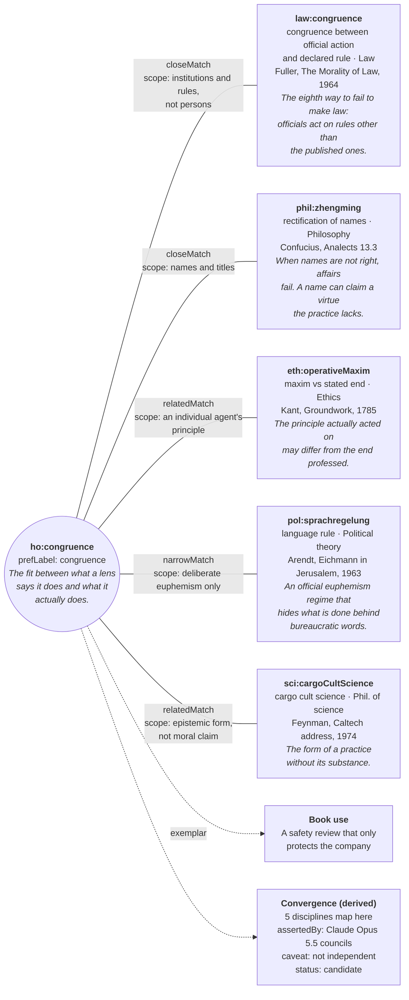

**user**: Read Handoff - PerspectiveStructure 0.02 and the notes it lists, then propose the 0.02 structure.
<!-- copilot-message {"notes":["01_The Writer's Room/Handoff - PerspectiveStructure 0.02.md"]} -->
[Timestamp: 2026/11/17 17:04:42]

**ai**: Reading the Summary, sections 1–3, and Moderator's summary of each review.I've read the handoff, 0.01, and the Summary, sections 1–3 and Moderator's summary of all seven reviews. I didn't open the vocabulary tables, and I only skimmed HO-II.d and HO-II.e for the keep-test and the missingness statuses. Nothing has been written yet. This is the proposal for your approval.

# Proposed PerspectiveStructure 0.02

## How I pruned
I tested each of the 120+ proposals in four ways:
1. **Core:** is it required to identify the lens at all? (Descartes)
2. **Pragmatic test:** would any query, decision or Divergence change if its value changed? (Peirce, the same as the HO-II.d keep-test)
3. **Merge:** is it the same idea as another proposal, under a different name?
4. **Description or evaluation:** is it a fact about the lens, or an Assessment that needs `assessedBy`? (Hart)

Two mechanisms do most of the shrinking:
- **Domain profiles** (from HO-II.e). Most of the Legal and AI-model attributes become optional profiles, not core groups.
- **An Assessments layer.** Every contested judgement about a lens goes into one place.

The groups are display facets, not OWL classes, as Laozi argued. ★ marks the leading tier: the attributes that most change outcomes (Fermi).

```text
PerspectiveType  ◄─ instantiates ─  Perspective (shot, HO-II.d; overrides frame defaults — Minsky)

0 CORE (required; others may take a missingness status, HO-II.e)
  ├── name ★
  ├── canonicalSource ★ ........ absorbs foundationalWork, canonicalText (Scalia)
  ├── objectOfAttention ★ ...... material cause
  └── foundationalCommitments ★  absorbs assumption, principles (Dworkin), priors/baseRates (Bayes)

1 RELATIONS (moved up: relations before attributes — Laozi, Gilligan, Edelman)
  ├── divergesFrom / convergesWith ★ (reified; new subtypes → HO-III.a, see decisions)
  ├── specializes / generalizes .. absorbs formalCause
  ├── partOf / hasSublens ........ Minsky, Hawkins
  ├── complements | complementaryWith (Bohr) | definedAgainst (Laozi)
  ├── coupledWith ................ resonance and feedback between lenses (Tesla)
  └── correctedBy → Community .... communityOfInquiry (Peirce)

2 IDENTITY & LINEAGE
  ├── nameByDomain · definitionByDomain (+ meaningAsOf, Scalia)
  ├── conceptStructure {definitional · family resemblance · prototype · interpretive} + exemplars
  │                               absorbs interpretiveConcept flag, openTexture
  ├── lensKind {designed · tacit · learned · cultural technology}  absorbs tacitPractice,
  │                               learnedRepresentation, culturalTechnology
  ├── lineage → Person · originatingCircumstance → Event
  ├── transmissionMode {text · apprenticeship · ritual · institution · narrative · trained model}
  └── historicalNote

3 AIM & NORMATIVE CORE
  ├── statedPurpose ★ ........... the stated end. The operative side is in the Congruence assessment, group 10
  ├── normativeForm ★ {deontic · consequentialist · aretaic · relational · contractualist} (plural)
  ├── valueTheory · embedsStandard → EvaluativeStandard (HO-II.a; fairnessMetric lives here)
  ├── unitOfMeasure ★ + commensurability
  ├── intentWeighting ★ {intent · outcome · mixed}  (fails on AI-caused harm — Saxe)
  ├── distributiveConcern · conflictResolution {lexical · weighing · deadlock}
  └── domainOfApplicability (jurisdiction lives in the Legal profile)

4 POSITION & SCOPE (three axes, plus extents)
  ├── socialScope (size) · moralCircle ★ (which beings count, AI systems included) · quadrant
  ├── assumedPositionality {impartial · situated · interested}  absorbs impartiality
  ├── spatialScope · systemicScope · temporalScope (+ discountRate)
  └── scaleValidity (Dyson; emergentBlindness = a blind spot outside this range)

5 EPISTEMICS
  ├── method/instrument + instrumentResponse ★ (threshold, false alarm, miss)
  │                               absorbs observabilityLimit, noiseFloor, instrumentDependence, activeSampling
  ├── criterionOfTruth + inferenceModes  (standardOfProof and causationTest in the Legal profile)
  ├── causalModel → CausalGraph (HO-I.a)
  ├── errorHandling {update · act on world · suppress · immunize}
  │                               merges predictionErrorHandling, updateRule, immunizingMoves
  ├── explorationMode {explore · exploit}
  ├── factHandling {preserves · blurs · dissolves}
  └── manipulability (includes authenticityAssumption)

6 STANCE (the holder's side)
  ├── bearerRole · controlLocus · stanceTowardObject {physical · design · intentional}
  ├── governingAnalogies
  └── effectOnHolder ★ {affective · dispositional · cognitive · physical/observer cost}
                                  merges characterFormation, cognitiveAlteration, observerCost

7 SUBJECT'S SIDE (Le Guin)
  ├── standingOfSubjects ★ {agent · patient · datum}
  ├── modelOfSubject · legibility (includes interfaceAbstraction)
  ├── consentToBeSeen ★ (qualified by powerAsymmetry)
  ├── adaptiveResponse
  └── livedExperience [A]

8 POWER (Butler's facet)
  ├── authority → bound parties + authorityBasis {coercive · legal · expert · moral · customary}
  ├── whoseInterests ★ · costBearer ★ (+ differentialBurden) · whoseVoice ★ (+ precisionWeighting)
  ├── powerAsymmetry {low · high · total}
  ├── accountabilityLocus ★ {named agent · role · institution · Nobody} (+ laundering pattern)
  └── remedy

9 DYNAMICS & MATERIALITY
  ├── performativity ★ {none · self-confirming · self-defeating}  absorbs feedback, active inference
  ├── infrastructureDependence → Infrastructure
  ├── validFrom / validTo · changeMode
  └── prevalence {dominant · contested · marginal · emerging}  (descriptive half of the old status)

10 ASSESSMENTS (each is an Assessment with assessedBy → PerspectiveType — Hart)
  ├── congruence ★★ stated vs operative ............ FIRST-CLASS (Confucius · Kant · Fuller ·
  │     ├── operativeMaxim / enforcementReality       Arendt · Feynman); absorbs misnaming,
  │     └── nameIntegrity {apt · euphemistic · inflated · captured}   languageRules, specificationGaming
  ├── blindSpot ★ typed {constitutive · negligent · accepted · suppressed}
  │                               absorbs acceptedHarm, suppressors, emergentBlindness
  ├── failureMode {excess · deficiency}
  ├── developmentalAltitude (only as an assessment, never a bare fact; see decisions)
  ├── epistemicStanding: corroboration (tests survived, HO-002) · calibration + uncertainty
  │                      · anomalies · orderOfMagnitude
  ├── proceduralIntegrity (Fuller's 8) · publicJustifiability (Mill's harm limit lives here)
  └── knownCritique → critiquedBy

11 PROVENANCE & TRUST (about the record, not the lens)
  ├── 11a Sources (keyReference, citation, Source class) — unchanged
  ├── 11b PROV (wasAttributedTo · wasGeneratedBy · wasDerivedFrom · dates · originalWording)
  └── 11c verificationStatus (citations only — Popper) · evidenceLabel · confidence · canonStatus

PROFILES (optional add-ons, HO-II.e)
  ├── LegalInstitutional: validity · efficacy · recognitionStatus · internalAcceptance · standing ·
  │     precedentialWeight · standardOfProof · causationTest · jurisdiction · limitationPeriod ·
  │     discoveryRule · legalPersonhood (twin of moralCircle)
  └── LearnedModel (Hinton): trainingProvenance · objectiveFunction · comprehensionClaim
        (+ lensKind = learned; blind spots default to suppressed or unknown)
```

## Dropped or demoted
Each item below fails the pragmatic test on its own, or is covered by a merge:
- `formalCause` is covered by `specializes` + definition.
- `reflexiveApplication` becomes the `selfInstance` design rule (see open decisions).
- `dominantFactors` is too context-dependent and belongs on the instance (shot).
- `translationLoss` and `compressionLoss` become annotations on a transformation mapping, and only if the embedding model is adopted.
- `limitBehavior` and `futureRobustness` become notes under `epistemicStanding`.
- `emergentEcosystems` is deferred and could later become a relation to Community.
- `narrativeForm` becomes a value of `transmissionMode`.
- `importance` is absorbed by the Power and Dynamics groups.
- `harmPrincipleRespected` folds into `publicJustifiability`.
- `degeneracy` and `reentrantIntegration` move to HO-III.a, because they describe Divergence and Integration, not a lens.

That leaves about 75 named attributes. Only the 4 in Core are required, and about 20 are ★. That's still large. If you want it leaner, I'd cut Dynamics into Power and Epistemics next.

## My pushback
- **Eleven groups is too many for a reader.** I kept them because each new group came from a distinct structural argument (normative core, Stance, Subject's side, Power). If you'd rather have fewer, Stance and Subject's side could merge into one "Holder and subject" group, reflecting Gilligan's point that a lens exists between people.
- **Congruence as first-class rests on five agreeing councils, but all seven councils were voiced by the same model.** I still recommend it. The case for it is that it captures the "safety" problem central to the book, not that the councils agreed.
- **`developmentalAltitude`:** I recommend keeping it, but only inside Assessments. That keeps the ranking visible as somebody's ranking.

## Decisions I need before writing the note
1. Adopt the PerspectiveType/Perspective split? I recommend yes; every review assumes it.
2. Use domain profiles for the Legal and LearnedModel attributes? I recommend yes.
3. Move evaluations into an Assessments layer? I recommend yes.
4. Should provenance be recorded per statement (RDF-star or named graphs), use an OWL + SKOS hybrid, use an embedding model, or record the ontology as an instance of its own type (`selfInstance`)? I recommend recording all four as open questions in 0.02, not deciding them now. The exception is the OWL + SKOS hybrid, which I'd adopt, because `conceptStructure` above already assumes it.
5. Add the two new Divergence subtypes to HO-III.a? I'd do that as a separate edit after 0.02.

Once you approve or adjust this, I'll write PerspectiveStructure 0.02 with the Idea template and file it. I'll then offer to log the type/instance split, the size-vs-altitude split and the table format in [[Decisions_Log]].
<!-- copilot-message {"tools":["Read (read): 01_The Writer's Room/Handoff - PerspectiveStructure 0.02.md","Glob (read)","Read (read): 02_Ideas Topics Concepts/Harm Ontology/PerspectiveStructure 0.01.md","Grep (read): 02_Ideas Topics Concepts/Harm Ontology","Read (read): 02_Ideas Topics Concepts/Harm Ontology/v-0.01 ClassicalCouncil Review of - PerspectiveStructure 0.01.md","Read (read): 02_Ideas Topics Concepts/Harm Ontology/v-0.01 EthicsCouncil Review of - PerspectiveStructure 0.01.md","Read (read): 02_Ideas Topics Concepts/Harm Ontology/v-0.01 LegalCouncil Review of - PerspectiveStructure 0.01.md","Read (read): 02_Ideas Topics Concepts/Harm Ontology/v-0.01 LogicCouncil Review of - PerspectiveStructure 0.01.md","Read (read): 02_Ideas Topics Concepts/Harm Ontology/v-0.01 PhysicsCouncil Review of - PerspectiveStructure 0.01.md","Read (read): 02_Ideas Topics Concepts/Harm Ontology/v-0.01 SciFiCouncil Review of - PerspectiveStructure 0.01.md","Read (read): 02_Ideas Topics Concepts/Harm Ontology/v-0.01 CognitiveCouncil Review of - PerspectiveStructure 0.01.md"]} -->
[Timestamp: 2026/11/17 17:04:42]

**user**: i dont yet want to go.  as you point out, some od these have alignment across several disciplines/domains. i had proposed we have some self documenting approach to acknowledging/reconciling this  and also with  the recognition that each domain used their own terminology. i proposed at a minimum we have skos:altLabel for each domain but maybe a domain profile with many such properties satisfies. how would you handle this and what does domain profiles entail and offer
[Timestamp: 2026/11/17 17:20:14]

**ai**: You're right to stop me. In my proposal, "profile" and "terminology" got blurred together. They solve two different problems, and your altLabel idea addresses one that domain profiles don't.

## Two separate problems

| Problem | Example | What solves it |
|---|---|---|
| **A. The same idea under different names** | Confucius's *misnaming*, Kant's *maxim*, Fuller's *congruence*, Arendt's *Sprachregelung* and Feynman's *cargo cult* | A **vocabulary layer**: each domain's labels, with mappings |
| **B. Each domain needs different attributes** | Law needs `standardOfProof`; an AI model needs `trainingProvenance` | **Domain profiles**: rules about which attributes are required or added |

## What a domain profile entails (from HO-II.e)
A profile is a SHACL shape, a validation rule set for one kind of record, such as `LegalInstitutional` or `LearnedModel`. It does four things:
- **Adds** attributes that only that domain needs.
- **Requires** certain attributes to be *addressed*, meaning given a value or a missingness status (Unknown, Undisclosed, Disputed, and so on). In HO-II.e's words, "must be addressed, not must be known."
- **Constrains** values, for example `standardOfProof` must be one of {preponderance · clear and convincing · beyond reasonable doubt}.
- **Stacks:** COMPAS could be validated against both the Legal and the LearnedModel profiles.

**What it offers:**
- a small core;
- domain completeness checks;
- missing information that becomes visible evidence, not silent blanks.

**What it doesn't do:** say what anything *means* or how one domain's term relates to another's. A shape only checks properties.

So profiles alone don't satisfy your terminology goal. They can help, because a profile could choose which label to *display* to its domain. But the mappings need to live elsewhere. One attribute appears in many profiles, and many domains have a term for an attribute even where no profile exists.

## How I'd handle the terminology: hub and spoke
1. **Hub:** each attribute in the structure is a `skos:Concept` with one neutral `prefLabel`, for example `congruence`. This is the ontology's own name.
2. **Spokes:** each domain's term is recorded as its own object, not as a bare altLabel. Plain `skos:altLabel` can't say *which* domain a label belongs to, or when or where it comes from. Two standard ways to fix that (both from memory, not checked against the specs this session):
   - **SKOS-XL labels:** a label becomes a resource that can carry domain, citation, `meaningAsOf` and key thinkers.
   - **Domain concepts with mapping links:** for example `law:congruence skos:closeMatch hub:congruence`.
3. **Graded matches** make the reconciliation self-documenting: `exactMatch`, `closeMatch`, `broadMatch`/`narrowMatch`, `relatedMatch`. This matters because the five witnesses aren't synonyms. Cargo cult is about *form without substance*, and *Sprachregelung* is *deliberate euphemism*. Graded matches respect Dworkin's warning that disagreement shouldn't be disguised as translation. A `scopeNote` on each mapping can state what differs.
4. **Convergence is derived, not asserted.** How many independent domains map to a hub concept measures its cross-disciplinary support. Each mapping also records `assertedBy`, so the caveat that "all seven councils were voiced by one model" stays attached to the evidence.

Sketch of one spoke:
```text
hub:congruence  (prefLabel "congruence")
  ← closeMatch   law:congruence        domain Law       Fuller 1964   meaningAsOf 1964
  ← closeMatch   conf:zhengming        domain Classical Analects 13.3
  ← relatedMatch eth:operativeMaxim    domain Ethics    Kant 1785     note: about the agent's principle, not institutional practice
  ← relatedMatch pol:Sprachregelung    domain Political Arendt 1963   note: deliberate euphemism regime
  ← relatedMatch sci:cargoCult         domain Science   Feynman 1974  note: form without substance
  convergence: 5 domains · assertedBy Claude Opus 5.5 (councils not independent) · status: candidate
```

You already have most of this. Each row of the councils' vocabulary tables, with its Term (altLabels), Citation, Historical note and Key thinkers, is essentially a spoke record. Consolidating 0.02 then means **mapping the existing rows to hub concepts**, not rewriting them.

## Recommendation
Use both, each for its own job:
- a **vocabulary layer** (hub concepts, per-domain labels with provenance, graded mappings, derived convergence);
- **profiles** for requiredness, with an optional "display labels from domain X" setting.

The 0.02 tree I proposed would stay as it is, but each node becomes a hub concept with its spokes listed.

## Questions for you
1. **Hub names:** should they be neutral coinages like `congruence`, or should each one borrow the strongest domain's term? Neutral names are fairer to all domains, but harder to recognize.
2. **Mapping grade:** should I assign `exact`/`close`/`related` when consolidating, or should every mapping start as `related` until you review it?
3. **Domains:** should a domain be one of the seven councils, or a real discipline (law, ethics, cognitive science…)? Councils are convenient but artificial. I'd use real disciplines and record the council only as provenance.

If this direction fits, it's probably worth its own bookmark (a Vocabulary/Crosswalk note under HO-II.d.1) before 0.02, so the structure can refer to it. I can draft it after you answer these.
<!-- copilot-message {"tools":["Read (read): 02_Ideas Topics Concepts/Harm Ontology/HO-II.e Missingness Statuses and Domain Profiles.md"]} -->
[Timestamp: 2026/11/17 17:20:14]

**user**: the bookmark is a good  idea  yes. but  first can you show a small example as a visual graph of a rich sample section showing hub and spoke with narrative content and the common naming convention
[Timestamp: 2026/11/17 17:27:44]

**ai**: **Error:** Credit balance is too low
[Timestamp: 2026/11/17 17:27:44]

**user**: repeat previous
[Timestamp: 2026/11/17 17:28:52]

**ai**: Here is the example. It uses the congruence hub, the strongest convergence across the councils, and should render in Obsidian's reading view. The narrative text is illustrative draft wording. The citations are the ones already web-checked in the review tables, but I haven't re-checked them here.

## Naming convention (proposed)

| Element | Pattern | Example |
|---|---|---|
| Hub concept ID | `ho:` + neutral camelCase | `ho:congruence` |
| Hub prefLabel | plain English, lower case | "congruence" |
| Spoke concept ID | `<discipline>:` + the domain's own term in camelCase | `law:congruence`, `phil:zhengming` |
| Spoke label | Term · Discipline · Thinker, Year | "rectification of names · Philosophy · Confucius, Analects 13.3" |
| Mapping edge | SKOS match type, plus a one-line `scopeNote` saying what differs | `closeMatch` — "about institutions, not persons" |
| Discipline prefixes | `law` · `eth` (ethics) · `phil` (classical philosophy) · `pol` (political theory) · `sci` (philosophy of science) · `cog` · `phys` · `lit` (literature) | |

Councils appear only as provenance (`assertedBy`), not as domains.

## Graph: `ho:congruence`



## Spoke record (one of the five, in full)
In the vocabulary note, each spoke would carry the same eight columns as your review tables:

| Field | `law:congruence` |
|---|---|
| Hub | `ho:congruence` (closeMatch) |
| Term (altLabels) | congruence; the eighth desideratum; "congruence between official action and declared rule" |
| Definition | The requirement that officials actually apply the rules that have been published. |
| Example | A content policy enforced against one community but not another: "one name, two lenses". |
| Citation | Lon L. Fuller, *The Morality of Law* (Yale UP, 1964), ch. 2 |
| Citation verified | (copied from the Legal review row) |
| Historical note | Fuller's response to the Hart–Fuller debate (1958) |
| Key thinkers | Lon Fuller; H.L.A. Hart (critic) |
| Scope note (how it differs from the hub) | Applies to rule systems and their officials, not to individual intentions. |
| Explanation | 100–200 words, carried over from the review table |
| meaningAsOf · assertedBy | 1964 · Claude Opus 5.5 (Legal Council), 2026-11-17 |

## Questions from before (still open)
1. **Hub names:** should they be neutral coinages like `congruence`, or should each one borrow the strongest domain's term?
2. **Mapping grade:** should I assign `exact`/`close`/`narrow`/`related` when consolidating, or should every mapping start as `related` until you review it?
3. **Domains:** should they be real disciplines, as shown above, or the seven councils? I recommend disciplines, with councils kept as provenance.

Once you've answered these and approved the format, I'll create the Vocabulary/Crosswalk bookmark note under HO-II.d.1 using the Idea template.
[Timestamp: 2026/11/17 17:28:52]

**user**: is the explanation actually 100-200words... or is that a placeholder? can you show the actual proposed explanation
[Timestamp: 2026/11/17 17:33:01]

**ai**: It was a placeholder. Let me pull the actual row from the Legal review.It was a placeholder. "Carried over from the review table" was also inaccurate: the Legal review has no row for congruence on its own. Its closest row is `proceduralIntegrity`, which covers all eight of Fuller's desiderata and mentions congruence in only one sentence.

## The existing Explanation (`proceduralIntegrity` row, Legal review, verbatim, about 120 words)
> "Fuller's desiderata are a ready-made audit for algorithmic rules, which often fail several at once: unpublished (secret models), unclear (opaque features), constantly changing (retraining), impossible to comply with (unknown criteria), and incongruent (stated purpose vs actual effect). Scoring each desideratum as an object gives the ontology a structured way to say *how* a lens fails procedurally, not just that it does. The eighth desideratum, congruence, is the formal version of Confucius's misnaming and Kant's operative maxim, so three councils converge on it. Hart's objection is worth recording: the desiderata are conditions of efficacy, compatible with great iniquity, so procedural integrity is not moral goodness. The ontology should keep them as separate attributes."

## Proposed new Explanation for the `law:congruence` spoke (about 165 words)
This is a new draft by Claude Opus 5.5, written for this example:

> Fuller's eighth desideratum asks whether the rules officials actually apply are the rules that were declared. As a spoke of `ho:congruence`, it contributes the most precise and testable version of the idea: compare the published rule with observed official action. That makes congruence something you can measure from enforcement records, not only argue about. It connects directly to Holmes's `enforcementReality` and to Pound's distinction between law in books and law in action. It differs from the hub in scope. Fuller audits rule systems and the officials who run them. He doesn't ask about one agent's private maxim, as Kant does, or about deliberate euphemism, as Arendt does. Incongruence in his sense can come from indifference, misreading or inaccessibility, not just bad faith (unverified paraphrase). For AI harm the test applies almost unchanged: a platform's published content policy against its moderation logs, or a model card's stated purpose against how the model is actually deployed. Hart's caution carries over too. A perfectly congruent system can still be unjust, so congruence is necessary for integrity but not sufficient for goodness.

## What this means for the crosswalk
- **Most spokes need a new Explanation.** The existing ones explain the review's *attribute* (here `proceduralIntegrity`). A spoke Explanation has to explain how the *term* relates to the hub and where it differs. I'd write these fresh and cite the review row each one draws on.
- **The hub needs its own Explanation** too: what the concept is in neutral terms, and why five disciplines converge on it.
- **Claims I added need verifying** before saving. Here that means the paraphrase of Fuller's causes of incongruence, which I've marked unverified. All web searches are pre-approved, so I'd check each one during drafting.

Do you want me to draft the hub Explanation and the other four spoke Explanations for congruence as the worked example? Answers to the three earlier questions (hub naming, mapping grades, disciplines vs councils) would still help before I set up the bookmark note.
<!-- copilot-message {"tools":["Grep (read): 02_Ideas Topics Concepts/Harm Ontology/v-0.01 LegalCouncil Review of - PerspectiveStructure 0.01.md","Read (read): 02_Ideas Topics Concepts/Harm Ontology/v-0.01 LegalCouncil Review of - PerspectiveStructure 0.01.md"]} -->
[Timestamp: 2026/11/17 17:33:01]

**user**: is this hub strictly for law where is that made obvious. thinking one hub per domain
[Timestamp: 2026/11/17 17:35:31]

**ai**: No. The hub `ho:congruence` is deliberately **cross-domain**. Only the spoke `law:congruence` is legal. My example made that hard to see in three ways:
- the spoke card I showed in full was the legal one;
- the `ho:` and `law:` prefixes carry the distinction, but nothing says so in plain words;
- the hub and the legal spoke share the word "congruence".

## The model as a matrix
The hub is a **row** (one concept). Your "one hub per domain" is a **column** (one discipline). SKOS has a name for a column too: a **concept scheme**.

| Concept hub (`ho:`) ↓ / Discipline scheme → | Law | Ethics | Philosophy | Political theory | Phil. of science |
|---|---|---|---|---|---|
| **congruence** | `law:congruence` | `eth:operativeMaxim` | `phil:zhengming` | `pol:sprachregelung` | `sci:cargoCultScience` |
| **accountabilityLocus** | `law:standing`? | — | — | `pol:ruleOfNobody` | — |
| **blindSpot** | — | — | `phil:constitutiveEmptiness` | — | `sci:anomaly`? |

(The second and third rows are illustrative only, and the "?" mappings aren't settled.)

- **Concept hub (row):** reconciles one idea across disciplines. This is where convergence, graded matches and "what differs" live.
- **Discipline scheme (column):** collects every term one discipline uses, in its own vocabulary, with its own definitions. It's what a lawyer would browse.

## Should there be one hub per domain?
I'd use both, but not as alternatives:
- **Domain-only hubs (columns only)** lose the thing you asked for: acknowledging and reconciling alignment *across* disciplines. Each domain would be a separate island. Connecting them would need domain-to-domain links, which for 8 disciplines is up to 28 pairings per concept, against 8 links to one shared hub.
- **Concept hubs only** make it hard for a domain reader to see their own vocabulary as a whole.
- **Both from the same data:** each spoke belongs to one discipline scheme (`skos:inScheme law:`) *and* maps to one concept hub. The column view and the row view are two indexes over the same records, with nothing duplicated.

## Making it obvious in the notes
- Label the hub explicitly: "**ho:congruence: cross-domain concept hub**", with a `scope: cross-domain` field.
- Give every spoke a visible `domain: Law` field next to its ID, and list its scheme ("in scheme: Law vocabulary").
- Give each discipline scheme its own index note (for example *Law vocabulary*) listing its terms and the hubs they map to.
- Hub prefLabels should avoid copying one discipline's word where possible. If "congruence" reads as legal, a neutral name like `statedOperativeFit` might be better. That's question 1 again.

So, to settle the design: do you want **concept hubs plus discipline schemes (rows and columns)**, as I recommend? Or did you mean something else by "one hub per domain", for example a separate ontology per domain?
[Timestamp: 2026/11/17 17:35:31]

**user**: would the ontology approach be a new namespace and a hub become like a class that collects properties and narrative for that domain? im adkin for clarification of your proposal not making a different recommendation where/how is an ontology used
[Timestamp: 2026/11/17 17:40:53]

**ai**: I was using "hub" loosely, so here is what each layer would be. There are three, each with a different job.

## The three layers

| Layer | What it is | Namespace | Holds | Used for |
|---|---|---|---|---|
| **1. Ontology (OWL)** | The *structure*: classes and properties | `ho:` | `ho:PerspectiveType` (class), `ho:Assessment` (class), `ho:congruence` (property), with domain and range | Reasoning and querying: "which lenses are incongruent?", computing Divergence |
| **2. Profiles (SHACL)** | *Rules* over the structure | `hosh:` (shapes) | `hosh:LegalInstitutionalProfile`: which properties must be addressed, and allowed values | Validation: "is this Legal record complete?" |
| **3. Vocabulary (SKOS)** | *Words and meaning* | `hov:` for the hubs; `law:`, `eth:`, `phil:` … for disciplines | Hub concepts, discipline terms, labels, definitions, narrative, mappings | Human understanding, cross-domain reconciliation, the explanations |

## Answers to your questions
- **Is a hub a new namespace?** Yes. The hubs would get their own vocabulary namespace (`hov:`), separate from the ontology's `ho:`. Using `ho:congruence` for the hub was my mistake, because it blurred two things:
  - `ho:congruence`: the **property** a record actually uses (an Assessment of a PerspectiveType).
  - `hov:congruence`: the **hub concept** that explains and reconciles that property across disciplines. It links to the property with something like `rdfs:isDefinedBy` or a `documents` link.
- **Is a hub a class?** No. A hub is a `skos:Concept`: a documented idea, not a container with properties. Classes such as `PerspectiveType` and `Assessment` live only in the ontology layer. The narrative (definition, Explanation, history note, examples) is attached to the hub as annotations.
- **Is a discipline namespace (`law:`) an ontology for that domain?** No. It's a **concept scheme**, the list of a discipline's terms with their own definitions. It doesn't define new classes or properties. The legal *attributes* that law adds, such as `standardOfProof`, still belong to the ontology (`ho:`). The Legal profile then selects and requires them. So law contributes **words** (scheme) and **requirements** (profile), but no separate ontology.

## How the layers connect for one item
```text
ONTOLOGY     ho:PerspectiveType ──ho:congruence──► ho:Assessment     (structure; queried)
                                       ▲
VOCABULARY   hov:congruence ───documents┘                             (hub: neutral definition,
              ▲  ▲  ▲  ▲  ▲                                           Explanation, convergence)
              │  │  │  │  └ sci:cargoCultScience  (in scheme: Phil. of science)
              │  │  │  └── pol:sprachregelung    (in scheme: Political theory)
              │  │  └───── phil:zhengming        (in scheme: Philosophy)
              │  └──────── eth:operativeMaxim    (in scheme: Ethics)
              └─────────── law:congruence        (in scheme: Law)   ← match type + scopeNote on each link

PROFILE      hosh:LegalInstitutionalProfile: requires ho:congruence to be addressed;
             displays labels from scheme law:
```

## Where this lives in the vault
None of this has to be RDF yet. For now:
- each hub is one note;
- each discipline scheme is an index note;
- the ontology structure is the PerspectiveStructure note;
- the frontmatter and tables follow the conventions above, so an export to RDF later is mechanical.

If this is clear, I'll write the layer model into the Vocabulary/Crosswalk bookmark note, so 0.02 can refer to it. Before I do: is the three-layer split (ontology, profiles, vocabulary) what you want recorded? And do you still want to answer the three earlier questions first (hub naming, mapping grades, disciplines vs councils)?
[Timestamp: 2026/11/17 17:40:53]

**user**: simple naming with the relevant discipline specific terminology preserved in the vocABULARY narrative. disciplines instead of council yes. i dont know what mapping grades are
[Timestamp: 2026/11/17 17:44:46]

**ai**: Both are settled: hubs get simple names, and each discipline's own terms live in the vocabulary narrative. Domains are real disciplines, and councils appear only as provenance.

## What mapping grades are
When a discipline's term is linked to a hub, the grade says **how closely the two match**. SKOS has five standard grades. Here they are applied to the congruence hub:

| Grade | Meaning | Example |
|---|---|---|
| **exactMatch** | The same idea; the terms are interchangeable | (none in this set) |
| **closeMatch** | Nearly the same; usable in most contexts | Fuller's *congruence*: the same idea, applied to rule systems |
| **narrowMatch** | The discipline's term is a **narrower case** of the hub | Arendt's *Sprachregelung*: a deliberate-euphemism case of incongruence |
| **broadMatch** | The discipline's term is **wider** than the hub | (none here) |
| **relatedMatch** | Connected, but a different idea | Feynman's *cargo cult science*: form without substance, which overlaps with but isn't the same as incongruence |

**Why it matters:** without grades, five terms linked to one hub look like five synonyms. Grades preserve the differences between disciplines, which is part of what you wanted acknowledged.

## Your choice
- **A. I propose grades as I draft, each with a one-line reason, and you review them.** This is my recommendation.
- **B. Everything starts as relatedMatch** (the safest claim), and we upgrade mappings only when you've looked at them.
- **C. Skip grades for now.** Every spoke simply links to its hub, and a scope note says how it differs.

Once you pick, the next step is the Vocabulary/Crosswalk bookmark note, filed under HO-II.d.1. It would record:
- the three-layer model (ontology, profiles, vocabulary);
- the naming rules (simple hub names, discipline terms in the narrative);
- disciplines as domains, with councils as provenance;
- your choice on grades;
- congruence as the worked example, with the hub and five spokes and their Explanations, verified before saving.

Shall I go ahead with that once you've chosen?
[Timestamp: 2026/11/17 17:44:46]

**user**: yes mapping grades
[Timestamp: 2026/11/17 17:45:05]

**ai**: I'll read it as option A: I propose a grade for each mapping with a reason, and you review them. First, the template and the allowed frontmatter values.Next, the citation rows the five spokes depend on. The councils verified these on 2026-11-17.Now filing it into the Harm Ontology index.The index resolved by exact `canonical_id` match, and no note already covers this (the only `ho-vocabulary-crosswalk` match is the new note itself). One placement question before I touch the index.

## Filing plan (needs your OK)

**Placement: I recommend HO-II.d.2, not HO-II.d.1.h.**
The letters a–g under HO-II.d.1 are peer reviews *of 0.01*. The crosswalk isn't a review. It's a method that 0.02 and every later version will depend on. Filing it under 0.01 would tie it to a frozen version. As HO-II.d.2 it sits beside PerspectiveStructure 0.01, and 0.02 can point to it.

| Item | Change |
|---|---|
| Note frontmatter | `bookmark: draft` → `HO-II.d.2`; status stays `seed`; add alias `HO-II.d.2` |
| File name | Unchanged: *Vocabulary Crosswalk - Concept Hubs and Discipline Schemes.md*. This follows the council reviews, which keep descriptive names without an ID prefix. |
| Folder | `_Unfiled Ideas/` → `02_Ideas Topics Concepts/Harm Ontology/` |
| Index entry (after the HO-II.d.1 block) | `[[Vocabulary Crosswalk - Concept Hubs and Discipline Schemes\|HO-II.d.2 — Vocabulary crosswalk]]`: hub-and-spoke vocabulary (SKOS concept hubs, discipline schemes, graded mappings), separating the ontology, profiles and vocabulary layers. Worked example: congruence across five disciplines. |
| Cross-reference added to the index | HO-II.d.2 and HO-II.e: profiles set requiredness, the crosswalk sets meaning, and a profile may display one discipline's labels. |
| Master index | No change (same index) |
| Links to rewrite | None. The note is new and nothing links to it yet. |

Approve this as HO-II.d.2? Or would you rather have HO-II.d.1.h as you first suggested?
<!-- copilot-message {"tools":["Read (read): 00_Claude_Admin/Templates/Idea.md","Read (read): 00_Claude_Admin/FileClasses/Idea.md","Grep (read): 02_Ideas Topics Concepts/Harm Ontology","Read (read): 02_Ideas Topics Concepts/Harm Ontology/v-0.01 ClassicalCouncil Review of - PerspectiveStructure 0.01.md","Read (read): 02_Ideas Topics Concepts/Harm Ontology/v-0.01 LogicCouncil Review of - PerspectiveStructure 0.01.md","Read (read): 02_Ideas Topics Concepts/Harm Ontology/v-0.01 PhysicsCouncil Review of - PerspectiveStructure 0.01.md","Grep (read): 02_Ideas Topics Concepts/Harm Ontology/v-0.01 EthicsCouncil Review of - PerspectiveStructure 0.01.md","Read (read): 02_Ideas Topics Concepts/Harm Ontology/v-0.01 EthicsCouncil Review of - PerspectiveStructure 0.01.md","Write (edit): 02_Ideas Topics Concepts/_Unfiled Ideas/Vocabulary Crosswalk - Concept Hubs and Discipline Schemes.md","Skill (other)","Grep (read)","Grep (read): 02_Ideas Topics Concepts/Harm Ontology/_Harm Ontology Bookmark Index.md"]} -->
[Timestamp: 2026/11/17 17:45:05]

**user**: your recommend
[Timestamp: 2026/11/17 17:50:08]

**ai**: The crosswalk is filed as **HO-II.d.2**, a sibling of PerspectiveStructure 0.01. I checked afterwards that its ID resolves to exactly one note.

**Files changed:**
- **[[Vocabulary Crosswalk - Concept Hubs and Discipline Schemes]]:** new note, moved into `02_Ideas Topics Concepts/Harm Ontology/`. It's set to `bookmark: HO-II.d.2` and `status: seed`, with an index/parent line at the top.
- **[[_Harm Ontology Bookmark Index]]:** a new HO-II.d.2 entry, plus a cross-reference saying that profiles set what's required and the crosswalk sets what things mean.

**What's in the note:**
- the three layers: ontology (`ho:`), profiles (`hosh:`) and vocabulary (`hov:` plus a prefix per discipline);
- your decisions: simple hub names, discipline terms kept in the narrative, real disciplines as domains with councils only as provenance;
- the five mapping grades;
- the congruence worked example: a diagram, the hub with its Explanation, and five spokes, each with a full row and a 100–200-word Explanation.

**Things to check:**
- **Spoke citations** are copied from the council rows already verified on 2026-11-17, and each spoke names the row it comes from. I didn't run new web searches.
- **Dropped claim:** I removed my unverified paraphrase of Fuller's causes of incongruence rather than checking it.
- **One reading of Kant is mine.** Treating a lens as an institution's maxim is labelled in the note as this ontology's interpretation, not Kant's.
- **The five grades are proposals for you to review.** They're listed under Open questions.
- **I read "yes mapping grades" as option A:** I propose a grade for each mapping with a reason, and you review it.

**Decisions to offer for [[Decisions_Log]].** Shall I add these?
- the three-layer model;
- simple hub names, with discipline terms in the narrative;
- disciplines, not councils, as domains;
- graded mappings that I propose and you review.

**Next options:**
1. Review the five congruence grades.
2. Build the next hub (blind spot, with its four kinds).
3. Go back to the 0.02 proposal, where each node now becomes a hub.
<!-- copilot-message {"tools":["PowerShell (other)","Read (read): 02_Ideas Topics Concepts/Harm Ontology/_Harm Ontology Bookmark Index.md","Edit (edit): 02_Ideas Topics Concepts/Harm Ontology/_Harm Ontology Bookmark Index.md","Edit (edit): 02_Ideas Topics Concepts/Harm Ontology/Vocabulary Crosswalk - Concept Hubs and Discipline Schemes.md","Grep (read)"]} -->
[Timestamp: 2026/11/17 17:50:08]

**user**: yes to all
[Timestamp: 2026/11/17 17:53:57]

**ai**: I've added four entries to the top of [[Decisions_Log]], all dated 2026-11-17 and linked to HO-II.d.2:
- the three-layer model;
- simple hub names, with discipline terms in the narrative;
- disciplines, not councils, as domains;
- graded mappings that I propose and you review.

For the next steps, the grade review needs your answers, so here it is first:

## Congruence grades to review

| Spoke | Proposed grade | Reason |
|---|---|---|
| `law:congruence` (Fuller) | **closeMatch** | The same idea, but restricted to rule systems and their officials |
| `phil:zhengming` (Confucius) | **closeMatch** | The same gap, located in names and titles |
| `eth:operativeMaxim` (Kant) | **relatedMatch** | About one agent's principle of action, not a lens's public identity |
| `pol:sprachregelung` (Arendt) | **narrowMatch** | One kind of incongruence: deliberate euphemism |
| `sci:cargoCultScience` (Feynman) | **relatedMatch** | Epistemic form vs substance, not stated purpose |

**Accept all five, or change any?** The one I'm least sure of is Kant. It could be **closeMatch** if you see a lens's operative purpose as the same thing as a maxim.

After that, I'll build the **blind spot** hub with its four kinds: constitutive (Laozi), negligent, accepted (Le Guin) and suppressed (Minsky). It'll use the same format, and I'll check any new citations on the web. Then we'll go back to the 0.02 proposal, where each node becomes a hub.
<!-- copilot-message {"tools":["Grep (read): 00_Claude_Admin/Decisions_Log.md","PowerShell (other)","Read (read): 00_Claude_Admin/Decisions_Log.md","Edit (edit): 00_Claude_Admin/Decisions_Log.md"]} -->
[Timestamp: 2026/11/17 17:53:57]

**user**: kant close match
[Timestamp: 2026/11/17 17:56:08]

**ai**: Updating the Kant spoke to closeMatch in the note.I've changed Kant to **closeMatch** in [[Vocabulary Crosswalk - Concept Hubs and Discipline Schemes]]. That covers the diagram, the grade cell (marked as your decision), the sentence in the Explanation that gave the old grade, and the Open questions line, which now says the review is done.

The other four grades were left as I proposed them. I've taken that as acceptance; tell me if you meant to keep reviewing them.

Final congruence grades:
- **closeMatch:** Fuller, Confucius, Kant
- **narrowMatch:** Arendt
- **relatedMatch:** Feynman

Next is the **blind spot** hub with its four kinds, in the same format, with new citations checked on the web. Shall I go ahead?
<!-- copilot-message {"tools":["Edit (edit): 02_Ideas Topics Concepts/Harm Ontology/Vocabulary Crosswalk - Concept Hubs and Discipline Schemes.md"]} -->
[Timestamp: 2026/11/17 17:56:08]

**user**: yes
[Timestamp: 2026/11/17 17:56:35]

**ai**: Both new legal citations are confirmed: *Global-Tech* through the Cornell LII syllabus, and *Donoghue* through several secondary sources. I'm writing the blind-spot hub into the crosswalk note now.I paraphrased one of my own quotes in Original wording. Replacing it with the exact text.The blind-spot hub is now in [[Vocabulary Crosswalk - Concept Hubs and Discipline Schemes]], below the congruence example.

**How it differs from congruence: the hub has kinds.** `hov:blindSpot` has four narrower concepts: constitutive, negligent, accepted and suppressed. Each discipline term maps to the kind it fits, not to the hub directly. The hub's Explanation sets out the main reason for typing them: each kind needs a different response.
- **Constitutive:** another lens has to cover what this one leaves out.
- **Negligent:** better instruments or more care.
- **Accepted:** moral and political argument.
- **Suppressed:** transparency and whistleblower protection.

## Eight spokes to review

| Kind | Spoke | Proposed grade | Reason |
|---|---|---|---|
| constitutive | `phil:wu` (Laozi, *Daodejing* ch. 11) | closeMatch | Usefulness through emptiness *is* the constitutive kind |
| negligent | `law:negligence` (*Donoghue v Stevenson*, 1932) | relatedMatch | Judges a person's conduct; the ontology borrows only the foreseeability test |
| negligent | `sci:anomaly` (Kuhn, 1962) | relatedMatch | Setting an anomaly aside isn't always negligent |
| accepted | `lit:omelas` (Le Guin, 1973) | closeMatch | A harm that is seen and knowingly accepted |
| accepted | `soc:sacrificeZone` (Lerner, 2010) | narrowMatch | Accepted harm tied to a particular place and community |
| suppressed | `cog:censors` (Minsky, 1986) | closeMatch | Internal agents that stop thoughts forming |
| suppressed | `sci:agnotology` (Proctor & Schiebinger, 2008) | closeMatch | Ignorance produced at institutional scale |
| suppressed | `law:willfulBlindness` (*Global-Tech v. SEB*, 2011) | narrowMatch | A legal test for deliberately avoiding knowledge |

## Citations
Six spokes reuse rows the councils already verified, and each row is named in the note. I checked two new ones on the web today:
- ***Global-Tech*:** confirmed from the Cornell LII syllabus. The two requirements are a subjective belief in a high probability that the fact exists, and deliberate action to avoid learning it. The Court said this goes beyond recklessness and negligence ([Cornell LII](https://www.law.cornell.edu/supct/html/10-6.ZS.html), [Patently-O](https://patentlyo.com/patent/2011/05/)).
- ***Donoghue v Stevenson*:** confirmed only through secondary study sources, for example [Brodies](https://brodies.com/insights/litigation/happy-90th-birthday-donoghue-v-stevenson/) and [Open University](https://www.open.edu/openlearn/mod/oucontent/view.php?id=68381&section=1). I didn't open the judgment itself, and the note says so.

Two examples are marked illustrative (data centres and a platform) because I haven't researched any real case for them.

## Something I'd question
An accepted harm is *seen*, so calling it a "blind spot" is strictly wrong. I kept the plain name, but the note offers `exclusion` or `omission` as alternatives. `omission` would line up with [[HO-005 Assessed Membership and Systematic Omission|HO-005]].

**Your calls:**
1. Accept the eight grades, or change any?
2. Keep `blindSpot` as the hub name, or rename it?

After that, we either build another hub (accountability locus or consent to be seen) or go back to the 0.02 proposal.
<!-- copilot-message {"tools":["Grep (read): 02_Ideas Topics Concepts/Harm Ontology","Bash (execute)","ToolSearch (other)","WebSearch (fetch)","Edit (edit): 02_Ideas Topics Concepts/Harm Ontology/Vocabulary Crosswalk - Concept Hubs and Discipline Schemes.md"]} -->
[Timestamp: 2026/11/17 17:56:35]

**user**: a blind spot might reasonably be thought of as something visible but missed. do you see this differently
[Timestamp: 2026/11/17 18:02:48]

**ai**: Mostly I agree with you, and following your definition through improves the hub.

## Two everyday meanings of "blind spot"
- **The driver's blind spot:** a car beside you that *is* visible and would show with a head check, but you miss it. This is your sense: visible but missed.
- **The eye's blind spot** (the optic disc): a gap that's built into the eye. You can't see there no matter what you do, and the brain fills it in, so you don't notice the gap. This is closer to the constitutive kind.

The first is the common meaning, and it fits the book better, because it implies the miss could have been avoided. That's where responsibility lies.

## Testing the four kinds against "visible but missed"

| Kind | Visible to this lens? | Missed? | A blind spot in your sense? |
|---|---|---|---|
| **Negligent** | Yes, with reasonable care | Yes | **Yes**, the clearest case |
| **Suppressed** | Yes, but prevented from being seen or recorded | Yes, on purpose | **Yes**. It's the deliberate version: not checking over your shoulder because you'd rather not know. Willful blindness is literally named this way. |
| **Constitutive** | No. It's outside the lens's frame by design | Not missed, but excluded | **No.** It's a frame or scope limit, the eye's built-in gap |
| **Accepted** | Yes | No, it's seen and tolerated | **No.** That's a trade-off, not a blind spot |

So I'd say my hub put three different things under one name:
- what's **outside the frame**;
- what's **in the frame but missed**;
- what's **seen and tolerated**.

## Proposed restructure
- Rename the hub **`omission`**: whatever a lens leaves out of its verdicts. This also lines up with [[HO-005 Assessed Membership and Systematic Omission|HO-005]].
- Give it three branches:
  - **`outOfFrame`**: the constitutive kind (Laozi). It links to scope, `scaleValidity` and `observabilityLimit`.
  - **`blindSpot`**: visible but missed, used in your sense. It has two kinds:
    - **negligent**: Donoghue, Kuhn's anomalies;
    - **suppressed**: Minsky, agnotology, willful blindness.
  - **`acceptedHarm`**: seen and tolerated (Omelas, sacrifice zones). The Sci-Fi review had already proposed this as a separate item, a sibling of blind spot rather than a kind of it.

The eight spokes keep their grades. Only where they attach changes.

The question this raises is where negligent ends and suppressed begins. *Global-Tech* gives a usable test: suspecting the fact and deliberately avoiding finding out counts as suppressed.

Shall I restructure the hub this way? Or would you rather keep "blind spot" as the hub name and narrow its definition, moving constitutive and accepted out as separate hubs?
[Timestamp: 2026/11/17 18:02:48]

**user**: yes. your way
[Timestamp: 2026/11/17 18:05:26]

**ai**: 
<!-- copilot-message {"tools":["Edit (edit): 02_Ideas Topics Concepts/Harm Ontology/Vocabulary Crosswalk - Concept Hubs and Discipline Schemes.md"]} -->
[Timestamp: 2026/11/17 18:05:26]